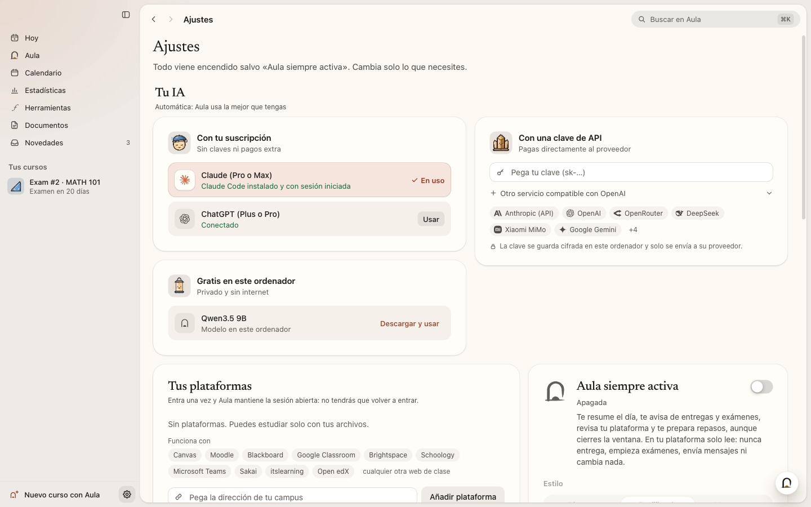
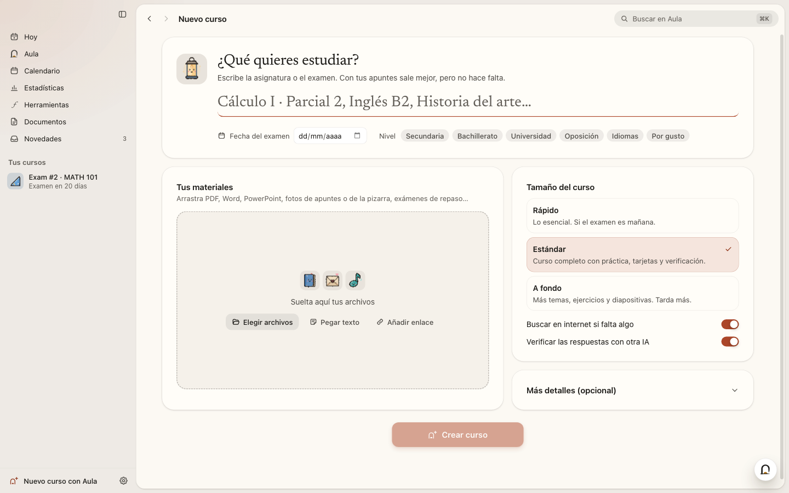
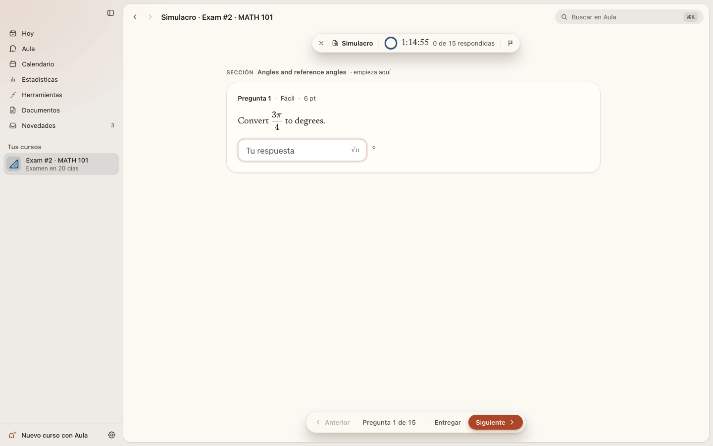
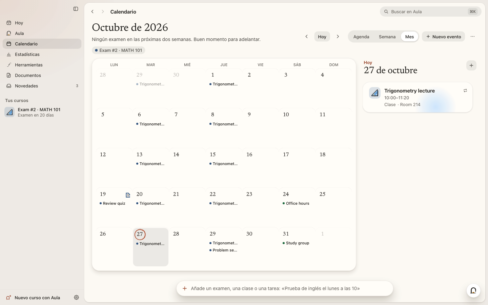

<p align="right"><a href="README.md">English</a> · <b>Español</b></p>

<p align="center">
  
</p>

<h1 align="center">Aula</h1>

<p align="center">
  Una app para estudiar en macOS, Windows y Linux.<br>
  Dale tus apuntes, diapositivas y exámenes de otros años, o solo un tema, y los convierte en un curso para estudiar.
</p>

<p align="center">
  <a href="https://github.com/luumlabs/aula/releases/latest"></a>
  <a href="LICENSE.md"></a>
  
</p>

<p align="center">
  <a href="https://github.com/luumlabs/aula/releases/download/v0.1.0/Aula-film-web.mp4">
    
  </a>
  <br><sub>Un recorrido de dos minutos por la app (vídeo de 24 MB, en inglés)</sub>
</p>

Te da lecciones cortas, ejercicios que se corrigen al responder, tarjetas de memoria y un simulacro con la misma
estructura que el examen real. Después te ayuda a ir trabajándolo, un poco cada día, hasta el examen.

No está atada a una asignatura. Cálculo, química orgánica, anatomía, un idioma, el examen de conducir, un libro que quieras entender bien. Si tienes materiales de clase, Aula los usa, así que el curso sigue tu temario. Si no, basta con algo como *Estadística para Psicología, final en mayo* para empezar.

Tus cursos y tu progreso se guardan en tu ordenador. Aula funciona con la IA que ya pagas (una suscripción a Claude o ChatGPT, o una clave
de API) o con un modelo gratis que corre en tu propio equipo. No hay cuentas ni rastreo.

> [!NOTE]
> Aula está en acceso anticipado. Funciona, pero vas a encontrar fallos y detalles sin pulir, y las cosas cambiarán de
> una versión a otra. Todavía no la uses como única preparación para un examen importante. Si algo falla,
> [avísame](#informar-de-un-fallo-o-proponer-una-idea).

<p align="center">
  
</p>

## Descargar e instalar

Descarga el archivo de tu sistema desde la [última versión](https://github.com/luumlabs/aula/releases/latest):

| Sistema | Archivo | La primera vez |
| --- | --- | --- |
| macOS 13 o posterior (Apple Silicon e Intel) | `Aula-0.1.2-mac.dmg` | Abre el .dmg y arrastra Aula a *Aplicaciones*. Aula aún no está notarizada por Apple, así que la primera vez macOS te pide confirmarlo. En macOS 15 o posterior, intenta abrirla, ve a *Ajustes del Sistema → Privacidad y seguridad* y pulsa *Abrir igualmente*. En macOS 13 y 14, haz clic derecho en Aula y elige *Abrir*. |
| Windows 10 y 11 (x64 y ARM, un solo instalador) | `Aula-Setup-0.1.2.exe` | Ejecuta el instalador (no pide permisos de administrador). Si aparece SmartScreen, pulsa *Más información → Ejecutar de todas formas*. Aula aún no está firmada. |
| Linux x64 | `Aula-0.1.2-linux-x86_64.AppImage` o `Aula-0.1.2-linux-amd64.deb` | AppImage: hazla ejecutable (`chmod +x Aula-*.AppImage`) y ábrela. Debian o Ubuntu: `sudo apt install ./Aula-0.1.2-linux-amd64.deb`. |
| Linux ARM64 | `Aula-0.1.2-linux-arm64.AppImage` | Hazla ejecutable (`chmod +x`) y ábrela. |

En Linux necesitas una distribución de 64 bits con glibc. Instala también GNOME Keyring o KWallet; si no, Aula tiene
que guardar tus claves sin cifrar.

La primera vez que abres Aula te pregunta tu nombre, te ayuda a [elegir una IA](#elegir-una-ia) y, si quieres, conecta
tu plataforma de estudio. Tu biblioteca empieza con dos cursos de ejemplo para que lo pruebes todo antes de crear los
tuyos.

**Actualizaciones.** Aula busca una versión nueva al arrancar y cada seis horas. La descarga en segundo plano,
comprueba su firma y la instala al salir (o al pulsar *Reiniciar para actualizar* en la barra lateral). En macOS, deja Aula en
*Aplicaciones* para que funcione; si una versión nueva no arranca, Aula vuelve a la anterior. La AppImage también se
actualiza sola. El `.deb` no: Aula te avisa cuando sale una versión nueva, y
descarga su `.deb` de las [versiones publicadas](https://github.com/luumlabs/aula/releases) e instálalo igual.

<details>
<summary><b>Si algo no funciona</b></summary>

| Problema | Qué hacer |
|---|---|
| macOS no puede verificar al desarrollador, o no aparece *Abrir* | Mira la fila de macOS de arriba. En macOS 15 o posterior, *Abrir igualmente* solo aparece en *Privacidad y seguridad* después de intentar abrir Aula una vez. |
| macOS dice que la app está dañada | Mueve Aula a *Aplicaciones* e inténtalo otra vez. Si sigue sin abrir, ejecuta `xattr -dr com.apple.quarantine /Applications/Aula.app` en el Terminal. |
| macOS no instala una actualización | Comprueba que Aula está en *Aplicaciones* y no en *Descargas* ni abierta desde el .dmg. *Ajustes → Acerca de* explica qué pasó y te deja reintentarlo o descargar la actualización. |
| La AppImage no arranca | Hazla ejecutable (`chmod +x`). Necesita FUSE 2: `sudo apt install libfuse2` (en Ubuntu 24.04 y posteriores, `libfuse2t64`). |
| Ubuntu 23.10 o posterior, con la AppImage | Ubuntu restringe los espacios de nombres de usuario que necesita el aislamiento (*sandbox*) de Chromium, así que la AppImage arranca con ese aislamiento apagado. Aula funciona igual, pero las páginas que abre (tu plataforma de estudio, por ejemplo) quedan menos aisladas. En x64, mejor instala el `.deb`: mantiene el aislamiento porque instala el perfil de AppArmor que Ubuntu necesita. |
| Aula no encuentra `claude` o `codex` | Instala la herramienta y ábrela una vez en un terminal para iniciar sesión. Después, *Ajustes → Tu IA* la encuentra. Para ChatGPT, *Conectar con ChatGPT* también puede descargar el Codex oficial por ti. |
| Un curso se paró por un límite de uso | No se pierde nada. Ábrelo y pulsa *Reanudar* cuando se renueve tu límite, o quédate con lo que ya hay. |
| *Ajustes → Acerca de* dice que tus claves no están cifradas | En Linux sin GNOME Keyring ni KWallet el sistema no puede cifrarlas. Instala uno y vuelve a iniciar sesión. |
| Otra cosa | [Abre una incidencia](https://github.com/luumlabs/aula/issues/new/choose), en español o en inglés. |
</details>

## Elegir una IA

Aula necesita un modelo de IA para escribir tus cursos y para hablar contigo. Elige sola el mejor que encuentra, y
puedes cambiarlo cuando quieras en *Ajustes → Tu IA*. Sin IA puedes seguir estudiando los cursos de ejemplo y los que
ya tengas.

| Opción | Qué necesitas | Notas |
| --- | --- | --- |
| Suscripción a Claude (Pro o Max) | La herramienta oficial `claude`, con la sesión iniciada | Sin clave de API y sin coste extra. |
| Suscripción a ChatGPT (Plus o Pro) | *Conectar con ChatGPT* en Aula | Usa Codex, la herramienta oficial de OpenAI. Aula puede descargarlo por ti y comprueba su SHA-256. |
| Un modelo en tu ordenador | Nada. Aula mira cuánta RAM tiene tu ordenador y te sugiere un modelo que quepa | Un clic descarga el servidor oficial de `llama.cpp` y un modelo verificado (desde 1 GB hasta decenas de GB, según tu ordenador). Después es gratis y funciona sin conexión. También detecta Ollama y LM Studio. |
| Una clave de API | Una clave de Anthropic, OpenAI, Google Gemini, OpenRouter, DeepSeek, Mistral, Groq, xAI, Xiaomi MiMo, OpenCode Zen o cualquier servicio compatible con OpenAI | Pagas directamente al proveedor. Aula te enseña lo que llevas gastado y puede pararse en un límite diario. Las claves se cifran con el llavero del sistema. |

OpenCode también funciona, si está instalado y con la sesión iniciada.


<p align="center">
  
</p>

<p align="center">
  <picture>
    <source media="(prefers-color-scheme: dark)" srcset="docs/media/screenshots/providers-dark-es.svg">
    
  </picture>
  <br>
  <sub>Los logos son marcas de sus dueños y solo sirven para identificar cada servicio (fuentes en <a href="THIRD_PARTY_NOTICES.md#ai-provider-logos">THIRD_PARTY_NOTICES.md</a>).</sub>
</p>

## Qué hace

### Cursos

Pulsa <kbd>Ctrl</kbd>/<kbd>⌘</kbd> <kbd>N</kbd> y di qué quieres estudiar. Añade la fecha del examen si la hay, y los
archivos que tengas: PDF, Word, PowerPoint, Excel, EPUB, páginas web, Markdown, archivos de texto o de código, enlaces,
texto pegado o fotos de tus apuntes o de la pizarra (se leen con OCR). Aula también puede traer los materiales de tu
plataforma de estudio.

Después, un pequeño equipo de agentes monta el curso, y puedes verlos trabajar. Unos lectores leen tus materiales.
Un planificador los convierte en un mapa de temas, dando más peso a lo que más pregunta el examen. Los autores escriben las
lecciones, los ejercicios y las tarjetas, y un verificador vuelve a resolver cada ejercicio con respuesta comprobable
sin mirar la solución. Cuando no
coinciden, un árbitro decide y corrige la solución. Si tu IA llega a un límite de uso a mitad, el curso se guarda y
pulsas *Reanudar* más tarde.

Puedes seguir cambiando un curso cuando ya está hecho (*añade 10 ejercicios más difíciles de identidades*) y deshacer
un cambio si no te convence.

<table>
  <tr>
    <td width="50%"></td>
    <td width="50%"></td>
  </tr>
</table>

### Lecciones

Puedes hacer una lección paso a paso (Aula explica, enseña un ejemplo y comprueba que lo has entendido antes de
seguir), explorarla a tu aire o solo leerla. Las matemáticas se componen con KaTeX, también la notación química. Las
lecciones pueden llevar gráficas con controles deslizantes, diagramas con etiquetas para practicar, moléculas en 3D
con su geometría real, simulaciones, mapas, diagramas de flujo y diapositivas. Las imágenes vienen de Wikimedia Commons
con su autor y su licencia, y Aula puede leerte cualquier lección en voz alta con las voces de tu sistema.

<p align="center">
  
</p>

### Práctica

Aula corrige ella misma la mayoría de las respuestas, sin preguntar a la IA. Su motor matemático entiende fracciones,
radicales, π y expresiones equivalentes, y hay 16 tipos de respuesta, desde opción múltiple y ecuaciones hasta
etiquetar una figura o ajustar una reacción. Las respuestas abiertas se corrigen con una rúbrica. Cuando cometes un
error típico, Aula lo reconoce y te explica por qué está mal. En los cursos de idiomas cuentan las tildes, así que
*murio* no es *murió*. Lo que fallas va a un cuaderno de errores y vuelve a los 1, 3, 7, 16 y 35 días.

Las tarjetas usan repaso espaciado con FSRS. Los simulacros copian la estructura de tu examen real (secciones, puntos,
dificultad), van con cronómetro y terminan con un informe por tema y un botón para practicar lo que fallaste. La
pantalla *Hoy* junta todo lo pendiente de tus cursos en un solo plan, empezando por lo que más sube tu nota.

<table>
  <tr>
    <td width="50%"></td>
    <td width="50%"></td>
  </tr>
</table>

### Hablar con Aula

<kbd>Ctrl</kbd>/<kbd>⌘</kbd> <kbd>2</kbd> abre un chat que conoce tus cursos, tu calendario y cómo vas. Dile *tengo un
examen de inglés el lunes a las 10* y se ofrece a añadirlo a tu calendario y a montarte un curso. Ves cada paso según ocurre, y lo que vaya a cambiar algo espera a que lo apruebes. Puede ponerte cuestionarios y tarjetas en el propio chat,
dibujar gráficas y fórmulas y citar tus materiales (pulsas una cita y el documento se abre en esa página).

Cada ejercicio tiene además un tutor al lado. Ve el ejercicio y tu respuesta, y te da pistas sin soltarte la solución.

<p align="center">
  
</p>

### Todo lo demás

- **Calendario** (<kbd>Ctrl</kbd>/<kbd>⌘</kbd> <kbd>3</kbd>): tus exámenes, las entregas de tu plataforma y tus propios
  eventos en vista de mes, semana o agenda. Escribe los eventos con tus palabras (*laboratorio de física todos los
  martes a las 4 hasta junio*), suscríbete a enlaces de calendario o importa y exporta archivos `.ics`. Cada examen
  tiene un botón *Preparar este examen*.
- **Herramientas** (<kbd>Ctrl</kbd>/<kbd>⌘</kbd> <kbd>5</kbd>): calculadora, graficadora, tabla periódica, ayudas de
  química, moléculas en 3D, conversor de unidades, temporizador Pomodoro, estadística, matrices, geometría,
  simulaciones de física y una lista de fórmulas y constantes.
- **Estadísticas**: tiempo de estudio, aciertos, un mapa de constancia de 12 semanas, dominio por tema, tu nota
  estimada a lo largo del tiempo y dieciséis logros.
- **Documentos**: convierte un curso en una guía de estudio, un resumen, una chuleta de una página, tarjetas para
  imprimir, un examen de práctica o diapositivas, en PDF, Word o Markdown. Los PDF y las fotos se abren en un lector
  donde puedes resaltar, tomar notas y preguntar por una página.
- **Plataformas de estudio**: Canvas, Moodle, Blackboard, Google Classroom, Brightspace, Schoology, Microsoft Teams,
  Sakai, itslearning, Open edX o cualquier web de clase. Inicias sesión una vez en el navegador de Aula y se queda
  abierta. Aula solo lee: bloquea todo lo que entregaría un trabajo, empezaría un cuestionario, publicaría, borraría o
  pagaría, y nunca escribe tu contraseña.
- **Aula siempre activa** (opcional): con la ventana cerrada, Aula puede mandarte un resumen por la mañana, mirar tu
  plataforma, recordarte las entregas y escribir un resumen semanal. Todo llega a *Novedades*, y se para hasta el día siguiente cuando gasta su presupuesto diario.
- **Memoria**: Aula recuerda lo que le ayuda a enseñarte, por ejemplo cómo prefieres que te expliquen o qué te cuesta. Puedes
  verlo, corregirlo, pausarlo o exportarlo todo en *Ajustes → Lo que Aula recuerda*.
- **Buscar**: <kbd>Ctrl</kbd>/<kbd>⌘</kbd> <kbd>K</kbd> encuentra pantallas, cursos y herramientas, y cualquier cosa
  dentro de tus cursos.

La interfaz está en español e inglés, y los cursos se pueden escribir en 12 idiomas. Tiene modo claro y oscuro, y las
animaciones respetan el ajuste de *reducir movimiento* de tu sistema.

<table>
  <tr>
    <td width="50%"></td>
    <td width="50%"></td>
  </tr>
  <tr>
    <td width="50%"></td>
    <td width="50%"></td>
  </tr>
</table>

<details>
<summary><b>Atajos de teclado</b></summary>

<kbd>Ctrl</kbd> en Windows y Linux, <kbd>⌘</kbd> en macOS.

| Atajo | Qué hace |
| --- | --- |
| <kbd>⌘</kbd> <kbd>K</kbd> | Buscar |
| <kbd>⌘</kbd> <kbd>N</kbd> · <kbd>⌘</kbd> <kbd>O</kbd> | Curso nuevo · Importar un curso (`.aulapack`) |
| <kbd>⌘</kbd> <kbd>1</kbd> … <kbd>7</kbd> | Hoy · Aula · Calendario · Estadísticas · Herramientas · Documentos · Novedades |
| <kbd>⌘</kbd> <kbd>J</kbd> | Preguntar a Aula |
| <kbd>⌘</kbd> <kbd>,</kbd> | Ajustes |
| <kbd>⌘</kbd> <kbd>[</kbd> / <kbd>]</kbd> (macOS) · <kbd>Alt</kbd> <kbd>←</kbd> / <kbd>→</kbd> (Windows, Linux) | Atrás · Adelante |
| Ejercicios | <kbd>Intro</kbd> comprobar · <kbd>A</kbd>–<kbd>Z</kbd> o <kbd>1</kbd>–<kbd>9</kbd> elegir una opción · <kbd>⌘</kbd> <kbd>Intro</kbd> entregar una respuesta abierta |
| Tarjetas | <kbd>Espacio</kbd> girar · <kbd>1</kbd>–<kbd>4</kbd> valorar · <kbd>H</kbd> pista · <kbd>⌘</kbd> <kbd>Z</kbd> deshacer |
| Simulacro | <kbd>Alt</kbd> <kbd>←</kbd> / <kbd>→</kbd> anterior / siguiente · <kbd>⌘</kbd> <kbd>⇧</kbd> <kbd>L</kbd> marcar |
</details>

## Privacidad

- Tus cursos, progreso, calendario, chats, documentos, notas y memoria se guardan en tu ordenador, en
  `~/Library/Application Support/Aula` (macOS), `%APPDATA%\Aula` (Windows) o `~/.config/Aula` (Linux). Puedes estudiar
  sin conexión.
- Sin cuenta, sin anuncios y sin analíticas. Aula no recoge datos de uso.
- Lo que sí sale de tu ordenador, y solo cuando hace falta:
  - lo que la IA necesita para cada tarea va al proveedor de IA que elegiste (nada, si usas un modelo local);
  - las búsquedas web van a DuckDuckGo, y las páginas que lee la IA se piden a sus sitios, pero solo con la búsqueda
    activada (*Ajustes → Privacidad y datos → Buscar en internet*, y *Buscar en internet si falta algo* al crear un
    curso). Claude Code, Codex y OpenCode usan para esto las herramientas web de Aula, nunca las suyas;
  - las imágenes vienen de Wikimedia Commons, y las páginas que abres de tu plataforma vienen de esa plataforma;
  - los enlaces de calendario a los que te suscribes y los enlaces que añades como materiales se piden a esos sitios;
  - los datos de idioma del OCR, desde la CDN de jsDelivr, la primera vez que Aula lee una foto y, en Linux, el
    diccionario del corrector de tu idioma, una vez, desde los servidores de Google;
  - las descargas que pides: el motor de IA local y los modelos desde GitHub y Hugging Face, y Codex desde GitHub;
  - la comprobación de actualizaciones, que pregunta a GitHub por la última versión sin enviar ningún identificador
    (GitHub ve tu dirección IP, como en cualquier descarga).
- Las claves de API, las sesiones de tu plataforma y los enlaces privados de calendario se cifran con el llavero del
  sistema (Llavero en macOS, DPAPI en Windows, GNOME Keyring o KWallet en Linux). El navegador de Aula tiene su propio
  perfil y nunca toca el tuyo. La app no lleva ninguna clave dentro.
- Un curso exportado (`.aulapack`) nunca incluye tus claves, y tú decides si incluye tu progreso.
- *Ajustes → Privacidad y datos* abre tu carpeta de datos, lo exporta todo en un `.zip` (sin claves ni sesiones de tu
  plataforma) o borra todos tus datos.

## Informar de un fallo o proponer una idea

Ahora mismo, los avisos de fallos son lo más útil que puedes mandar.

- Si algo falla, [abre un aviso de fallo](https://github.com/luumlabs/aula/issues/new?template=bug_report.yml). Cuenta
  qué hiciste, qué esperabas y qué pasó, con tu sistema, la versión de Aula (*Ajustes → Acerca de*) y la IA que usas.
  Una captura ayuda.
- Si tienes una idea, [proponla aquí](https://github.com/luumlabs/aula/issues/new?template=idea.yml).
- Las incidencias son públicas: no pegues nunca claves de API, contraseñas, enlaces privados de calendario ni nada
  personal de tus cursos.
- Los problemas de seguridad se avisan en privado. Mira [`SECURITY.md`](SECURITY.md).

## Compilar desde el código

Necesitas **Node.js 22** (22.12 o posterior; también vale 20.19 o posterior) y Git.

```bash
git clone https://github.com/luumlabs/aula.git
cd aula
npm install                 # .npmrc ya pone legacy-peer-deps
npm run dev                 # la app con recarga en caliente
```

| Comando | Qué hace |
| --- | --- |
| `npm run typecheck` | TypeScript del proceso principal y de la interfaz |
| `npm test` | Pruebas unitarias (vitest) |
| `npm run build` | Compila en `out/` |
| `npm run e2e` | Compila y pasa las pruebas de extremo a extremo con la app Electron real y una IA simulada (en Linux, ponle delante `xvfb-run -a`) |
| `npm run dist:mac` · `dist:win` · `dist:linux` | Instaladores en `release/` |

Variables de entorno útiles: `AULA_HOME` (otra carpeta de datos), `AULA_FAKE_AI=1` (una IA simulada, para pruebas) y
`AULA_NO_UPDATES=1`. Cómo publicar una versión está en [`docs/PUBLISHING.md`](docs/PUBLISHING.md).

La app está hecha con Electron 44, React 19, TypeScript y Tailwind CSS 4. El motor de estudio de `src/engine`
(corrección, matemáticas exactas, FSRS, química, el validador de cursos) es TypeScript puro, sin Node, y lo usan tanto el proceso principal como la interfaz. Los servicios de Node de `src/main/services` se ocupan de los cursos, los
proveedores de IA, los agentes, el asistente, las automatizaciones, la importación de archivos y las plataformas, y
solo `src/main/electron` habla con Electron. La interfaz y el proceso principal se comunican por un único canal IPC con
tipos, con `contextIsolation`, sandbox y una CSP estricta. Hay más notas técnicas en [`CLAUDE.md`](CLAUDE.md) (en inglés).

Las *pull requests* son bienvenidas. Lee antes [`CONTRIBUTING.md`](CONTRIBUTING.md).

## Apoya a Aula

Aula es gratis y lo seguirá siendo. Si te ayuda y quieres apoyar su desarrollo, puedes hacerlo con
[GitHub Sponsors](https://github.com/sponsors/luumlabs), cada mes o una sola vez. Dar una
estrella al repositorio, avisar de fallos y contárselo a alguien que esté estudiando también ayuda mucho.

## Gracias

Aula se apoya en mucho trabajo de código abierto, sobre todo [Electron](https://www.electronjs.org),
[React](https://react.dev), [Vite](https://vite.dev), [Tailwind CSS](https://tailwindcss.com),
[three.js](https://threejs.org), [KaTeX](https://katex.org), [PDF.js](https://mozilla.github.io/pdf.js/) y
[Tesseract.js](https://tesseract.projectnaptha.com). Cuando se lo pides, Aula también descarga
[llama.cpp](https://github.com/ggml-org/llama.cpp), los modelos abiertos que elijas y
[Codex](https://github.com/openai/codex). La lista completa de componentes y sus licencias está en
[`THIRD_PARTY_NOTICES.md`](THIRD_PARTY_NOTICES.md), y cada copia instalada lleva el texto de la licencia de cada
paquete que incluye (`THIRD_PARTY_LICENSES.txt`, junto a los recursos de la app).

## Licencia

Aula es libre y de código abierto, con la [licencia GNU Affero General Public License v3.0, solo esa versión](LICENSE.md)
(AGPL-3.0-only). Copyright © 2026 Luum Labs. Se ofrece sin ninguna garantía. En pocas palabras:

- Puedes usarla para lo que quieras, estudiar cómo funciona, cambiarla y compartirla.
- Si compartes una versión modificada, o dejas que otros la usen a través de una red,
  tienes que ofrecerles su código completo con esta misma licencia.
- Una versión modificada necesita su propio nombre e icono. Puedes copiar y cambiar el código y los dibujos, pero una
  versión modificada no puede llamarse «Aula» ni usar el icono de Aula. Las copias sin modificar pueden conservar los
  dos. Los términos exactos (sección 7) están en [`NOTICE.md`](NOTICE.md).
- Los componentes de terceros mantienen sus licencias: mira [`THIRD_PARTY_NOTICES.md`](THIRD_PARTY_NOTICES.md).
- Para participar en el proyecto, mira [`CONTRIBUTING.md`](CONTRIBUTING.md) y el [código de conducta](CODE_OF_CONDUCT.md).
