<p align="right"><a href="README.md">English</a> · <b>Español</b></p>

<p align="center">
  
</p>

<h1 align="center">Aula</h1>

<p align="center">
  <b>Tu compañera de estudio — para macOS, Windows y Linux.</b><br>
  Una asignatura, un examen, un idioma o cualquier cosa que te despierte curiosidad: dale a Aula tus apuntes, diapositivas y exámenes anteriores —<br>
  o deja que los busque en tu plataforma de estudio, o simplemente dile qué quieres aprender. Crea un curso completo para <i>tu</i> objetivo<br>
  y lo estudia contigo — lecciones interactivas, práctica que te explica los errores, tarjetas, simulacros y hojas de estudio para imprimir — hasta que estés listo.
</p>

<p align="center">
  <a href="https://github.com/luumlabs/aula/releases/latest"><b>⬇&nbsp;Descargar Aula</b></a><br>
  <sub>Gratis y de código abierto · macOS, Windows y Linux · acceso anticipado</sub>
</p>

<p align="center">
  
  
  
  <a href="https://github.com/luumlabs/aula/releases/latest"></a>
  <a href="LICENSE.md"></a>
  <a href="https://github.com/sponsors/luumlabs"></a>
</p>

<p align="center">
  <a href="#descargar-e-instalar">Descargar e instalar</a> ·
  <a href="#elige-tu-ia">Elige tu IA</a> ·
  <a href="#qué-hace-aula">Qué hace Aula</a> ·
  <a href="#privacidad">Privacidad</a> ·
  <a href="#informar-de-un-fallo-o-proponer-una-idea">Informar de un fallo</a> ·
  <a href="#compilar-desde-el-código">Compilar</a> ·
  <a href="#apoya-a-aula">Apoya a Aula</a>
</p>

<p align="center">
  <a href="https://github.com/luumlabs/aula/releases/download/v0.1.0/Aula-film-web.mp4">
    
  </a>
  <br><sub>Mira la película (2:27, en inglés · vídeo de 27 MB)</sub>
</p>
<!-- Para el equipo: para tener reproductor, suelta aquí un corte de la película de ≤10 MB en el editor web de GitHub (antes
     comprueba que el correo de tus commits es la dirección noreply: GitHub → Settings → Emails). -->

> [!WARNING]
> **Acceso anticipado.** Aula todavía se está construyendo y probando. Puedes encontrarte fallos o detalles sin pulir,
> y algunas cosas pueden cambiar de una versión a otra. No te fíes solo de Aula para un examen importante todavía — y si
> algo falla, [cuéntanoslo](#informar-de-un-fallo-o-proponer-una-idea).

<p align="center">
  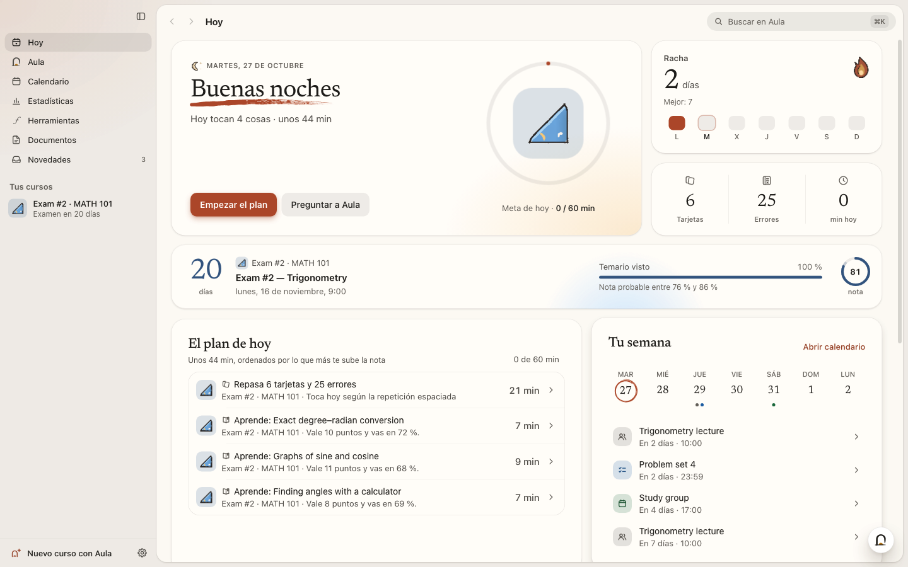
</p>

<p align="center">
  <b>Funciona con la IA que ya tienes</b> — o con una que va en tu ordenador, gratis y privada.<br><br>
  <picture>
    <source media="(prefers-color-scheme: dark)" srcset="docs/media/v2/providers-dark-es.svg">
    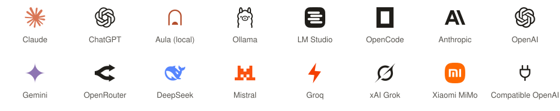
  </picture>
  <br>
  <sub>Los logos son marcas de sus dueños y aparecen solo para identificar cada servicio (fuentes en <a href="THIRD_PARTY_NOTICES.md#ai-provider-logos">THIRD_PARTY_NOTICES.md</a>).</sub>
</p>

## Estudia lo que quieras

Aula no está atada a una asignatura. Cálculo, química orgánica, anatomía, un idioma, historia del arte, el examen del
carné, una certificación, un libro que quieres entender — si puedes describirlo, Aula te lo enseña:

- **Con tus materiales**: las diapositivas, los apuntes, los exámenes anteriores y las lecturas que usa de verdad tu
  clase, para que el curso siga tu temario y tu examen.
- **Desde tu plataforma de estudio**: Canvas, Moodle, Classroom, Teams y más — Aula lee los materiales y las entregas por
  ti.
- **Con una frase**: *«Inglés B2»*, *«Estadística para Psicología · final en mayo»*, *«¿Cómo funcionan las vacunas?»* —
  Aula planifica el curso y busca imágenes con licencia libre para acompañarlo.

Cada curso recibe el mismo cuidado: lecciones, ejercicios corregidos con exactitud, tarjetas, un simulacro con la forma
del examen real, un glosario y un formulario — en el idioma que elijas.

## Lo más destacado

- **Un chat que enseña lo que hace.** Aula piensa en voz alta y cada paso aparece mientras pasa — mira tus cursos, busca
  en tus materiales, prepara un cuestionario, apunta un examen en tu calendario — y todo lo que cambia algo espera tu
  visto bueno.
- **Luz tras el cristal.** Nada de rayas de colores: una luz suave y mate del color de cada tarjeta se mueve detrás de
  ella y se acerca al ratón. Papel cálido, una sola luz de color ladrillo, títulos con serifa, modo claro y oscuro.
- **Ilustraciones a mano que hacen lo suyo.** 58 iconos de curso y 44 compañeros dibujados a pincel, cada uno con su
  pequeña historia: el matraz de química vierte de un lado a otro, el corazón late cada vez más rápido, recibe una
  descarga y se ríe.
- **Tu plataforma de estudio no te pide entrar cada vez.** Inicias sesión una vez — también con el inicio de sesión único
  de tu centro — y Aula mantiene la sesión, cifrada en tu ordenador. Solo lee: nunca entrega, publica, vota, reserva ni
  cambia nada allí.
- **Un guardado de fiar.** Escrituras atómicas y duraderas, con copias; un archivo dañado nunca se sustituye sin avisar.
- **Se actualiza sola en todos los sistemas**, comprobando cada versión antes de instalarla — en macOS, con vuelta atrás
  automática.

Qué cambió en cada versión: [`CHANGELOG.md`](CHANGELOG.md) (en inglés).

## Descargar e instalar

Descarga el archivo de tu sistema desde la [última versión](https://github.com/luumlabs/aula/releases/latest)
(el número del nombre es la versión — hoy, `0.1.0`):

| Sistema | Archivo | La primera vez |
| --- | --- | --- |
| **macOS** 13 Ventura o posterior (Apple Silicon e Intel) | `Aula-0.1.0-mac.dmg` | Abre el .dmg y arrastra **Aula** a *Aplicaciones*. Aula aún no está notarizada por Apple, así que la primera vez macOS te pide confirmarlo: en macOS 15 o posterior, intenta abrirla, ve a *Ajustes del Sistema → Privacidad y seguridad* y pulsa **Abrir igualmente**; en macOS 13 y 14, clic derecho en Aula → **Abrir**. |
| **Windows** 10 y 11 (x64 y ARM, un solo instalador) | `Aula-Setup-0.1.0.exe` | Ejecuta el instalador (no pide permisos de administrador). Si aparece SmartScreen, pulsa **Más información → Ejecutar de todas formas** (Aula aún no está firmada). |
| **Linux** x64 | `Aula-0.1.0-linux-x86_64.AppImage` o `Aula-0.1.0-linux-amd64.deb` | AppImage: hazla ejecutable (`chmod +x Aula-*.AppImage`) y ábrela. Debian/Ubuntu: `sudo apt install ./Aula-0.1.0-linux-amd64.deb`. |
| **Linux** ARM64 | `Aula-0.1.0-linux-arm64.AppImage` | Hazla ejecutable (`chmod +x`) y ábrela. |

En Linux, Aula necesita una distribución de 64 bits con glibc y un llavero (GNOME Keyring o KWallet) para cifrar tus
claves.

**La primera vez.** Aula te pregunta tu nombre, te ayuda a [elegir tu IA](#elige-tu-ia) y, si quieres, conecta tu
plataforma de estudio. Tu biblioteca empieza con dos cursos de ejemplo en tu idioma, para que lo pruebes todo antes de
crear los tuyos.

**Las actualizaciones son automáticas.** Aula busca una versión nueva al arrancar y cada pocas horas, la descarga en
segundo plano, la comprueba y la instala al salir (o al pulsar *Reiniciar* en la barra lateral). En macOS, deja Aula en
*Aplicaciones*: Aula instala las actualizaciones ella misma, antes comprueba la firma de la versión nueva y vuelve a la
anterior si la nueva no arranca. La AppImage también se actualiza sola; el `.deb` de Linux no — cuando salga una versión
nueva, descarga su `.deb` de las [versiones publicadas](https://github.com/luumlabs/aula/releases) e instálalo igual.

<details>
<summary><b>Si algo no va</b></summary>

| Problema | Qué hacer |
|---|---|
| macOS dice que no puede verificar al desarrollador, o no aparece *Abrir* | Mira la fila de macOS de arriba. En macOS 15 o posterior, *Abrir igualmente* solo aparece en *Privacidad y seguridad* después de intentar abrir Aula una vez. |
| macOS dice que la app está dañada | Mueve Aula a *Aplicaciones* e inténtalo de nuevo. Si sigue sin abrir: `xattr -dr com.apple.quarantine /Applications/Aula.app` en el Terminal. |
| macOS no instala una actualización | Comprueba que Aula está en *Aplicaciones* (no en *Descargas* ni abierta desde el .dmg); *Ajustes → Acerca de* explica qué pasó y ofrece *Intentar de nuevo* o la descarga. |
| La AppImage no arranca | Hazla ejecutable (`chmod +x`). Necesita FUSE 2: `sudo apt install libfuse2` (en Ubuntu 24.04 y posteriores, `libfuse2t64`). |
| Ubuntu 23.10 o posterior, con la AppImage | Ubuntu restringe los espacios de nombres de usuario que necesita el aislamiento (*sandbox*) de Chromium, así que la AppImage arranca con ese aislamiento apagado: Aula funciona, pero las páginas que abre (tu plataforma de estudio, por ejemplo) quedan menos aisladas. En x64, instala mejor el `.deb`: mantiene el aislamiento (instala el perfil de AppArmor que Ubuntu necesita). |
| «No encuentro `claude` / `codex`» | Instala la herramienta y ábrela una vez en un terminal para iniciar sesión; después *Ajustes → Tu IA* la encuentra. Para ChatGPT, *Conectar con ChatGPT* también puede descargar Codex oficial por ti. |
| Un curso se paró por un límite de uso | No se pierde nada: ábrelo y pulsa **Reanudar** cuando se renueve tu límite — o quédate con lo que hay. |
| Ajustes → Acerca de dice que tus claves no están cifradas | En Linux sin llavero (GNOME Keyring o KWallet) el sistema no puede cifrarlas; instala uno y vuelve a iniciar sesión. |
| Otra cosa | [Abre una incidencia](https://github.com/luumlabs/aula/issues/new/choose) (mejor en inglés) — mira [Informar de un fallo](#informar-de-un-fallo-o-proponer-una-idea). |
</details>

## Elige tu IA

Aula elige sola la mejor IA que haya; puedes cambiarla cuando quieras en *Ajustes → Tu IA*. Cada opción lleva su logo,
así que siempre sabes cuál está trabajando.

| Opción | Qué necesitas | Detalles |
| --- | --- | --- |
| **Tu suscripción** — Claude (Pro o Max) | La herramienta oficial `claude`, con la sesión iniciada | Sin claves ni pagos extra. |
| **Tu suscripción** — ChatGPT (Plus o Pro) | *Conectar con ChatGPT* | Aula usa Codex oficial (puede descargarlo por ti, comprobado con su SHA-256). |
| **En este ordenador, gratis** | Nada: Aula mira tu memoria y te recomienda un modelo que quepa | Un clic descarga el servidor oficial de `llama.cpp` y un modelo verificado (unos GB). Privado y sin internet después. También detecta Ollama y LM Studio. |
| **Una clave de API** | Una clave de Anthropic, OpenAI, Google Gemini, OpenRouter, DeepSeek, Mistral, Groq, xAI, Xiaomi MiMo, OpenCode Zen — o de cualquier servicio compatible con OpenAI | La pegas y Aula reconoce el proveedor. Pagas directamente al proveedor; Aula te muestra lo gastado y puede parar en un tope diario. Las claves se cifran con el llavero del sistema. |

<p align="center">
  
</p>

## Qué hace Aula

### Crear un curso con Aula

Pulsa <kbd>Ctrl</kbd>/<kbd>⌘</kbd> <kbd>N</kbd> y dile a Aula qué quieres estudiar — *«Cálculo I · Parcial 2»*,
*«Inglés B2»*, *«Historia del arte»*. Añade la fecha del examen si la hay, y tus materiales si los tienes: **PDF,
Word, PowerPoint, Excel, EPUB, páginas web, Markdown, archivos de texto y de código, fotos de apuntes o de la pizarra**
(leídas con OCR), enlaces o texto pegado. O deja que Aula **los busque en tu plataforma de estudio**. Elige
**Rápido**, **Estándar** o **A fondo**, cómo quieres las lecciones y el idioma del curso, y Aula se pone a trabajar.

Un **equipo de agentes** construye el curso mientras miras, cada uno con su compañero dibujado a mano:

- Los **lectores** repasan cada material; un **planificador** lo convierte en un mapa de habilidades ordenado por
  requisitos y con el peso de lo que pregunta el examen.
- Para cada habilidad, los **autores** escriben en paralelo la lección, los ejercicios y las tarjetas.
- Un **verificador** resuelve cada ejercicio *sin ver la solución*; si no coincide, un **árbitro** decide y corrige la
  clave.
- El glosario, la hoja de fórmulas y un simulacro con la forma del examen real se escriben a la vez, y una última
  pasada lo pule todo.

Si la IA llega a un límite de uso, el curso espera guardado y pulsas **Reanudar** más tarde; si falla otra cosa, el
curso te dice por qué con palabras claras y ofrece **Intentar de nuevo**. **Pedir cambios a Aula**
amplía o corrige un curso — *«añade 10 ejercicios más difíciles de identidades»*, con archivos nuevos si quieres — sin
empezar de cero, y el menú del curso guarda el historial de lo que cambió Aula para que puedas **deshacerlo**.

<table>
  <tr>
    <td width="50%"></td>
    <td width="50%">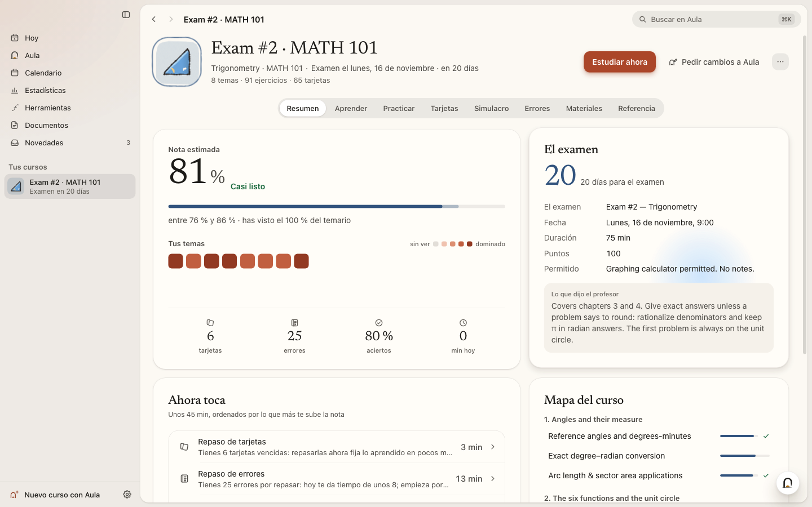</td>
  </tr>
  <tr>
    <td align="center"><sub>Empieza por un tema, un examen o tus archivos</sub></td>
    <td align="center"><sub>Cada curso: nota estimada, cuenta atrás y qué toca</sub></td>
  </tr>
</table>

### Aprender

Tres formas de recorrer una lección, y puedes cambiar cuando quieras:

- **Paso a paso** explica un concepto, enseña un ejemplo resuelto y comprueba que lo entendiste antes de seguir; un
  error trae otra explicación y un ejercicio distinto.
- **Explorar** te deja moverte libremente por explicaciones y actividades.
- **Solo leer** lo muestra todo sin preguntas obligatorias.

Las lecciones se dibujan de forma nativa: matemáticas tipografiadas (KaTeX, con notación química), gráficas con
deslizadores, tablas, ejemplos resueltos, actividades de *predecir* y *encontrar el error*, líneas de tiempo e imágenes
con licencia libre de Wikimedia Commons con su autor y licencia. Aula puede **leerte las lecciones en voz alta** con las
voces del sistema.

Los **visuales interactivos** funcionan sin internet:

- **Diagramas con etiquetas** que exploras y luego practicas con **Señala** (pulsa cada parte) y **Arrastra** (pon
  cada nombre en su sitio), comprobados contra la figura.
- **3D**: moléculas con su geometría VSEPR real y pares libres, redes cristalinas y sólidos con sus medidas.
- **Simulaciones** con deslizadores, reloj y gráficas en vivo; **mapas** con rutas y práctica de *«¿Dónde está…?»*
  (con un mapa del mundo incluido); **diagramas de flujo y procesos animados** paso a paso; y **diapositivas** en cinco
  temas, para presentar a pantalla completa con notas del orador.

<p align="center">
  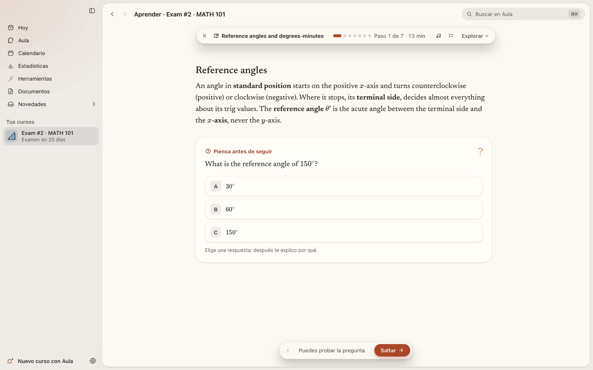
</p>

### Práctica que te explica los errores

El motor matemático de Aula comprueba las respuestas de forma exacta — fracciones, radicales, π, expresiones
equivalentes — en **16 tipos de respuesta**: opción múltiple, números, expresiones, ecuaciones, conjuntos, intervalos,
puntos, respuestas cortas, huecos, ordenar, emparejar, verdadero/falso, etiquetar una figura, química, varias partes y
respuestas abiertas (corregidas con una rúbrica). Cuando cometes un **error típico**, Aula lo reconoce y te dice *por
qué*. En los cursos de idiomas cuentan la ortografía y las tildes: *murio* no es *murió*. Las pistas y las soluciones están a un clic, las plantillas cambian los números cada vez y todo lo que fallas va a
tu **cuaderno de errores**, que te lo devuelve a los 1, 3, 7, 16 y 35 días.

### Tarjetas y el plan de hoy

Las tarjetas usan repetición espaciada **FSRS** — respondes *Otra vez*, *Difícil*, *Bien* o *Fácil* y Aula decide
cuándo volver a preguntarte —, también tarjetas de huecos y tarjetas que tapan una parte de un diagrama cada vez.
**Hoy** reúne todo lo pendiente de tus cursos en un solo plan, ordenado por lo que más te sube la nota, con una meta
diaria y una racha.

<table>
  <tr>
    <td width="50%">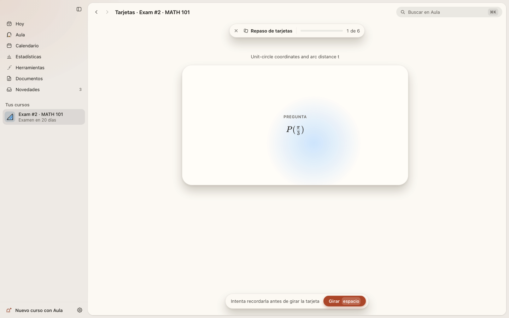</td>
    <td width="50%"></td>
  </tr>
  <tr>
    <td align="center"><sub>Tarjetas con repetición espaciada</sub></td>
    <td align="center"><sub>Simulacros con la forma del examen real</sub></td>
  </tr>
</table>

### Simulacros

Los simulacros con tiempo siguen tu examen real: secciones, puntos y dificultad. Sin pistas hasta que entregas; el
reloj se para si sales. Marca preguntas para volver a ellas y al final recibes un informe por temas y un botón para
**practicar lo que fallaste**.

### Habla con Aula

**Aula** (<kbd>Ctrl</kbd>/<kbd>⌘</kbd> <kbd>2</kbd>) es un chat que conoce tus cursos, tu calendario y cómo vas — y que
puede actuar en la app. *«Tengo un examen de inglés el lunes a las 10»* → lo apunta en tu calendario, te ofrece
preparar un curso y empieza a crearlo mientras sigues hablando. Todo lo que cambia algo espera tu visto bueno en una
tarjeta.

- **Cuestionarios y tarjetas dentro de la conversación**: respóndelos ahí, gira las tarjetas y guárdalas en un curso.
- **Respuestas que se ven**: fórmulas, gráficas exactas, tablas, pasos — y además la calculadora, el conversor de
  unidades y las herramientas de química.
- **Respuestas que citan tus materiales**: pulsa una cita y el documento se abre en esa página.
- **Menciona** un curso, una lección, un ejercicio, un material o un evento con <kbd>@</kbd>; **adjunta** archivos;
  sigue escribiendo mientras Aula responde y tu mensaje espera su turno. Si una respuesta se corta, se guarda, con
  **Continuar**.

<p align="center">
  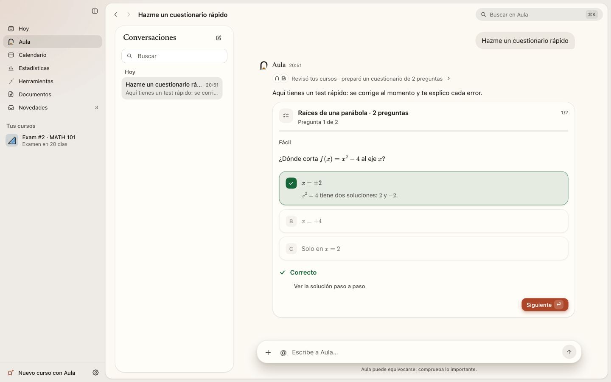
</p>

En cada ejercicio tienes además un **tutor** al lado: la misma Aula, mirando el ejercicio y tu respuesta. Te da pistas
sin darte la solución.

### Herramientas

Doce herramientas, siempre a un clic (<kbd>Ctrl</kbd>/<kbd>⌘</kbd> <kbd>5</kbd>): una **calculadora** exacta, una
**graficadora** (raíces, extremos, asíntotas), la **tabla periódica**, **química** (masa molar, ajuste de reacciones,
estequiometría, disoluciones, gases, pH), **moléculas en 3D**, un **conversor de unidades**, un **temporizador
Pomodoro**, **estadística**, **matrices**, **geometría**, **simulaciones de física** (péndulo, tiro parabólico, muelle,
ondas, choques) y **fórmulas y constantes**. La calculadora, el conversor y el temporizador pueden flotar sobre lo que
estés estudiando.

<table>
  <tr>
    <td width="50%">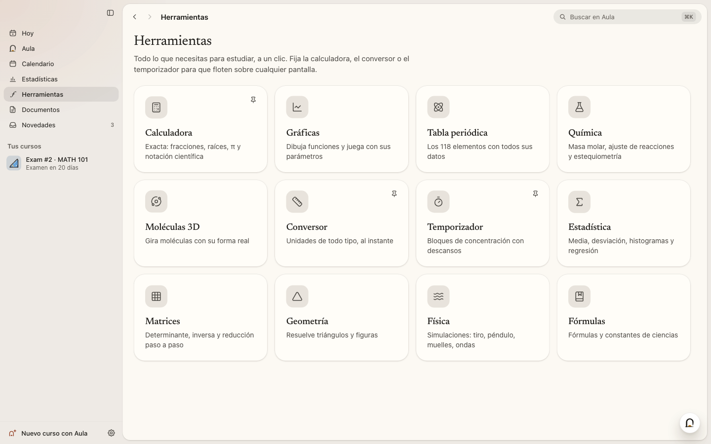</td>
    <td width="50%">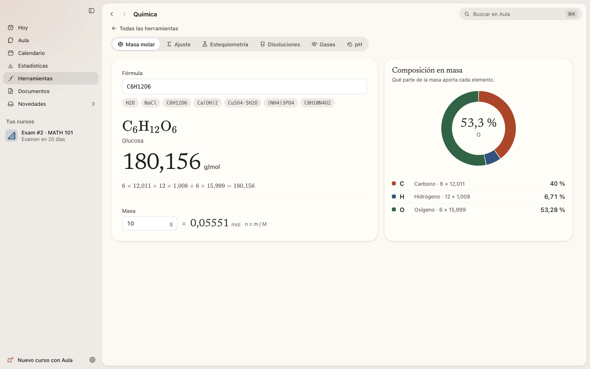</td>
  </tr>
</table>

### Calendario

<kbd>Ctrl</kbd>/<kbd>⌘</kbd> <kbd>3</kbd> abre un calendario con todo en un sitio — los exámenes de tus cursos, las
entregas de tu plataforma y tus propios eventos — en vista **Mes**, **Semana** o **Agenda**. Escribe un evento con tus
palabras (*«Laboratorio de física los martes a las 16 hasta junio»*), abre cualquier evento para cambiarlo o borrarlo,
suscríbete a un enlace de calendario o importa un archivo `.ics`, y exporta el tuyo. Junto a cada examen está
**Preparar este examen**: la pantalla de nuevo curso se abre ya rellenada. En *Hoy*, tu semana flota en un pequeño
calendario.

<p align="center">
  
</p>

### Estadísticas

Tiempo de estudio, días activos, aciertos y racha de un vistazo; un mapa de **constancia** de las últimas doce
semanas; tu **ritmo** por día de la semana; el **dominio por semana**; los **aciertos por tema**; tu **nota
estimada** a lo largo del tiempo; y tus **logros** — dieciséis hitos dibujados a mano (una semana seguida, cien aciertos,
tu primer tema dominado…) que se encienden, con una pequeña celebración, en cuanto los consigues.

<p align="center">
  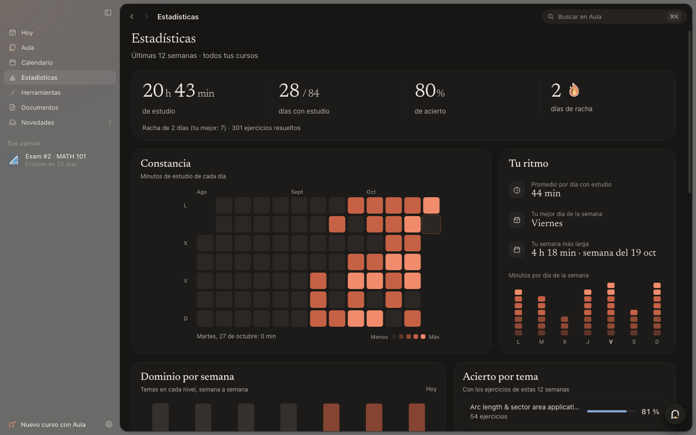
</p>

### Documentos y el lector

Convierte cualquier curso en algo para imprimir o llevar encima: una **guía de estudio**, un **resumen**, una **chuleta
de una página**, **tarjetas para recortar**, un **examen de práctica** con su hoja de soluciones o **diapositivas** —
en **PDF, Word o Markdown**, en A4 o Carta. Los PDF y las fotos se abren en el **lector** de Aula: subraya, resalta,
tacha y añade notas en cuatro colores (el original no se toca nunca), y pide a Aula que resuma una página, un capítulo
o el documento entero, que te explique un pasaje o que convierta una selección en tarjetas o ejercicios. Las respuestas
citan las páginas.

### Tu plataforma de estudio — y nunca hace tus exámenes

Canvas, Moodle, Blackboard, Google Classroom, Brightspace, Schoology, Microsoft Teams, Sakai, itslearning y Open edX —
o cualquier otra web de clase. **Inicia sesión una vez** en el navegador propio de Aula y la mantiene (las cookies se
cifran en tu ordenador); Aula lee tus materiales y tus fechas y conecta el calendario de la plataforma. Solo **lee**:
nunca entrega un trabajo, empieza un cuestionario, publica, vota, reserva una cita, marca algo como hecho, borra, paga
ni cierra tu sesión. Bloquea esos botones y cualquier petición de fondo que cambiaría algo (solo pasa el inicio de
sesión), te pregunta antes de pulsar un botón que no conoce o de ir a otro sitio, y nunca escribe tu contraseña. Abrir
una página aún puede marcarla como vista, igual que en tu navegador.

### Aula siempre activa, y Novedades

Enciende **Aula siempre activa** y Aula sigue trabajando con la ventana cerrada: un resumen por la mañana, revisiones
de tu plataforma, avisos antes de cada entrega, propuestas para preparar los próximos exámenes y un resumen semanal —
y rutinas tuyas. Todo llega a **Novedades**, donde lees, pospones, archivas o respondes; Aula vive en la bandeja del
sistema y te manda notificaciones. Puedes pausarla cuando quieras; tiene un presupuesto diario para no desbocarse.

<p align="center">
  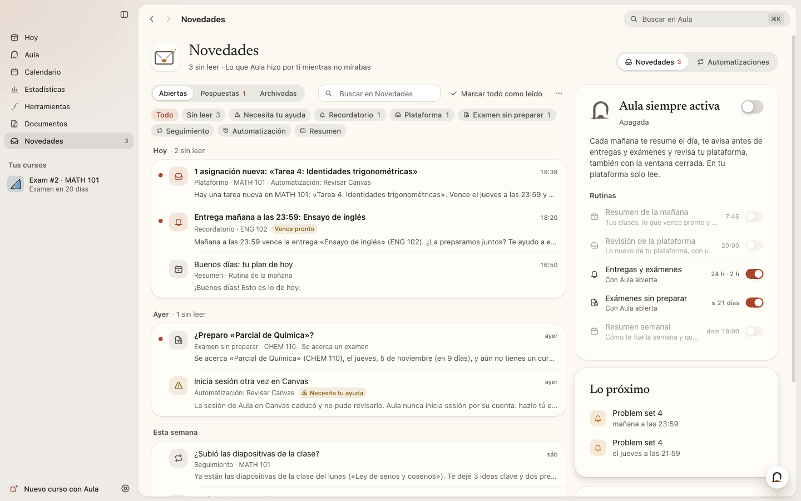
</p>

### Memoria

Aula recuerda lo que le ayuda a enseñarte — cómo te gustan las explicaciones, qué te cuesta. En *Ajustes → Memoria* ves
todo lo que recuerda, y puedes buscar, corregir, olvidar, añadir, pausar o exportar.

### ⌘K, en todas partes

<kbd>Ctrl</kbd>/<kbd>⌘</kbd> <kbd>K</kbd> encuentra una pantalla, un curso, una herramienta o una acción — y las
lecciones, ejercicios, términos del glosario y materiales de tus cursos — o le pregunta directamente a Aula.

### Hecha con cariño

**Papel y luz** — papel cálido y una sola luz de color ladrillo, serifa para títulos y cifras, modo claro y oscuro. 58
iconos de curso y 44 compañeros dibujados a pincel (con una línea que cobra vida suavemente), cifras que cuentan, un calendario que flota, tarjetas que
llenan la pantalla. Las animaciones respetan el ajuste *reducir movimiento* de tu sistema. La interfaz está en
**español e inglés**; los cursos se pueden crear en 12 idiomas.

<table>
  <tr>
    <td width="50%">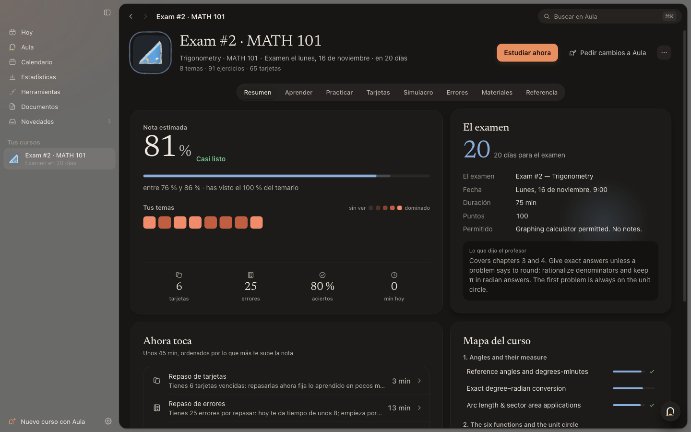</td>
    <td width="50%">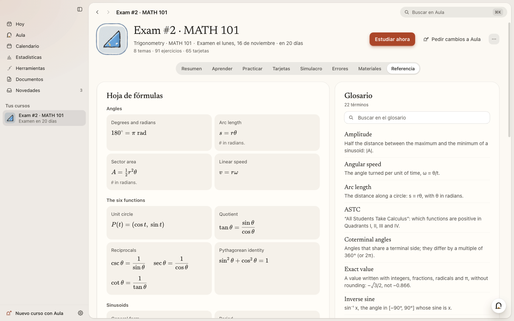</td>
  </tr>
</table>

## Atajos de teclado

<kbd>Ctrl</kbd> en Windows y Linux, <kbd>⌘</kbd> en macOS.

| Atajo | Qué hace |
| --- | --- |
| <kbd>⌘</kbd> <kbd>K</kbd> | Buscar en Aula |
| <kbd>⌘</kbd> <kbd>N</kbd> · <kbd>⌘</kbd> <kbd>O</kbd> | Nuevo curso · Importar un curso (`.aulapack`) |
| <kbd>⌘</kbd> <kbd>1</kbd> … <kbd>7</kbd> | Hoy · Aula · Calendario · Estadísticas · Herramientas · Documentos · Novedades |
| <kbd>⌘</kbd> <kbd>J</kbd> | Preguntar a Aula |
| <kbd>⌘</kbd> <kbd>,</kbd> | Ajustes |
| <kbd>⌘</kbd> <kbd>[</kbd> / <kbd>]</kbd> (macOS) · <kbd>Alt</kbd> <kbd>←</kbd> / <kbd>→</kbd> | Atrás · Adelante |
| Ejercicios | <kbd>Intro</kbd> comprobar · <kbd>A</kbd>–<kbd>Z</kbd> o <kbd>1</kbd>–<kbd>9</kbd> elegir una opción · <kbd>⌘</kbd> <kbd>Intro</kbd> entregar una respuesta abierta |
| Tarjetas | <kbd>Espacio</kbd> girar · <kbd>1</kbd>–<kbd>4</kbd> valorar · <kbd>H</kbd> pista · <kbd>⌘</kbd> <kbd>Z</kbd> deshacer |
| Simulacro | <kbd>Alt</kbd> <kbd>←</kbd> / <kbd>→</kbd> anterior / siguiente · <kbd>⌘</kbd> <kbd>⇧</kbd> <kbd>L</kbd> marcar |

## Privacidad

- Cursos, progreso, calendario, conversaciones, documentos, anotaciones y memoria se **guardan en tu ordenador**, en
  `~/Library/Application Support/Aula` (macOS), `%APPDATA%\Aula` (Windows) o `~/.config/Aula` (Linux). Puedes estudiar
  sin conexión.
- **Sin cuenta, sin anuncios, sin analíticas.** Aula no recoge datos de uso.
- Lo que sale de tu ordenador, y solo cuando hace falta: lo que la IA necesita para cada tarea va al **proveedor de IA
  que elegiste** (nada, con un modelo en tu ordenador); las búsquedas web van a DuckDuckGo, y las páginas que lee la IA, a
  sus sitios, solo cuando *Buscar en internet si falta algo* está activado (Claude Code, Codex y OpenCode también usan las
  herramientas web de Aula, nunca las suyas); las imágenes vienen de Wikimedia Commons; las páginas que abres de tu plataforma; los datos
  de idioma del OCR la primera vez que lees una foto; en Linux, el diccionario del corrector ortográfico de tu idioma
  (de los servidores de Google, una vez); las descargas que pides (el motor local y los modelos desde GitHub
  y Hugging Face, Codex desde GitHub); y la comprobación de actualizaciones, que pregunta a GitHub por la última versión
  sin enviar nada sobre ti.
- Las claves de API, las sesiones de tu plataforma y los enlaces privados de calendario se **cifran con el llavero del
  sistema** (Llavero en macOS, DPAPI en Windows, GNOME Keyring o KWallet en Linux). El navegador de Aula usa **su propio
  perfil**, nunca el tuyo. La app no lleva ninguna clave dentro.
- Un curso exportado (`.aulapack`) nunca incluye tus claves; tú decides si incluye tu progreso.
- *Ajustes → Privacidad y datos* abre tu carpeta de datos, **lo exporta todo** en un `.zip` (sin tus claves ni las
  sesiones de tu plataforma) o **borra todos tus datos**.

## Informar de un fallo o proponer una idea

Aula está en acceso anticipado, así que tus avisos ayudan muchísimo.

- **¿Algo falla?** [Abre un aviso de fallo](https://github.com/luumlabs/aula/issues/new?template=bug_report.yml): qué
  hiciste, qué esperabas y qué pasó, con tu sistema, la versión de Aula (*Ajustes → Acerca de*) y la IA que usas. Una
  captura ayuda.
- **¿Una idea?** [Propónla](https://github.com/luumlabs/aula/issues/new?template=idea.yml).
- Las incidencias son **públicas**: no pegues nunca claves de API, contraseñas, enlaces privados de calendario ni nada
  personal de tus cursos.
- Los **problemas de seguridad** van en privado: mira [`SECURITY.md`](SECURITY.md).

## Compilar desde el código

Necesitas **Node.js 22** (22.12 o posterior; también vale 20.19 o posterior) y Git.

```bash
git clone https://github.com/luumlabs/aula.git
cd aula
npm install                 # .npmrc ya pone legacy-peer-deps
npm run dev                 # la app con recarga en caliente
```

| Orden | Qué hace |
| --- | --- |
| `npm run typecheck` | TypeScript del proceso principal y de la interfaz |
| `npm test` | Pruebas unitarias (vitest) |
| `npm run build` | Compila en `out/` |
| `npm run e2e` | Compila y pasa las pruebas de extremo a extremo con la app Electron real y una IA simulada (en Linux, delante `xvfb-run -a`) |
| `npm run dist:mac` · `dist:win` · `dist:linux` | Instaladores en `release/` |

Variables de entorno útiles: `AULA_HOME` (otra carpeta de datos), `AULA_FAKE_AI=1` (una IA simulada, para pruebas),
`AULA_NO_UPDATES=1`. Cómo publicar una versión: [`docs/PUBLISHING.md`](docs/PUBLISHING.md).

**Cómo está hecha.** Electron 44, React 19, TypeScript y Tailwind CSS 4. El motor de estudio (`src/engine`) —
corrección, matemáticas exactas, FSRS, química, el validador de cursos — es TypeScript puro que comparten el proceso
principal y la interfaz; los servicios de Node (`src/main/services`) se ocupan de los cursos, los proveedores de IA, el
equipo de agentes, el asistente, las automatizaciones, la lectura de archivos y las plataformas; solo
`src/main/electron` toca Electron. La interfaz habla con el proceso principal por un único canal IPC con tipos, con
`contextIsolation`, sandbox y una CSP estricta. Notas para desarrollar: [`CLAUDE.md`](CLAUDE.md).

**Contribuir.** Las *pull requests* son bienvenidas: lee antes [`CONTRIBUTING.md`](CONTRIBUTING.md).

## Apoya a Aula

Aula es gratis y de código abierto, y lo seguirá siendo. Si te ayuda a estudiar, puedes apoyar su desarrollo en
[**GitHub Sponsors**](https://github.com/sponsors/luumlabs), cada mes o una sola vez. Es totalmente opcional: todo Aula es gratis para todo el mundo.

Otras formas de ayudar: dale una estrella al repositorio, [informa de un fallo o propón una idea](#informar-de-un-fallo-o-proponer-una-idea),
mejora el código (lee [`CONTRIBUTING.md`](CONTRIBUTING.md)) y cuéntaselo a alguien que esté estudiando.

## Créditos

Aula se apoya en un trabajo abierto excelente. Gracias: [Electron](https://www.electronjs.org), [React](https://react.dev),
[Vite](https://vite.dev) y [electron-vite](https://electron-vite.org), [Tailwind CSS](https://tailwindcss.com),
[Motion](https://motion.dev), [three.js](https://threejs.org) con [React Three Fiber](https://r3f.docs.pmnd.rs),
[KaTeX](https://katex.org) (con mhchem), [react-markdown](https://github.com/remarkjs/react-markdown) y los
complementos de remark/rehype, [PDF.js](https://mozilla.github.io/pdf.js/),
[Tesseract.js](https://tesseract.projectnaptha.com), [Mammoth](https://github.com/mwilliamson/mammoth.js),
[docx](https://docx.js.org), [JSZip](https://stuk.github.io/jszip/),
[Readability](https://github.com/mozilla/readability), [d3-geo](https://d3js.org/d3-geo) con los datos de
[Natural Earth](https://www.naturalearthdata.com), [dagre](https://github.com/dagrejs/dagre),
[cmdk](https://cmdk.paco.me), [Lucide](https://lucide.dev), [i18next](https://www.i18next.com),
[Zustand](https://zustand.docs.pmnd.rs), [electron-updater](https://www.electron.build), las
fuentes [Inter](https://rsms.me/inter/) y [Newsreader](https://github.com/productiontype/Newsreader) (con
[Fontsource](https://fontsource.org)), los logos de los proveedores de IA de [Simple Icons](https://simpleicons.org), los datos de los elementos de
[Periodic-Table-JSON](https://github.com/Bowserinator/Periodic-Table-JSON) y — descargados solo si los pides —
[llama.cpp](https://github.com/ggml-org/llama.cpp), los modelos abiertos que elijas y
[Codex](https://github.com/openai/codex). Las imágenes de Wikimedia Commons muestran siempre su autor y licencia.
Licencias y avisos: [`THIRD_PARTY_NOTICES.md`](THIRD_PARTY_NOTICES.md); cada copia instalada de Aula lleva además el
texto completo de la licencia de cada paquete que incluye (`THIRD_PARTY_LICENSES.txt`, junto a los recursos de la app).

## Licencia

Aula es **libre y de código abierto**, con la [licencia GNU Affero General Public License v3.0, solo esa versión](LICENSE.md)
(AGPL-3.0-only). Copyright © 2026 Luum Labs. Se ofrece **sin ninguna garantía**. En pocas palabras:

- **Gratis para todos y para cualquier uso**: úsala, estudia cómo funciona, cámbiala y compártela.
- **Los cambios siguen abiertos**: si compartes una versión modificada —o dejas que otros la usen a través de una red—
  tienes que ofrecerles su código completo con esta misma licencia.
- **Una versión modificada necesita su propio nombre e icono**: la licencia te deja copiar y cambiar el código y los
  dibujos, pero una versión modificada no puede llamarse «Aula» ni usar el icono de Aula; las copias sin modificar
  pueden conservar los dos (los términos de la sección 7 están en [`NOTICE.md`](NOTICE.md)).
- Los componentes de terceros mantienen sus licencias: mira [`THIRD_PARTY_NOTICES.md`](THIRD_PARTY_NOTICES.md).
- Para participar en el proyecto: [`CONTRIBUTING.md`](CONTRIBUTING.md) y el [código de conducta](CODE_OF_CONDUCT.md).

Aula existe para que las buenas herramientas de estudio estén al alcance de cualquier estudiante — un pequeño paso para
democratizar la educación.

<p align="center"><sub>Hecha con cariño para estudiantes de todas partes.</sub></p>
