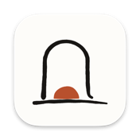
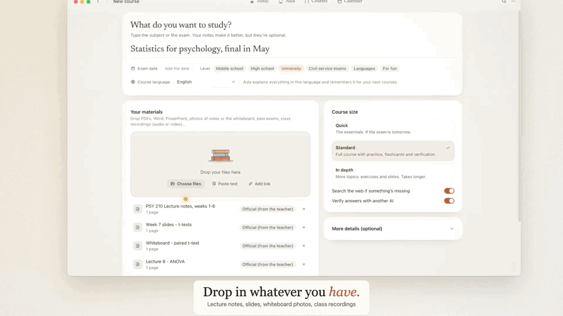
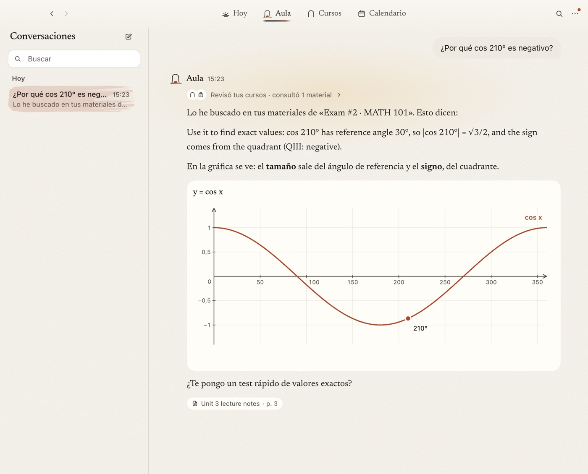
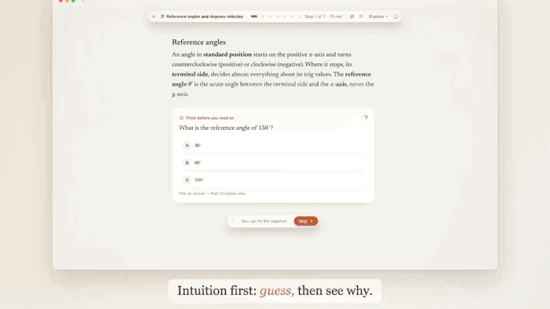
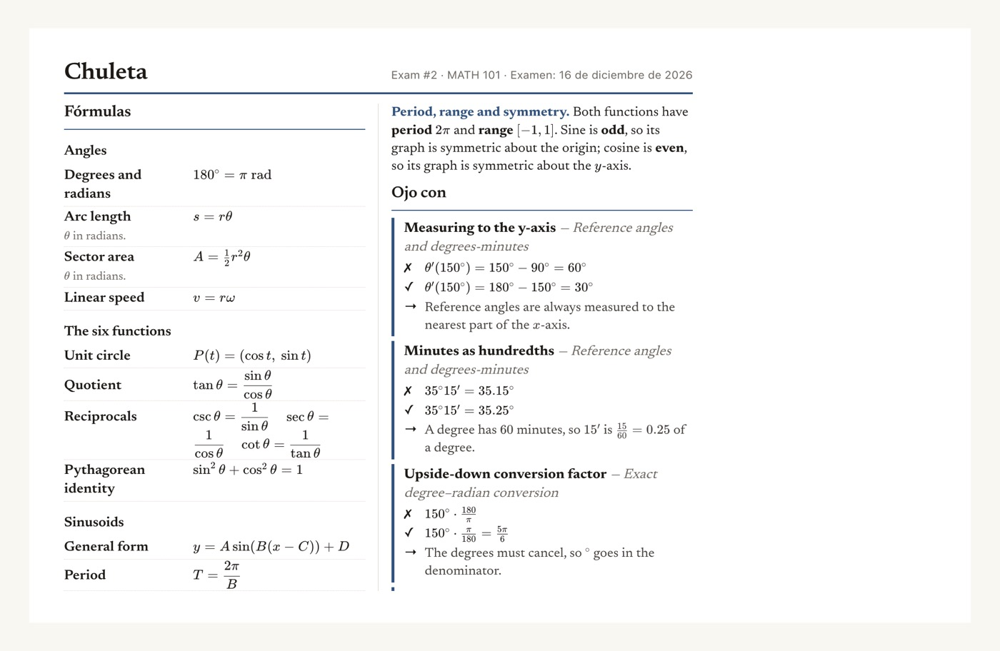
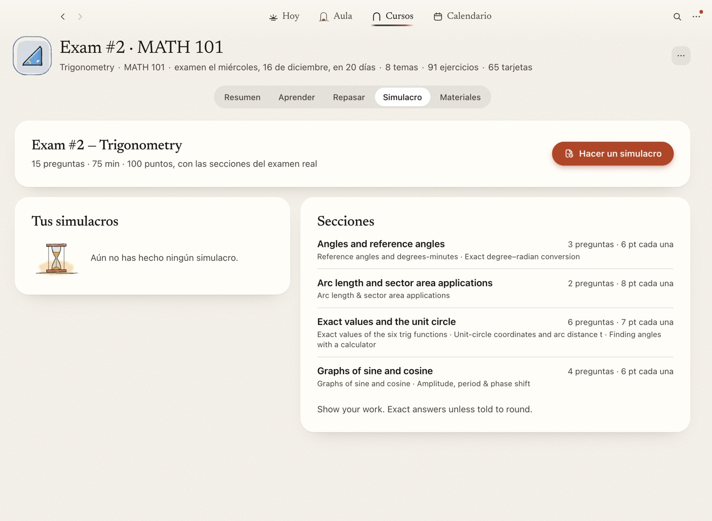
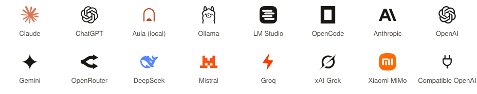
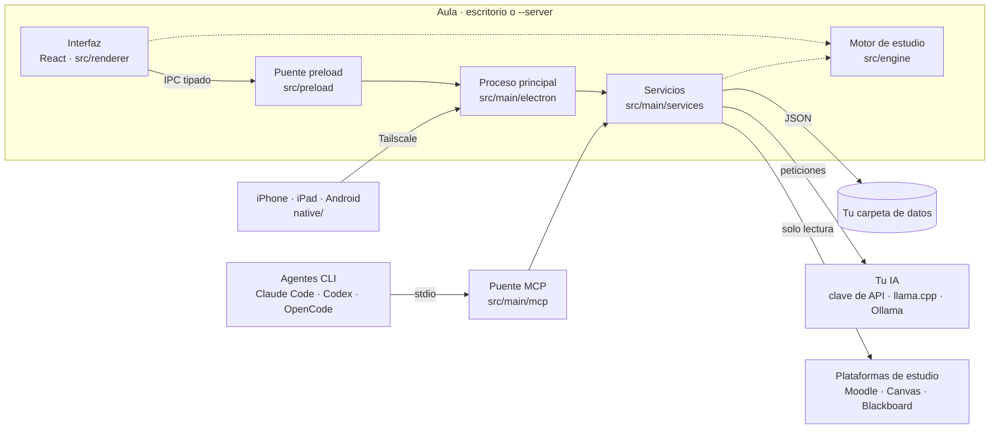

<!-- Mantener a la par con README.md: mismas secciones en el mismo orden, mismas imágenes (las fijas en -es). -->
<p align="right"><a href="README.md">English</a> · <b>Español</b></p>

<p align="center">
  
</p>

<h1 align="center">Aula</h1>

<h3 align="center">Convierte tus apuntes en un curso, con una tutora de IA que lo estudia contigo.</h3>

<p align="center">
  Una app de estudio gratuita y de código abierto para tu ordenador. Dale tus apuntes, diapositivas o exámenes de
  otros años, tráelos de Moodle o Canvas, o dale solo un tema, y tendrás lecciones, ejercicios que se corrigen al
  momento, tarjetas y simulacros de examen. Usa el plan de ChatGPT o Claude que ya pagas, o una IA local gratis (un
  LLM en tu ordenador) que funciona sin internet.
</p>

<p align="center">
  <a href="https://github.com/luumlabs/aula/releases/latest"></a>
  <a href="LICENSE.md"></a>
</p>

<p align="center">
  <a href="#mírala-en-90-segundos">
    <picture>
      <source media="(prefers-reduced-motion: reduce)" srcset="docs/media/landing/hero-still.jpg">
      
    </picture>
  </a>
  <br>
  <sub><a href="#mírala-en-90-segundos">Mira la demo de 90 segundos</a> · la app de verdad, acelerada y con la IA simulada de sus pruebas (rótulos en inglés)</sub>
</p>

<p align="center">
  <a href="https://github.com/luumlabs/aula/releases/latest"><b>Descargar para Windows, macOS o Linux</b></a>
  &nbsp;·&nbsp; gratis, sin cuenta ni rastreo
</p>

## Lo que puedes hacer

### Tutora de IA

Pregúntale cualquier duda de lo que estudias. Aula lo busca en tus propios apuntes, te dice la página y dibuja lo que
explica. Junto a cada ejercicio te da pistas sin soltarte la respuesta.



<sub>Esta respuesta es de la IA simulada que usan las pruebas de Aula, sobre el curso de ejemplo (en inglés). Tu IA escribe la suya.</sub>

### Cursos

Lecciones cortas que te hacen pensar antes de darte la explicación, con figuras trazadas a partir de las matemáticas de
verdad, ejemplos resueltos, ejercicios que se corrigen al momento y tarjetas con repetición espaciada.

<p>
  <picture>
    <source media="(prefers-reduced-motion: reduce)" srcset="docs/media/landing/lesson-still.jpg">
    
  </picture>
</p>

### Apuntes

Aula convierte un curso en apuntes para imprimir: una guía de estudio, un resumen o una chuleta con las fórmulas y los
errores que no debes cometer, en PDF o Word. Tus PDF se abren en un lector donde puedes subrayar y preguntar por una
página.



### Exámenes

Un simulacro cronometrado con las mismas secciones, minutos y puntos que el examen de verdad. Al acabar tienes un informe
por temas y un botón para practicar lo que fallaste. También puedes imprimir un examen de práctica.



## Mírala en 90 segundos

<!-- El vídeo es la URL del adjunto sola en su línea: GitHub la convierte en un reproductor que también funciona para
     quien no ha iniciado sesión. Una etiqueta <video src="…"> deja la URL de github.com, que esas visitas no pueden abrir. -->

https://github.com/user-attachments/assets/dfe84366-3f26-4372-8cc0-7e7ef3b6e00f

<sub>Un curso entero, de principio a fin: se crea con cuatro archivos y después vienen una lección, un ejercicio que pilla
un error típico, el cuaderno de errores, las tarjetas, un simulacro y el plan de hoy. Sin voz y con rótulos en inglés.
¿No carga el reproductor? <a href="https://github.com/luumlabs/aula/raw/main/docs/media/demo/aula-demo-90s.mp4">Descarga el MP4 (9 MB)</a>.</sub>

## Por qué Aula

- **Cualquier asignatura, tu temario.** Cálculo, química orgánica, anatomía, un idioma, el examen de conducir. Con tus
  materiales de clase, el curso sigue tu temario. Sin ellos, basta con algo como *Estadística para Psicología, final en
  mayo*.
- **Lee lo que ya tienes.** PDF, Word, PowerPoint, fotos de la pizarra, grabaciones de clase, enlaces o tu plataforma:
  Moodle, Canvas, Blackboard, Google Classroom, Brightspace y más. Solo lee: nunca entrega nada por ti.
- **Tu IA, o una gratis que funciona sin conexión.** La suscripción a Claude o ChatGPT que ya pagas, una clave de API o
  un modelo local (llama.cpp, Ollama, LM Studio) en tu propio ordenador.
- **Se acuerda por ti.** Tarjetas con repetición espaciada (FSRS), un cuaderno que te devuelve tus errores a los 1, 3,
  7, 16 y 35 días, y un plan para hoy que empieza por lo que más te sube la nota.
- **Donde estudies.** Windows, macOS y Linux. Si Aula está en un Mac o en un [servidor en casa](docs/SERVER.md),
  también puedes abrirla desde tu [iPhone, tu iPad o tu Android](docs/DEVICES.md).

Cada pantalla, herramienta y atajo: [docs/FEATURES.es.md](docs/FEATURES.es.md).

<sub>Aula es joven y se hace en abierto. Si te parece útil, darle una estrella al repositorio (el botón Star, arriba del
todo) ayuda a que otros estudiantes la encuentren.</sub>

## Para empezar

**Para usarla.** Descarga el instalador de tu sistema desde la
[última versión](https://github.com/luumlabs/aula/releases/latest). Es gratis y no pide cuenta.

- **Windows** 10 y 11 (x64 y ARM): `Aula-Setup-<versión>.exe`. Si aparece SmartScreen, pulsa *Más información →
  Ejecutar de todas formas* (en Windows, Aula aún no está firmada).
- **macOS** 13 o posterior (Apple Silicon e Intel): `Aula-<versión>-mac.dmg`. Arrastra Aula a *Aplicaciones* y
  ábrela: va firmada con un Developer ID de Apple y notarizada.
- **Linux** x64 y ARM64: la `.AppImage` (dale `chmod +x` y ábrela) o, en x64, el `.deb`
  (`sudo apt install ./Aula-<versión>-linux-amd64.deb`).
- **Android** 8 o posterior: `Aula-<versión>-android.apk`, una ventana a Aula funcionando en tu Mac o en
  [tu propio servidor](docs/SERVER.md) (mira [Dispositivos](docs/DEVICES.md)).

La primera vez, Aula te pregunta tu nombre, te ayuda a [elegir una IA](#elige-una-ia) y te da cursos de ejemplo para
probarlo todo. Se actualiza sola (con el `.deb`, te avisa cuando sale una versión nueva). Paso a paso, cómo actualizar
desde la 0.1.x, notas de Linux y qué hacer si algo falla: [docs/INSTALL.es.md](docs/INSTALL.es.md).

> [!NOTE]
> Aula está en acceso anticipado. Funciona, pero vas a encontrar fallos y detalles sin pulir, y las cosas cambian de una
> versión a otra. Todavía no la uses como única preparación para un examen importante, y [avísame](#cómo-ayudar) si algo
> falla.

**Desde el código** (Node.js 22.12 o posterior, y Git):

```bash
git clone https://github.com/luumlabs/aula.git && cd aula
npm install
npm run dev
```

El primer `npm run dev` descarga Electron y abre la app con recarga en caliente. ¿Sin clave de IA? Arráncala con
`AULA_FAKE_AI=1 npm run dev` (en PowerShell, `$env:AULA_FAKE_AI=1; npm run dev`) y tendrás una simulada. Si además usas
Aula a diario, apunta también `AULA_HOME` a una carpeta vacía, para que la versión de desarrollo tenga sus propios datos.

## Elige una IA

¿Ya pagas ChatGPT o Claude? Aula usa tu plan. Si no, puede instalarte una IA gratuita en tu ordenador que funciona sin
conexión. Elige sola la mejor opción que encuentra, y puedes cambiarla cuando quieras en *Ajustes → Tu IA*. Sin ninguna
IA puedes seguir estudiando los cursos de ejemplo y los que ya tengas.

- **Suscripción a Claude** (Pro o Max): la herramienta oficial `claude`, con la sesión iniciada. Incluido en tu plan.
- **Suscripción a ChatGPT** (Plus o Pro): *Conectar con ChatGPT* en Aula (usa Codex, la herramienta oficial). Incluido
  en tu plan.
- **Un modelo en tu ordenador**: no hay que preparar nada. Aula te sugiere uno que quepa en tu RAM y descarga
  `llama.cpp` y un modelo verificado. También detecta Ollama y LM Studio. Gratis y sin conexión.
- **Una clave de API** de Anthropic, OpenAI, Google Gemini, OpenRouter, DeepSeek y más, o de cualquier servicio
  compatible con OpenAI. Pagas al proveedor, con un límite diario si quieres.

OpenCode también funciona, si está instalado y con la sesión iniciada. Más detalle:
[docs/FEATURES.es.md](docs/FEATURES.es.md#tu-ia-en-detalle).

<p align="center">
  <picture>
    <source media="(prefers-color-scheme: dark)" srcset="docs/media/screenshots/providers-dark-es.svg">
    
  </picture>
  <br>
  <sub>Los logos son marcas de sus dueños y solo sirven para identificar cada servicio (fuentes en <a href="THIRD_PARTY_NOTICES.md#ai-provider-logos">THIRD_PARTY_NOTICES.md</a>).</sub>
</p>

## Privacidad

- Tus cursos, tu progreso, el calendario, los chats, los documentos, las notas y la memoria son archivos en tu
  ordenador. Sin cuenta, sin anuncios, sin analíticas.
- A la IA que elegiste solo va lo que necesita cada tarea, y con un modelo local no va nada. Las claves se cifran con el
  llavero del sistema.
- La política completa: [docs/PRIVACY.md](docs/PRIVACY.md#español).

<details>
<summary><b>Todo lo que puede salir de tu ordenador, y cuándo</b></summary>

- Tus cursos, progreso, calendario, chats, documentos, notas y memoria se guardan en tu ordenador, en
  `~/Library/Application Support/Aula` (macOS), `%APPDATA%\Aula` (Windows) o `~/.config/Aula` (Linux). Puedes estudiar
  sin conexión.
- Sin cuenta, sin anuncios y sin analíticas. Aula no recoge datos de uso.
- Lo que sí sale de tu ordenador, y solo cuando hace falta:
  - lo que la IA necesita para cada tarea va al proveedor de IA que elegiste (nada, si usas un modelo local);
  - las búsquedas web van a DuckDuckGo, y las páginas que lee la IA se piden a sus sitios, pero solo con la búsqueda
    activada (*Ajustes → Privacidad y datos → Buscar en internet*, y *Buscar en internet si falta algo* al crear un
    curso). Claude Code, Codex y OpenCode usan para esto las herramientas web de Aula, nunca las suyas;
  - las imágenes vienen de Wikimedia Commons, y las páginas que abres de tu plataforma vienen de esa plataforma;
  - los enlaces de calendario a los que te suscribes y los enlaces que añades como materiales se piden a esos sitios;
  - los datos de idioma del OCR, desde la CDN de jsDelivr, la primera vez que Aula lee una foto y, en Linux, el
    diccionario del corrector de tu idioma, una vez, desde los servidores de Google;
  - las descargas que pides: el motor de IA local y los modelos desde GitHub y Hugging Face, y Codex desde GitHub;
  - la comprobación de actualizaciones, que pregunta a GitHub por la última versión sin enviar ningún identificador
    (GitHub ve tu dirección IP, como en cualquier descarga).
- Las claves de API, las sesiones de tu plataforma y los enlaces privados de calendario se cifran con el llavero del
  sistema (Llavero en macOS, DPAPI en Windows, GNOME Keyring o KWallet en Linux). El navegador de Aula tiene su propio
  perfil y nunca toca el tuyo. La app no lleva ninguna clave dentro.
- Un curso exportado (`.aulapack`) nunca incluye tus claves, y tú decides si incluye tu progreso.
- *Ajustes → Privacidad y datos* abre tu carpeta de datos, lo exporta todo en un `.zip` (sin claves ni sesiones de tu
  plataforma) o borra todos tus datos.

</details>

## Cómo ayudar

<a href="https://github.com/luumlabs/aula/issues?q=is%3Aissue+is%3Aopen+label%3A%22good+first+issue%22"></a>

Aula se hace en abierto, y no hace falta ser experto para echar una mano.

- **Elige un issue de los marcados [good first issue](https://github.com/luumlabs/aula/issues?q=is%3Aissue+is%3Aopen+label%3A%22good+first+issue%22).**
  Son tareas pequeñas que dicen qué archivos tocar y cómo comprobarlo: un arreglo del conversor de unidades, fórmulas
  nuevas, pruebas, una traducción. Comenta en el issue para que nadie más empiece el mismo.
- **Cuéntame qué falla.** [Abre un aviso de fallo](https://github.com/luumlabs/aula/issues/new?template=bug_report.yml)
  con lo que hiciste, lo que pasó, tu sistema, la versión de Aula (*Ajustes → Acerca de*) y tu IA. Los issues son
  públicos: no pegues nunca claves, contraseñas, enlaces privados de calendario ni nada personal.
- **Propón una idea** [aquí](https://github.com/luumlabs/aula/issues/new?template=idea.yml).
- **Traduce.** La interfaz está en inglés y en español. Los issues con la etiqueta
  [translation](https://github.com/luumlabs/aula/labels/translation) son una buena forma de empezar.
- **Cuéntaselo a alguien que esté estudiando**, o compártela en el grupo de tu clase. Ayuda más de lo que parece.
- **Apóyala** con [GitHub Sponsors](https://github.com/sponsors/luumlabs), cada mes o una sola vez. Aula es gratis y lo
  seguirá siendo.

Para trabajar en el código, [ejecútala desde el código fuente](#para-empezar): son tres comandos y, con
`AULA_FAKE_AI=1`, tienes una IA simulada sin necesidad de clave. Después, empieza por [CONTRIBUTING.md](CONTRIBUTING.md)
y [Cómo está hecha](#cómo-está-hecha). Los problemas de seguridad se avisan en privado: mira [SECURITY.md](SECURITY.md).

## Comunidad

Aula crece en público. Si quieres seguir el proyecto, ver cómo va o preguntar algo que no sea un fallo, estoy en Reddit
como [u/astrolafi](https://www.reddit.com/user/astrolafi).

## Cómo está hecha

Aula es una app de Electron escrita en TypeScript y React. La misma app funciona sin ventana como servidor
([`--server` o la imagen de Docker](docs/SERVER.md)), y las apps del móvil y la tableta son ventanas a ella.



<details>
<summary><b>Dónde está cada cosa, comandos y variables de entorno</b></summary>

| Carpeta | Qué hay |
| --- | --- |
| `src/renderer` | La interfaz en React. Todo texto pasa por i18n (`i18n/locales/{en,es}`) |
| `src/preload` | El único puente entre la interfaz y el proceso principal (`window.aula`), con `contextIsolation` y sandbox |
| `src/main/electron` | El único código que importa Electron: ventanas, el IPC tipado, el llavero, actualizaciones, el servidor de dispositivos |
| `src/main/services` | Node sin Electron: cursos, proveedores de IA, los agentes que crean los cursos, la tutora, importación, plataformas |
| `src/engine` | TypeScript puro compartido por los dos lados: corrección, matemáticas exactas, FSRS, química, el validador de cursos |
| `src/main/mcp` | El puente MCP con el que Claude Code, Codex y OpenCode usan las herramientas de Aula |
| `native/` · `server/` | Las apps de iPhone/iPad y Android, el proceso auxiliar de Tailscale y Aula como servidor sin ventana (`--server`, Docker) |

| Comando | Qué hace |
| --- | --- |
| `npm run typecheck` | TypeScript del proceso principal y de la interfaz |
| `npm test` | Pruebas unitarias (vitest) |
| `npm run build` | Compila en `out/` |
| `npm run e2e` | Compila y pasa las pruebas de extremo a extremo con la app Electron real y una IA simulada (en Linux, ponle delante `xvfb-run -a`) |
| `npm run dist:mac` · `dist:win` · `dist:linux` | Instaladores en `release/` |

Variables de entorno útiles: `AULA_HOME` (otra carpeta de datos), `AULA_FAKE_AI=1` (una IA simulada) y
`AULA_NO_UPDATES=1`.

La app está hecha con Electron 44, React 19, TypeScript y Tailwind CSS 4. El motor de estudio de `src/engine`
(corrección, matemáticas exactas, FSRS, química, el validador de cursos) es TypeScript puro, sin Node, y lo usan tanto el proceso principal como la interfaz. Los servicios de Node de `src/main/services` se ocupan de los cursos, los
proveedores de IA, los agentes, el asistente, las automatizaciones, la importación de archivos y las plataformas, y
solo `src/main/electron` habla con Electron. La interfaz y el proceso principal se comunican por un único canal IPC con
tipos, con `contextIsolation`, sandbox y una CSP estricta. Hay más notas técnicas en [`CLAUDE.md`](CLAUDE.md) (en inglés).

</details>

Antes de abrir una *pull request*, lee [CONTRIBUTING.md](CONTRIBUTING.md). Las reglas del código, los contratos de IPC y
los formatos de datos están en [CLAUDE.md](CLAUDE.md) (en inglés), y cómo publicar una versión en
[docs/PUBLISHING.md](docs/PUBLISHING.md).

## Gracias

Aula se apoya en mucho trabajo de código abierto, sobre todo [Electron](https://www.electronjs.org),
[React](https://react.dev), [Vite](https://vite.dev), [Tailwind CSS](https://tailwindcss.com),
[three.js](https://threejs.org), [KaTeX](https://katex.org), [PDF.js](https://mozilla.github.io/pdf.js/) y
[Tesseract.js](https://tesseract.projectnaptha.com). Cuando se lo pides, Aula también descarga
[llama.cpp](https://github.com/ggml-org/llama.cpp), los modelos abiertos que elijas y
[Codex](https://github.com/openai/codex). La lista completa de componentes y sus licencias está en
[`THIRD_PARTY_NOTICES.md`](THIRD_PARTY_NOTICES.md), y cada copia instalada lleva el texto de la licencia de cada
paquete que incluye (`THIRD_PARTY_LICENSES.txt`, junto a los recursos de la app).

Muchas de las figuras de Aula (formas de diagrama como pirámides, diagramas de Venn y mapas mentales, moléculas dibujadas
desde SMILES, dibujos que se mueven, «marcar y preguntar al tutor», países en los mapas) están adaptadas de
[Sketchy](https://github.com/ddkbs/sketchy), de ddkbs, con licencia MIT. ¡Gracias!

## Licencia

Aula es libre y de código abierto, con la [licencia GNU Affero General Public License v3.0, solo esa versión](LICENSE.md)
(AGPL-3.0-only). Copyright © 2026 Luum Labs. Se ofrece sin ninguna garantía. En pocas palabras:

- Puedes usarla para lo que quieras, estudiar cómo funciona, cambiarla y compartirla.
- Si compartes una versión modificada, o dejas que otros la usen a través de una red,
  tienes que ofrecerles su código completo con esta misma licencia.
- Una versión modificada necesita su propio nombre e icono. Puedes copiar y cambiar el código y los dibujos, pero una
  versión modificada no puede llamarse «Aula» ni usar el icono de Aula. Las copias sin modificar pueden conservar los
  dos. Los términos exactos (sección 7) están en [`NOTICE.md`](NOTICE.md).
- Los componentes de terceros mantienen sus licencias: mira [`THIRD_PARTY_NOTICES.md`](THIRD_PARTY_NOTICES.md).
- Para participar en el proyecto, mira [`CONTRIBUTING.md`](CONTRIBUTING.md) y el [código de conducta](CODE_OF_CONDUCT.md).
