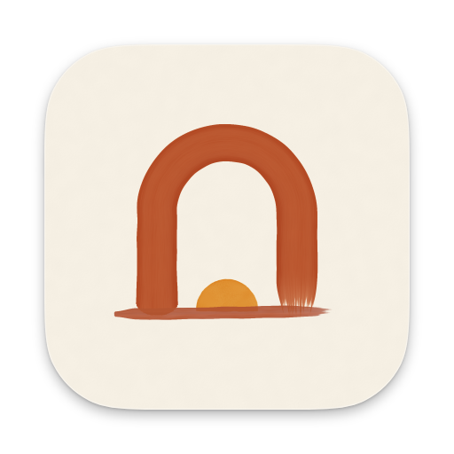
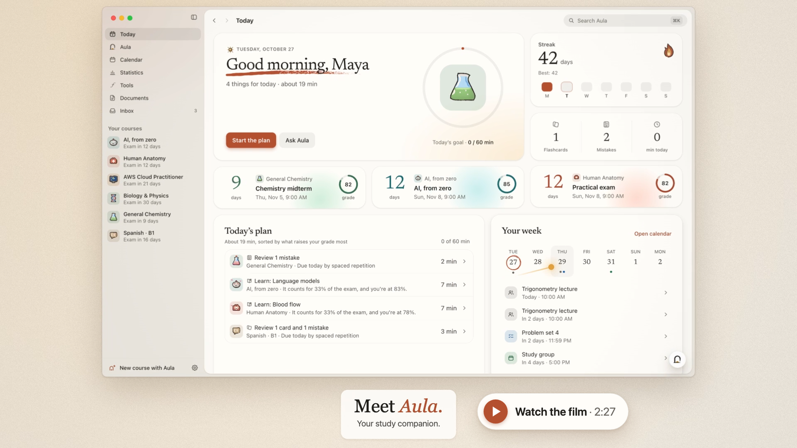
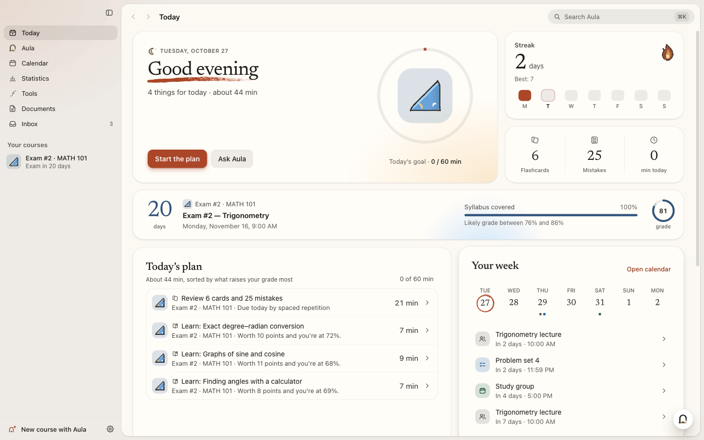
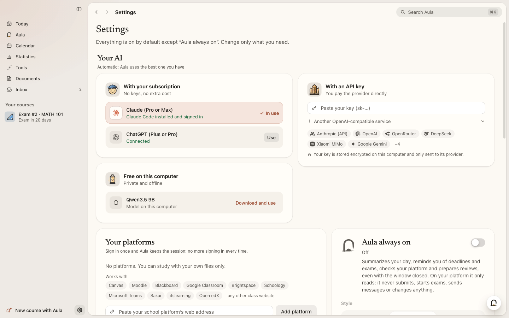
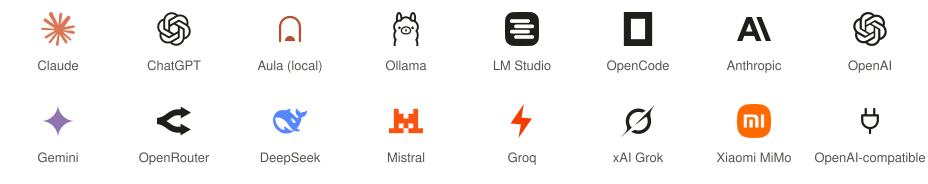
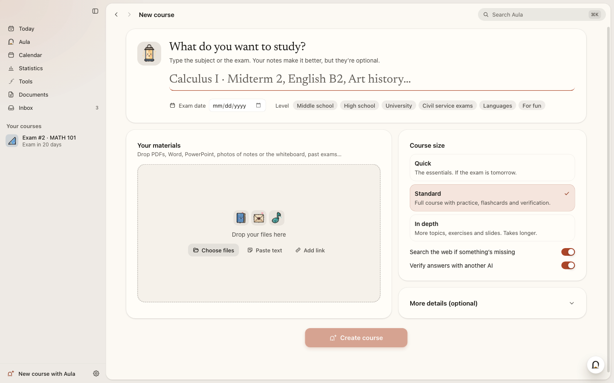
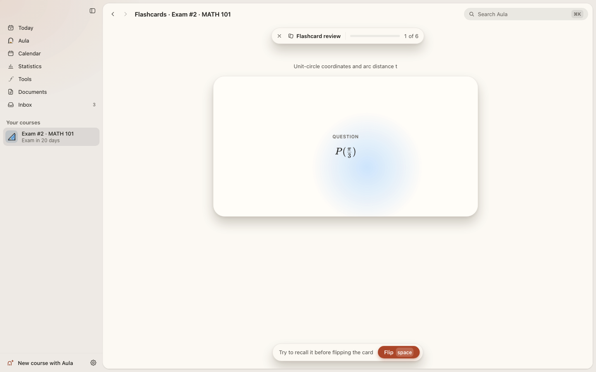
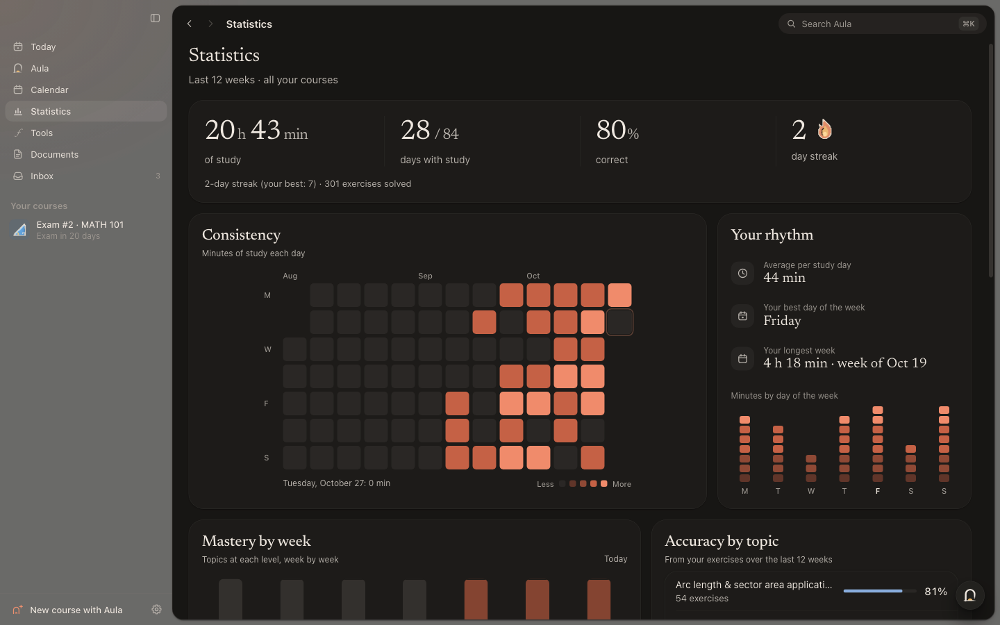
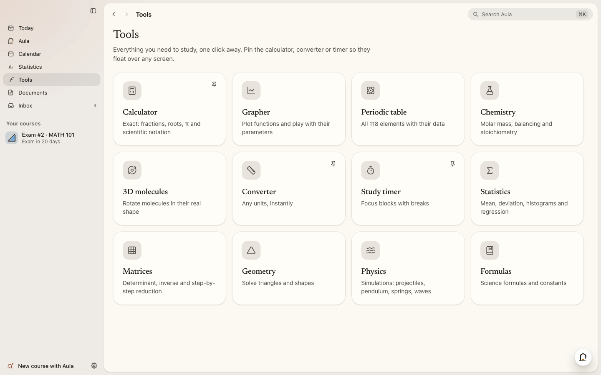

<p align="right"><b>English</b> · <a href="README.es.md">Español</a></p>

<p align="center">
  
</p>

<h1 align="center">Aula</h1>

<p align="center">
  A study app for macOS, Windows and Linux.<br>
  Give it your notes, slides and past exams, or just a topic, and it turns them into a course you can study from.
</p>

<p align="center">
  <a href="https://github.com/luumlabs/aula/releases/latest"></a>
  <a href="LICENSE.md"></a>
  
</p>

<p align="center">
  <a href="https://github.com/luumlabs/aula/releases/download/v0.1.0/Aula-film-web.mp4">
    
  </a>
  <br><sub>A two-and-a-half-minute tour of the app (27 MB video)</sub>
</p>
<!-- Maintainers: for an inline player, drop a ≤10 MB cut of the film here in GitHub's web editor (first check that your
     commit email is the noreply address: GitHub → Settings → Emails). -->

You get short lessons, exercises that are checked as you answer them, flashcards and a mock exam shaped like the real
one. Then Aula helps you work through all of it, a bit each day, until the exam.

It isn't tied to one subject. Calculus, organic chemistry, anatomy, a language, a driving test, a book you want to
understand properly. If you have class materials, Aula uses them, so the course follows your syllabus. If you don't, a line like *Statistics for psychology, final in May* is enough to get started.

Your courses and progress are stored on your computer. Aula works with the AI you already pay for (a Claude or ChatGPT subscription, or an
API key) or with a free model that runs on your own machine. There's no account and no tracking.

> [!NOTE]
> Aula is in early access. It works, but you will find bugs and rough edges, and things will change between versions.
> Please don't make it the only way you prepare for an important exam yet. If something breaks,
> [tell me](#report-a-bug-or-suggest-an-idea).

<p align="center">
  
</p>

## Download and install

Download the file for your system from the [latest release](https://github.com/luumlabs/aula/releases/latest):

| System | File | First launch |
| --- | --- | --- |
| macOS 13 or later (Apple Silicon and Intel) | `Aula-0.1.0-mac.dmg` | Open the .dmg and drag Aula to *Applications*. Aula isn't notarized by Apple yet, so macOS asks you to confirm the first time. On macOS 15 or later, try to open it, then go to *System Settings → Privacy & Security* and click *Open Anyway*. On macOS 13 and 14, right-click Aula and choose *Open*. |
| Windows 10 and 11 (x64 and ARM, one installer) | `Aula-Setup-0.1.0.exe` | Run the installer (it doesn't need admin rights). If SmartScreen shows up, click *More info → Run anyway*. Aula isn't code-signed yet. |
| Linux x64 | `Aula-0.1.0-linux-x86_64.AppImage` or `Aula-0.1.0-linux-amd64.deb` | AppImage: make it executable (`chmod +x Aula-*.AppImage`) and open it. Debian or Ubuntu: `sudo apt install ./Aula-0.1.0-linux-amd64.deb`. |
| Linux ARM64 | `Aula-0.1.0-linux-arm64.AppImage` | Make it executable (`chmod +x`) and open it. |

On Linux you need a 64-bit distribution with glibc. Install GNOME Keyring or KWallet too, or Aula has to store your
keys unencrypted.

The first time you open Aula it asks your name, helps you [pick an AI](#pick-an-ai) and, if you want, connects your
study platform. Your library starts with two example courses, so you can try everything before making your own.

**Updates.** Aula looks for a new version when it starts and every six hours. It downloads it in the background, checks
its signature and installs it when you quit (or when you click *Restart to update* in the sidebar). On macOS, keep Aula in
*Applications* for this to work; if a new version doesn't start, Aula goes back to the previous one. The AppImage
updates itself too. The `.deb` doesn't: Aula tells you when a new version is out, and you
download its `.deb` from the [releases](https://github.com/luumlabs/aula/releases) and install it the same way.

<details>
<summary><b>Troubleshooting</b></summary>

| Problem | What to do |
|---|---|
| macOS can't verify the developer, or there's no *Open* button | See the macOS row above. On macOS 15 or later, *Open Anyway* only shows up in *Privacy & Security* after you've tried to open Aula once. |
| macOS says the app is damaged | Move Aula to *Applications* and try again. If it still won't open, run `xattr -dr com.apple.quarantine /Applications/Aula.app` in Terminal. |
| macOS doesn't install an update | Check that Aula is in *Applications*, not in *Downloads* or running from the .dmg. *Settings → About* says what went wrong and lets you try again or download the update. |
| The AppImage doesn't start | Make it executable (`chmod +x`). It needs FUSE 2: `sudo apt install libfuse2` (on Ubuntu 24.04 and later, `libfuse2t64`). |
| Ubuntu 23.10 or later, with the AppImage | Ubuntu restricts the user namespaces that Chromium's sandbox needs, so the AppImage starts with that sandbox turned off. Aula still works, but the pages it opens (your study platform, for example) are less isolated. On x64, use the `.deb` instead: it keeps the sandbox on by installing the AppArmor profile Ubuntu needs. |
| Aula can't find `claude` or `codex` | Install the CLI and open it once in a terminal to sign in. After that, *Settings → Your AI* finds it. For ChatGPT, *Connect with ChatGPT* can also download the official Codex for you. |
| A course stopped at a usage limit | Nothing is lost. Open it and press *Resume* when your limit renews, or keep what's already there. |
| *Settings → About* says your keys aren't encrypted | On Linux without GNOME Keyring or KWallet your system can't encrypt them. Install one and sign in again. |
| Anything else | [Open an issue](https://github.com/luumlabs/aula/issues/new/choose). |
</details>

## Pick an AI

Aula needs an AI model to write your courses and to talk to you. It picks the best one it can find on its own, and you
can change it any time in *Settings → Your AI*. Without one you can still study the example courses and any course you
already have.

| Option | What you need | Notes |
| --- | --- | --- |
| Claude subscription (Pro or Max) | The official `claude` CLI, signed in | No API key and no extra cost. |
| ChatGPT subscription (Plus or Pro) | *Connect with ChatGPT* in Aula | Uses the official Codex CLI. Aula can download it for you and checks its SHA-256. |
| A model on your computer | Nothing. Aula checks how much RAM your computer has and suggests a model that fits | One click downloads the official `llama.cpp` server and a verified model (from about 1 GB to tens of GB, depending on your computer). After that it's free and works offline. Ollama and LM Studio are detected too. |
| An API key | A key from Anthropic, OpenAI, Google Gemini, OpenRouter, DeepSeek, Mistral, Groq, xAI, Xiaomi MiMo, OpenCode Zen or any OpenAI-compatible service | You pay the provider directly. Aula shows what you've spent and can stop at a daily limit. Keys are encrypted with your system's keychain. |

OpenCode works too, if it's installed and signed in.


<p align="center">
  
</p>

<p align="center">
  <picture>
    <source media="(prefers-color-scheme: dark)" srcset="docs/media/screenshots/providers-dark-en.svg">
    
  </picture>
  <br>
  <sub>Logos are trademarks of their owners and only identify each service (sources in <a href="THIRD_PARTY_NOTICES.md#ai-provider-logos">THIRD_PARTY_NOTICES.md</a>).</sub>
</p>

## What it does

### Courses

Press <kbd>Ctrl</kbd>/<kbd>⌘</kbd> <kbd>N</kbd> and say what you want to study. Add the exam date if there is one, and
any files you have: PDF, Word, PowerPoint, Excel, EPUB, web pages, Markdown, text or code files, links, pasted text, or
photos of your notes or the whiteboard (read with OCR). Aula can also pull your materials from your study platform.

A small team of agents then builds the course, and you can watch them work. Readers go through your materials. A
planner turns them into a map of topics, weighted by what the exam asks. Authors write the lessons, exercises and
flashcards, and a verifier solves every exercise that has a checkable answer again, without
looking at the answer key. When the two disagree, a referee
decides and fixes the key. If your AI hits a usage limit halfway, the course is saved and you press *Resume* later.

You can keep changing a course after it's built (*add 10 harder exercises on identities*), and undo a change if you
don't like it.

<table>
  <tr>
    <td width="50%"></td>
    <td width="50%"></td>
  </tr>
</table>

### Lessons

You can go through a lesson step by step (Aula explains, shows an example and checks you got it before moving on),
explore it freely, or just read it. Math is typeset with KaTeX, chemistry notation included. Lessons can have graphs
with sliders, labeled diagrams you can practice on, 3D molecules with their real geometry, simulations, maps,
flowcharts and slides. Images come from Wikimedia Commons with their author and license, and Aula can read any lesson
aloud with your system's voices.

<p align="center">
  
</p>

### Practice

Aula grades most answers itself, without asking the AI. Its math engine understands
fractions, radicals, π and equivalent expressions, and there are 16 kinds of answers, from multiple choice and
equations to labeling a figure or balancing a reaction. Open answers are graded against a rubric. When you make a
common mistake, Aula recognizes it and tells you why it's wrong. In language courses accents count, so *murio* is not
*murió*. Whatever you miss goes into a mistakes notebook and comes back after 1, 3, 7, 16 and 35 days.

Flashcards use FSRS spaced repetition. Mock exams copy the structure of your real one (sections, points, difficulty),
run on a timer and end with a report by topic and a button to practice what you missed. The *Today* screen puts
everything that's due across your courses into one plan, starting with what will raise your grade the most.

<table>
  <tr>
    <td width="50%"></td>
    <td width="50%"></td>
  </tr>
</table>

### Talking to Aula

<kbd>Ctrl</kbd>/<kbd>⌘</kbd> <kbd>2</kbd> opens a chat that knows your courses, your calendar and how you're doing.
Tell it *I have an English test on Monday at 10* and it offers to add the test to your calendar and build a course for it. You see each step as it happens, and anything that would change something waits for you to approve it. It can put
quizzes and flashcards right in the chat, draw graphs and formulas, and cite your own materials (click a citation and
the document opens on that page).

Every exercise also has a tutor next to it. It sees the exercise and your answer, and gives hints without giving the
answer away.

<p align="center">
  
</p>

### Everything else

- **Calendar** (<kbd>Ctrl</kbd>/<kbd>⌘</kbd> <kbd>3</kbd>): your exams, platform deadlines and your own events in month,
  week or agenda view. Type events in plain words (*Physics lab every Tuesday at 4pm until June*), subscribe to
  calendar links, or import and export `.ics` files. Every exam has a *Prepare for this exam* button.
- **Tools** (<kbd>Ctrl</kbd>/<kbd>⌘</kbd> <kbd>5</kbd>): a calculator, a grapher, the periodic table, chemistry helpers,
  3D molecules, a unit converter, a Pomodoro timer, statistics, matrices, geometry, physics simulations and a list of
  formulas and constants.
- **Statistics**: study time, accuracy, a 12-week consistency heatmap, mastery by topic, your estimated grade over time
  and sixteen achievements.
- **Documents**: turn a course into a study guide, a summary, a one-page cheat sheet, printable flashcards, a practice
  exam or slides, as PDF, Word or Markdown. PDFs and photos open in a reader where you can highlight, take notes and
  ask about a page.
- **Study platforms**: Canvas, Moodle, Blackboard, Google Classroom, Brightspace, Schoology, Microsoft Teams, Sakai,
  itslearning, Open edX or any class website. You sign in once in Aula's own browser and it stays signed in. Aula only
  reads: it blocks anything that would submit work, start a quiz, post, delete or pay, and it never types your
  password.
- **Aula always on** (optional): with the window closed, Aula can send you a morning summary, check your platform, remind
  you of deadlines and write a weekly summary. It all lands in the Inbox, and it stops for the day when it reaches its daily budget.
- **Memory**: Aula remembers what helps it teach you, like how you prefer explanations or what you find hard. You can
  see, edit, pause or export all of it in *Settings → What Aula remembers*.
- **Search**: <kbd>Ctrl</kbd>/<kbd>⌘</kbd> <kbd>K</kbd> finds screens, courses and tools, and anything inside your
  courses.

The interface is in English and Spanish, and courses can be written in 12 languages. There's a light and a dark mode,
and animations follow your system's *reduce motion* setting.

<table>
  <tr>
    <td width="50%"></td>
    <td width="50%"></td>
  </tr>
  <tr>
    <td width="50%"></td>
    <td width="50%"></td>
  </tr>
</table>

<details>
<summary><b>Keyboard shortcuts</b></summary>

<kbd>Ctrl</kbd> on Windows and Linux, <kbd>⌘</kbd> on macOS.

| Shortcut | What it does |
| --- | --- |
| <kbd>⌘</kbd> <kbd>K</kbd> | Search |
| <kbd>⌘</kbd> <kbd>N</kbd> · <kbd>⌘</kbd> <kbd>O</kbd> | New course · Import a course (`.aulapack`) |
| <kbd>⌘</kbd> <kbd>1</kbd> … <kbd>7</kbd> | Today · Aula · Calendar · Statistics · Tools · Documents · Inbox |
| <kbd>⌘</kbd> <kbd>J</kbd> | Ask Aula |
| <kbd>⌘</kbd> <kbd>,</kbd> | Settings |
| <kbd>⌘</kbd> <kbd>[</kbd> / <kbd>]</kbd> (macOS) · <kbd>Alt</kbd> <kbd>←</kbd> / <kbd>→</kbd> (Windows, Linux) | Back · Forward |
| Exercises | <kbd>Enter</kbd> check · <kbd>A</kbd>–<kbd>Z</kbd> or <kbd>1</kbd>–<kbd>9</kbd> pick an option · <kbd>⌘</kbd> <kbd>Enter</kbd> submit an open answer |
| Flashcards | <kbd>Space</kbd> flip · <kbd>1</kbd>–<kbd>4</kbd> rate · <kbd>H</kbd> hint · <kbd>⌘</kbd> <kbd>Z</kbd> undo |
| Mock exam | <kbd>Alt</kbd> <kbd>←</kbd> / <kbd>→</kbd> previous / next · <kbd>⌘</kbd> <kbd>⇧</kbd> <kbd>L</kbd> flag |
</details>

## Privacy

- Your courses, progress, calendar, chats, documents, notes and memory are stored on your computer, in
  `~/Library/Application Support/Aula` (macOS), `%APPDATA%\Aula` (Windows) or `~/.config/Aula` (Linux). You can study
  offline.
- No account, no ads, no analytics. Aula doesn't collect usage data.
- What does leave your computer, and only when it's needed:
  - what the AI needs for each task goes to the AI provider you picked (nothing does if you use a local model);
  - web searches go to DuckDuckGo, and pages the AI reads are fetched from their sites, but only while web search is on
    (*Settings → Privacy and data → Web search*, and *Search the web if something's missing* when you create a course).
    Claude Code, Codex and OpenCode use Aula's web tools for this, never their own;
  - images come from Wikimedia Commons, and the pages you open on your study platform come from that platform;
  - calendar links you subscribe to, and links you add as course materials, are fetched from those sites;
  - the OCR language data, from the jsDelivr CDN, the first time Aula reads a photo, and on Linux the spell-check
    dictionary for your language, once, from Google's servers;
  - downloads you ask for: the local AI engine and models from GitHub and Hugging Face, and Codex from GitHub;
  - the update check, which asks GitHub for the latest version without sending any identifier (GitHub still sees your
    IP address, as with any download).
- API keys, platform sessions and private calendar links are encrypted with your system's keychain (Keychain on macOS,
  DPAPI on Windows, GNOME Keyring or KWallet on Linux). Aula's browser has its own profile and never touches yours. The
  app doesn't ship with any keys inside.
- An exported course (`.aulapack`) never includes your keys, and you decide whether it includes your progress.
- *Settings → Privacy and data* opens your data folder, exports everything as a `.zip` (without keys or platform
  sessions) or deletes all your data.

## Report a bug or suggest an idea

Bug reports are the most useful thing you can send right now.

- If something broke, [open a bug report](https://github.com/luumlabs/aula/issues/new?template=bug_report.yml). Say
  what you did, what you expected and what happened, plus your system, Aula's version (*Settings → About*) and the AI
  you use. A screenshot helps.
- If you have an idea, [suggest it here](https://github.com/luumlabs/aula/issues/new?template=idea.yml).
- Issues are public, so never paste API keys, passwords, private calendar links or anything personal from your courses.
- Security problems should be reported privately. See [`SECURITY.md`](SECURITY.md).

## Build from source

You need **Node.js 22** (22.12 or later; 20.19 or later also works) and Git.

```bash
git clone https://github.com/luumlabs/aula.git
cd aula
npm install                 # .npmrc already sets legacy-peer-deps
npm run dev                 # the app with hot reload
```

| Command | What it does |
| --- | --- |
| `npm run typecheck` | TypeScript for the main process and the interface |
| `npm test` | Unit tests (vitest) |
| `npm run build` | Builds into `out/` |
| `npm run e2e` | Builds and runs the end-to-end tests on the real Electron app with a simulated AI (on Linux, prefix it with `xvfb-run -a`) |
| `npm run dist:mac` · `dist:win` · `dist:linux` | Installers into `release/` |

Handy environment variables: `AULA_HOME` (use another data folder), `AULA_FAKE_AI=1` (a simulated AI, for tests) and
`AULA_NO_UPDATES=1`. Publishing a release is described in [`docs/PUBLISHING.md`](docs/PUBLISHING.md).

The app is built with Electron 44, React 19, TypeScript and Tailwind CSS 4. The study engine in `src/engine` (grading,
exact math, FSRS, chemistry, the course validator) is plain TypeScript shared by the main process and the interface.
The Node services in `src/main/services` handle courses, AI providers, the agents, the assistant, automations, file
import and study platforms, and only `src/main/electron` talks to Electron. The interface and the main process talk
over one typed IPC channel, with `contextIsolation`, a sandbox and a strict CSP. There are more notes for developers in
[`CLAUDE.md`](CLAUDE.md).

Pull requests are welcome. Please read [`CONTRIBUTING.md`](CONTRIBUTING.md) first.

## Support Aula

Aula is free and will stay free. If it helps you and you'd like to support its development, you can do it through
[GitHub Sponsors](https://github.com/sponsors/luumlabs), monthly or just once. Starring the
repository, reporting bugs and telling a friend who's studying help a lot too.

## Thanks

Aula is built on a lot of open source work, mainly [Electron](https://www.electronjs.org),
[React](https://react.dev), [Vite](https://vite.dev), [Tailwind CSS](https://tailwindcss.com),
[three.js](https://threejs.org), [KaTeX](https://katex.org), [PDF.js](https://mozilla.github.io/pdf.js/) and
[Tesseract.js](https://tesseract.projectnaptha.com). When you ask for it, Aula also downloads
[llama.cpp](https://github.com/ggml-org/llama.cpp), the open models you choose and the
[Codex CLI](https://github.com/openai/codex). The full list of components and their licenses is in
[`THIRD_PARTY_NOTICES.md`](THIRD_PARTY_NOTICES.md), and every installed copy carries the license text of each package
inside it (`THIRD_PARTY_LICENSES.txt`, next to the app's resources).

## License

Aula is free and open source under the [GNU Affero General Public License v3.0 only](LICENSE.md) (AGPL-3.0-only).
Copyright © 2026 Luum Labs. It comes with no warranty. In short:

- You can use it for anything, study how it works, change it and share it.
- If you share a modified version, or let people use it over a network, you must offer them
  its complete source code under this same license.
- A modified version needs its own name and icon. You can copy and change the code and the artwork, but a modified
  version can't be called "Aula" or use Aula's icon. Unmodified copies can keep both. The exact terms (section 7) are
  in [`NOTICE.md`](NOTICE.md).
- Third-party components keep their own licenses: see [`THIRD_PARTY_NOTICES.md`](THIRD_PARTY_NOTICES.md).
- To take part in the project, see [`CONTRIBUTING.md`](CONTRIBUTING.md) and the [Code of Conduct](CODE_OF_CONDUCT.md).
