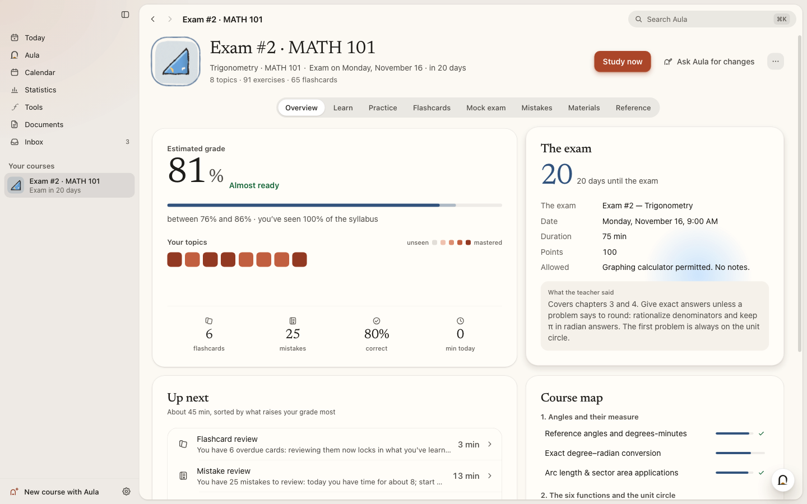
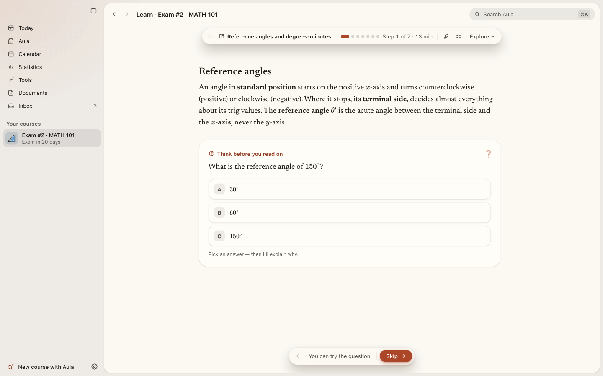
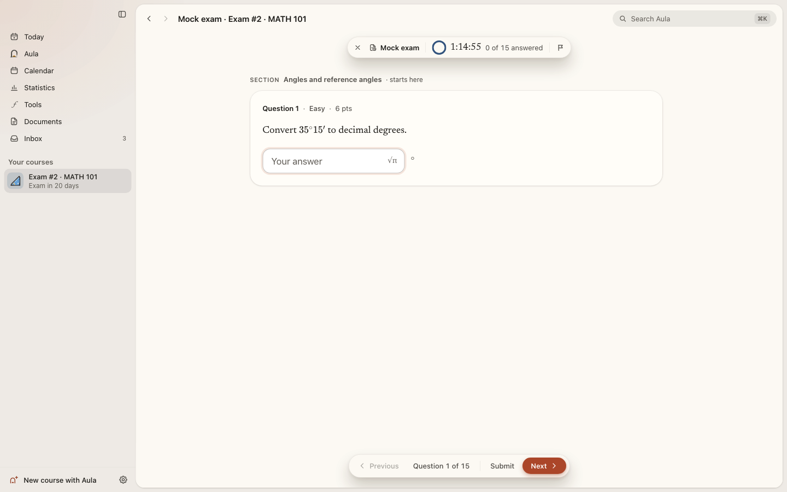
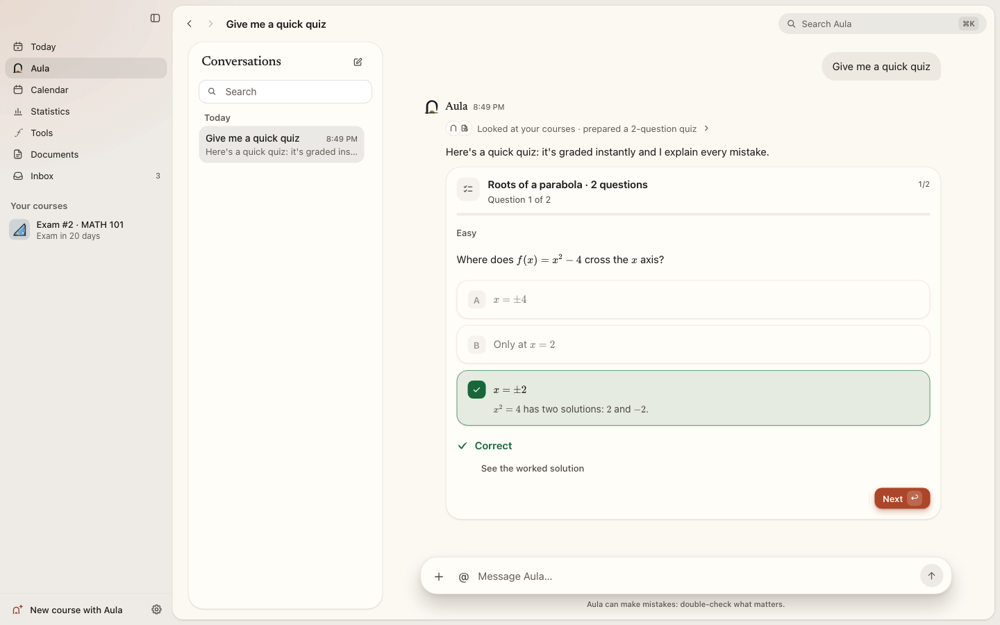
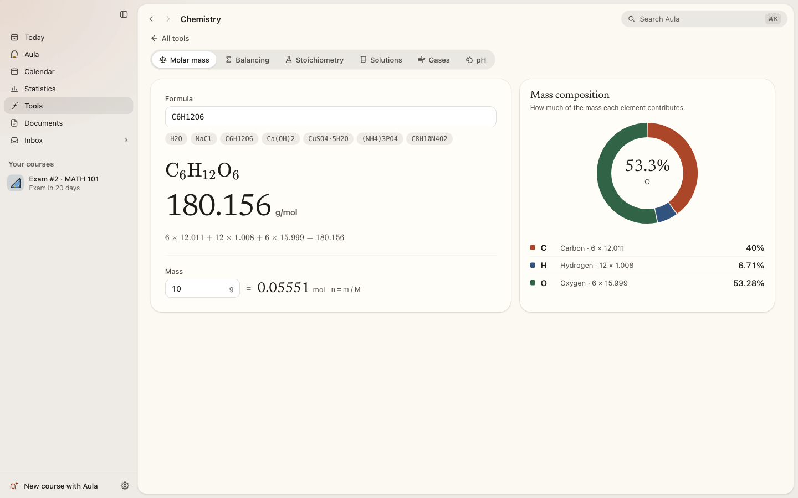
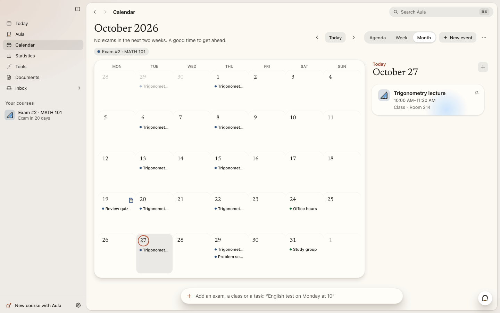
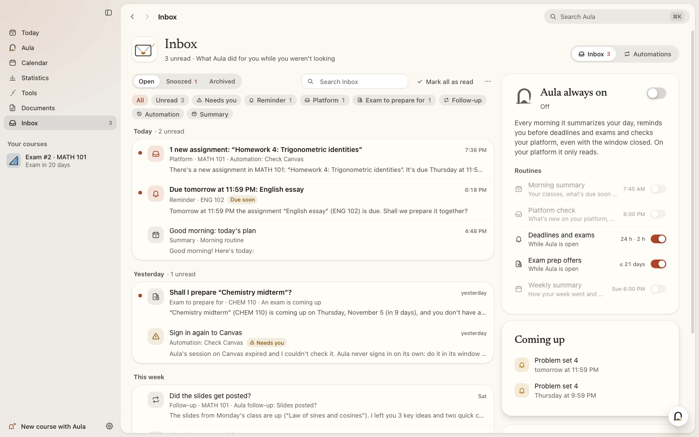
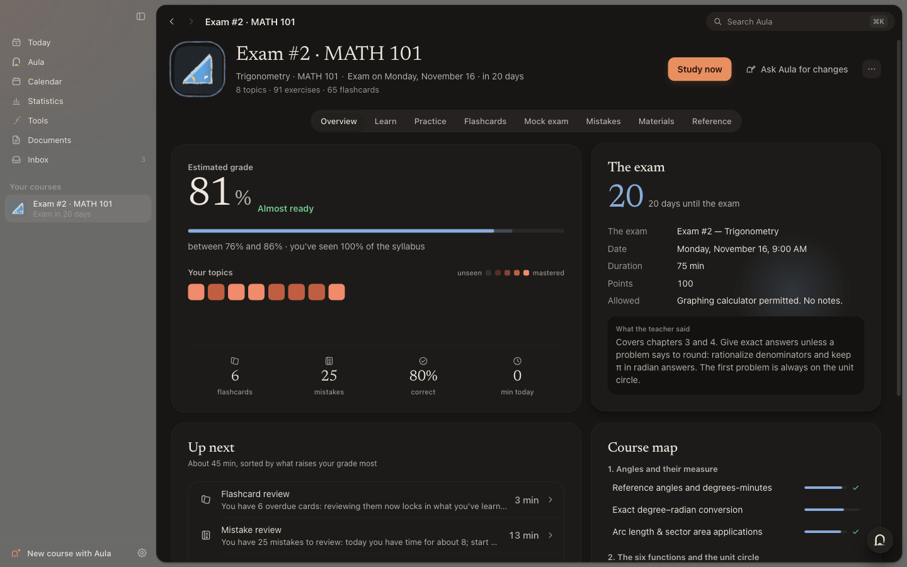
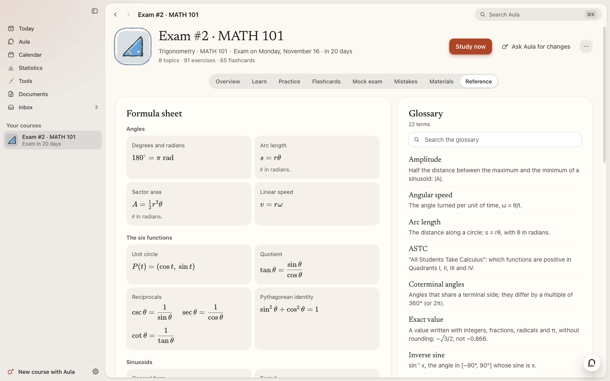

<p align="right"><b>English</b> · <a href="README.es.md">Español</a></p>

<p align="center">
  
</p>

<h1 align="center">Aula</h1>

<p align="center">
  <b>Your study companion — for macOS, Windows and Linux.</b><br>
  A school subject, an exam, a language or anything you're curious about: give Aula your notes, slides and past exams —<br>
  or let it find them on your study platform, or just tell it what you want to learn. It builds a complete course for <i>your</i> goal<br>
  and studies it with you — interactive lessons, practice that explains your mistakes, flashcards, mock exams and printable study sheets — until you're ready.
</p>

<p align="center">
  <a href="https://github.com/luumlabs/aula/releases/latest"><b>⬇&nbsp;Download Aula</b></a><br>
  <sub>Free and open source · macOS, Windows and Linux · early access</sub>
</p>

<p align="center">
  
  
  
  <a href="https://github.com/luumlabs/aula/releases/latest"></a>
  <a href="LICENSE.md"></a>
  <a href="https://github.com/sponsors/luumlabs"></a>
</p>

<p align="center">
  <a href="#download-and-install">Download &amp; install</a> ·
  <a href="#choose-your-ai">Choose your AI</a> ·
  <a href="#what-aula-does">What Aula does</a> ·
  <a href="#privacy">Privacy</a> ·
  <a href="#report-a-bug-or-suggest-an-idea">Report a bug</a> ·
  <a href="#build-from-source">Build from source</a> ·
  <a href="#support-aula">Support Aula</a>
</p>

<p align="center">
  <a href="https://github.com/luumlabs/aula/releases/download/v0.1.0/Aula-film-web.mp4">
    
  </a>
  <br><sub>Watch the film (2:27 · 27 MB video)</sub>
</p>
<!-- Maintainers: for an inline player, drop a ≤10 MB cut of the film here in GitHub's web editor (first check that your
     commit email is the noreply address: GitHub → Settings → Emails). -->

> [!WARNING]
> **Early access.** Aula is still being built and tested. You may run into bugs or rough edges, and things can change
> from one version to the next. Don't rely on it alone for an important exam yet — and if something breaks,
> [let us know](#report-a-bug-or-suggest-an-idea).

<p align="center">
  
</p>

<p align="center">
  <b>Works with the AI you already have</b> — or with one that runs on your computer, free and private.<br><br>
  <picture>
    <source media="(prefers-color-scheme: dark)" srcset="docs/media/v2/providers-dark-en.svg">
    
  </picture>
  <br>
  <sub>Logos are trademarks of their owners and appear only to identify each service (sources in <a href="THIRD_PARTY_NOTICES.md#ai-provider-logos">THIRD_PARTY_NOTICES.md</a>).</sub>
</p>

## Study anything

Aula isn't tied to one subject. Calculus, organic chemistry, anatomy, a language, art history, a driving test, a
certification, a book you want to understand — if you can describe it, Aula can teach it:

- **From your materials**: the slides, notes, past exams and readings your class actually uses, so the course follows
  your syllabus and your exam.
- **From your study platform**: Canvas, Moodle, Classroom, Teams and more — Aula reads the materials and the deadlines
  for you.
- **From a sentence**: *“English B2”*, *“Statistics for psychology · final in May”*, *“How do vaccines work?”* — Aula
  plans the course and finds openly licensed images to go with it.

Every course gets the same care: lessons, exercises checked exactly, flashcards, a mock exam shaped like the real one,
a glossary and a formula sheet — in the language you choose.

## Highlights

- **A chat that shows what it's doing.** Aula thinks out loud, then every step appears as it happens — looking at your
  courses, searching your materials, preparing a quiz, adding an exam to your calendar — and anything that changes
  something waits for your OK.
- **Light behind the glass.** No colored stripes: a soft, matte light of each card's color drifts behind the card and
  leans toward your pointer. Warm paper, one brick-red light, serif titles, light and dark modes.
- **Hand-drawn illustrations that act out their subject.** 58 course icons and 44 companions, drawn with a brush and
  each with its own little story: the chemistry flask pours from side to side, the heart beats faster, gets a shock and
  laughs.
- **Your study platform keeps you signed in.** Sign in once — school single sign-on included — and Aula keeps the session,
  encrypted on your computer. It only reads: it never submits, posts, votes, books or changes anything there.
- **Saving you can trust.** Atomic, durable writes with backups; a damaged file is never silently replaced.
- **Updates itself on every system**, verified before installing — on macOS with automatic rollback.

What changed in each version: [`CHANGELOG.md`](CHANGELOG.md).

## Download and install

Download the file for your system from the [latest release](https://github.com/luumlabs/aula/releases/latest)
(the number in the name is the version — `0.1.0` today):

| System | File | First launch |
| --- | --- | --- |
| **macOS** 13 Ventura or later (Apple Silicon and Intel) | `Aula-0.1.0-mac.dmg` | Open the .dmg and drag **Aula** to *Applications*. Aula isn't notarized by Apple yet, so the first time macOS asks you to confirm: on macOS 15 or later, try to open it, then go to *System Settings → Privacy & Security* and click **Open Anyway**; on macOS 13 and 14, right-click Aula → **Open**. |
| **Windows** 10 and 11 (x64 and ARM, one installer) | `Aula-Setup-0.1.0.exe` | Run the installer (no administrator rights needed). If SmartScreen appears, click **More info → Run anyway** (Aula isn't code-signed yet). |
| **Linux** x64 | `Aula-0.1.0-linux-x86_64.AppImage` or `Aula-0.1.0-linux-amd64.deb` | AppImage: make it executable (`chmod +x Aula-*.AppImage`) and open it. Debian/Ubuntu: `sudo apt install ./Aula-0.1.0-linux-amd64.deb`. |
| **Linux** ARM64 | `Aula-0.1.0-linux-arm64.AppImage` | Make it executable (`chmod +x`) and open it. |

On Linux, Aula needs a 64-bit distribution with glibc, and a keyring (GNOME Keyring or KWallet) to encrypt your keys.

**First launch.** Aula asks your name, helps you [choose your AI](#choose-your-ai) and, if you like, connects your
study platform. Your library starts with two example courses in your language, so you can try everything before
creating your own.

**Updates are automatic.** Aula checks for a new version when it starts and every few hours, downloads it in the
background, checks it and installs it when you quit (or when you press *Restart* in the sidebar). On macOS, keep Aula in
*Applications*: Aula installs updates itself, checks the new version's signature first and goes back to the previous
version if the new one doesn't start. The AppImage updates itself too; the Linux `.deb` doesn't — when a new version
comes out, download its `.deb` from the [releases](https://github.com/luumlabs/aula/releases) and install it the same way.

<details>
<summary><b>Troubleshooting</b></summary>

| Problem | What to do |
|---|---|
| macOS says it can't verify the developer, or there's no *Open* button | See the macOS row above. On macOS 15 or later, *Open Anyway* appears in *Privacy & Security* only after you've tried to open Aula once. |
| macOS says the app is damaged | Move Aula to *Applications* and try again. If it still refuses: `xattr -dr com.apple.quarantine /Applications/Aula.app` in Terminal. |
| macOS doesn't install an update | Make sure Aula is in *Applications* (not in *Downloads* or running from the .dmg); *Settings → About* says what happened and offers *Try again* or the download. |
| The AppImage doesn't start | Make it executable (`chmod +x`). It needs FUSE 2: `sudo apt install libfuse2` (on Ubuntu 24.04 and later, `libfuse2t64`). |
| Ubuntu 23.10 or later, with the AppImage | Ubuntu restricts the user namespaces that Chromium's sandbox needs, so the AppImage starts with that sandbox turned off: Aula works, but the pages it opens (your study platform, for example) are less isolated. On x64, install the `.deb` instead: it keeps the sandbox on (it installs the AppArmor profile Ubuntu needs). |
| “I can't find `claude` / `codex`” | Install the CLI and open it once in a terminal to sign in; then *Settings → Your AI* finds it. For ChatGPT, *Connect with ChatGPT* can also download the official Codex for you. |
| A course stopped at a usage limit | Nothing is lost: open it and press **Resume** when your limit renews — or keep what's there. |
| Settings → About says your keys aren't encrypted | On Linux without a keyring (GNOME Keyring or KWallet) your system can't encrypt them; install one and sign in again. |
| Something else | [Open an issue](https://github.com/luumlabs/aula/issues/new/choose) — see [Report a bug](#report-a-bug-or-suggest-an-idea). |
</details>

## Choose your AI

Aula picks the best AI available automatically; you can change it any time in *Settings → Your AI*. Every option shows
its logo, so you always know which one is working.

| Option | What you need | Notes |
| --- | --- | --- |
| **Your subscription** — Claude (Pro or Max) | The official `claude` CLI, signed in | No keys, no extra cost. |
| **Your subscription** — ChatGPT (Plus or Pro) | *Connect with ChatGPT* | Aula uses the official Codex CLI (it can download it for you, checked against its SHA-256). |
| **On this computer, free** | Nothing: Aula checks your memory and recommends a model that fits | One click downloads the official `llama.cpp` server and a verified model (a few GB). Private and offline afterwards. Ollama and LM Studio are detected too. |
| **An API key** | A key from Anthropic, OpenAI, Google Gemini, OpenRouter, DeepSeek, Mistral, Groq, xAI, Xiaomi MiMo, OpenCode Zen — or any OpenAI-compatible service | Paste it and Aula recognizes the provider. You pay the provider directly; Aula shows what you've spent and can stop at a daily cap. Keys are encrypted with your system's keychain. |

<p align="center">
  
</p>

## What Aula does

### Create a course with Aula

Press <kbd>Ctrl</kbd>/<kbd>⌘</kbd> <kbd>N</kbd> and tell Aula what you want to study — *“Calculus I · Midterm 2”*,
*“English B2”*, *“Art history”*. Add the exam date if there is one, and your materials if you have them: **PDF, Word,
PowerPoint, Excel, EPUB, web pages, Markdown, text and code files, photos of notes or of the whiteboard** (read with
OCR), links or pasted text. Or let Aula **fetch them from your study platform**. Choose **Quick**, **Standard** or
**In depth**, how lessons should work and the course language, and Aula gets to work.

A **team of agents** builds the course while you watch, each with its own hand-drawn companion:

- **Readers** go through every material; a **planner** turns them into a map of skills ordered by prerequisites and
  weighted by what the exam asks.
- For each skill, **authors** write the lesson, the exercises and the flashcards in parallel.
- A **verifier** solves every exercise *without seeing the answer key*; when it disagrees, a **referee** decides and
  fixes the key.
- The glossary, the formula sheet and a mock exam shaped like the real one are written at the same time, and a final
  pass polishes everything.

If the AI hits a usage limit, the course waits, saved, and you press **Resume** later; if something else goes wrong,
the course tells you why in plain words and offers **Try again**. **Ask Aula for changes**
extends or corrects a course — *“add 10 harder exercises on identities”*, with new files if you want — without starting
over, and the course menu keeps a history of what Aula changed so you can **undo** it.

<table>
  <tr>
    <td width="50%"></td>
    <td width="50%"></td>
  </tr>
  <tr>
    <td align="center"><sub>Start from a topic, an exam or your files</sub></td>
    <td align="center"><sub>Every course: grade estimate, exam countdown, what's next</sub></td>
  </tr>
</table>

### Learn

Three ways to go through a lesson, and you can switch any time:

- **Step by step** explains a concept, shows a worked example and checks you understood before moving on; a mistake
  brings another explanation and a different exercise.
- **Explore** lets you move freely through explanations and activities.
- **Just read** shows everything without compulsory questions.

Lessons are drawn natively: typeset math (KaTeX, with chemistry notation), graphs with sliders, tables, worked
examples, *predict* and *find the error* activities, timelines, and openly licensed images from Wikimedia Commons with
their author and license. Aula can **read lessons aloud** with your system's voices.

**Interactive visuals** work offline:

- **Labeled diagrams** you explore, then practice with **Point** (click each part) and **Drag** (put each name in its
  place), checked against the figure.
- **3D**: molecules with real VSEPR geometry and lone pairs, crystal lattices, and solids with their measurements.
- **Simulations** with sliders, a clock and live plots; **maps** with routes and *“Where is…?”* practice (a built-in
  world map); **flowcharts and animated processes** step by step; and **slides** in five themes, presented full screen
  with speaker notes.

<p align="center">
  
</p>

### Practice that explains your mistakes

Answers are checked exactly by Aula's math engine — fractions, radicals, π, equivalent expressions — across **16 answer
types**: multiple choice, numbers, expressions, equations, sets, intervals, points, short answers, fill-in-the-blanks,
ordering, matching, true/false, labeling a figure, chemistry, multi-part and open answers (graded against a rubric).
When you make a **typical mistake**, Aula recognizes it and tells you *why*. In language courses spelling and accents
count, so *murio* isn't *murió*. Hints and full solutions are one click
away, templates give fresh numbers every time, and everything you miss goes to your **mistakes notebook**, which brings
it back after 1, 3, 7, 16 and 35 days.

### Flashcards and today's plan

Flashcards use **FSRS** spaced repetition — answer *Again*, *Hard*, *Good* or *Easy* and Aula decides when to ask again
— including cloze cards and cards that hide one part of a diagram at a time. **Today** turns everything due across your
courses into one plan, sorted by what raises your grade most, with a daily goal and a streak.

<table>
  <tr>
    <td width="50%"></td>
    <td width="50%"></td>
  </tr>
  <tr>
    <td align="center"><sub>Flashcards with spaced repetition</sub></td>
    <td align="center"><sub>Mock exams with the shape of the real one</sub></td>
  </tr>
</table>

### Mock exams

Timed mock exams follow your real exam: sections, points and difficulty. No hints until you submit; the clock pauses
if you leave. Flag questions to revisit, then get a report by topic and one button to **practice what you missed**.

### Talk to Aula

**Aula** (<kbd>Ctrl</kbd>/<kbd>⌘</kbd> <kbd>2</kbd>) is a chat that knows your courses, your calendar and how you're
doing — and can act in the app. *“I have an English test on Monday at 10”* → it adds it to your calendar, offers to
prepare a course and starts building it while you keep talking. Anything that changes something waits for your OK on
a card.

- **Quizzes and flashcards right in the conversation**: answer them there, flip the cards, save them to a course.
- **Answers you can see**: formulas, exact graphs, tables, steps — plus the calculator, unit converter and chemistry
  tools.
- **Answers that cite your materials**: click a citation and the document opens at that page.
- **Mention** a course, lesson, exercise, material or event with <kbd>@</kbd>; **attach** files; keep writing while
  Aula answers and your message waits its turn. An answer cut off midway is kept, with **Continue**.

<p align="center">
  
</p>

In every exercise there's also a **tutor** at your side: the same Aula, looking at the exercise and your answer. It
gives hints without giving the answer away.

### Tools

Twelve tools, always one click away (<kbd>Ctrl</kbd>/<kbd>⌘</kbd> <kbd>5</kbd>): an exact **calculator**, a
**grapher** (roots, extremes, asymptotes), the **periodic table**, **chemistry** (molar mass, balancing,
stoichiometry, solutions, gases, pH), **3D molecules**, a **unit converter**, a **Pomodoro timer**, **statistics**,
**matrices**, **geometry**, **physics simulations** (pendulum, projectile, spring, waves, collisions) and **formulas
and constants**. The calculator, the converter and the timer can float over whatever you're studying.

<table>
  <tr>
    <td width="50%"></td>
    <td width="50%"></td>
  </tr>
</table>

### Calendar

<kbd>Ctrl</kbd>/<kbd>⌘</kbd> <kbd>3</kbd> opens a calendar with everything in one place — the exams of your courses,
the deadlines from your study platform and your own events — in **Month**, **Week** or **Agenda** view. Type an event
in plain words (*“Physics lab every Tuesday at 4pm until June”*), open any event to edit or delete it, subscribe to a
calendar link or import an `.ics` file, and export yours. Next to every exam there's **Prepare this exam**: the
new-course screen opens already filled in. On *Today*, your week floats in a small calendar.

<p align="center">
  
</p>

### Statistics

Study time, active days, accuracy and streak at a glance; a **consistency** heatmap of the last twelve weeks; your
**rhythm** by weekday; **mastery by week**; **accuracy by topic**; your **estimated grade** over time; and your
**achievements** — sixteen hand-drawn milestones (a week in a row, a hundred right answers, your first topic mastered…)
that light up, with a little celebration, the moment you earn them.

<p align="center">
  
</p>

### Documents and the reader

Turn any course into something to print or take anywhere: a **study guide**, a **summary**, a **one-page cheat
sheet**, **flashcards to cut out**, a **practice exam** with its answer sheet, or **slides** — as **PDF, Word or
Markdown**, in A4 or Letter. PDFs and photos open in Aula's **reader**: highlight, underline, strike and add notes in
four colors (the original is never touched), and ask Aula to summarize a page, a chapter or the whole document,
explain a passage, or turn a selection into flashcards or exercises. Answers cite pages.

### Your study platform — and it never takes your exams

Canvas, Moodle, Blackboard, Google Classroom, Brightspace, Schoology, Microsoft Teams, Sakai, itslearning and Open edX
— or any other class website. **Sign in once** in Aula's own browser and it keeps you signed in (cookies encrypted on
your computer); Aula reads your materials and deadlines and connects the platform's calendar. It's **read-only**:
it never submits work, starts a quiz, posts, votes, books a slot, marks things done, deletes, pays or logs you out. It
blocks those buttons and any background request that would change something (only signing in gets through), asks
before a button it doesn't know or a link to another site, and never types your password. Opening a page can still
mark it as seen, just as it would in your own browser.

### Aula always on, and the Inbox

Turn on **Aula always on** and Aula keeps working with the window closed: a morning brief, checks of your platform,
reminders before deadlines, offers to help you prepare for upcoming exams and a weekly summary — plus routines of your own.
Everything lands in your **Inbox**, where you read, snooze, archive or reply; Aula lives in the system tray and sends
notifications. Pause it any time; it has a daily budget so it never runs away.

<p align="center">
  
</p>

### Memory

Aula remembers what helps it teach you — how you like explanations, what you find hard. In *Settings → Memory* you see
everything it remembers, and can search, correct, forget, add, pause or export it.

### ⌘K, everywhere

<kbd>Ctrl</kbd>/<kbd>⌘</kbd> <kbd>K</kbd> finds a screen, a course, a tool or an action — and the lessons, exercises,
glossary terms and materials inside your courses — or asks Aula directly.

### Made with care

**Papel y luz** — warm paper and a single brick-red light, serif for titles and numbers, light and dark modes. 58
hand-drawn course icons and 44 companions drawn with a brush (with a line that gently comes alive), numbers that count up, a calendar that floats, cards that
fill the screen. Animations respect your system's *reduce motion* setting. The interface is in **English and
Spanish**; courses can be created in 12 languages.

<table>
  <tr>
    <td width="50%"></td>
    <td width="50%"></td>
  </tr>
</table>

## Keyboard shortcuts

<kbd>Ctrl</kbd> on Windows and Linux, <kbd>⌘</kbd> on macOS.

| Shortcut | What it does |
| --- | --- |
| <kbd>⌘</kbd> <kbd>K</kbd> | Search Aula |
| <kbd>⌘</kbd> <kbd>N</kbd> · <kbd>⌘</kbd> <kbd>O</kbd> | New course · Import a course (`.aulapack`) |
| <kbd>⌘</kbd> <kbd>1</kbd> … <kbd>7</kbd> | Today · Aula · Calendar · Statistics · Tools · Documents · Inbox |
| <kbd>⌘</kbd> <kbd>J</kbd> | Ask Aula |
| <kbd>⌘</kbd> <kbd>,</kbd> | Settings |
| <kbd>⌘</kbd> <kbd>[</kbd> / <kbd>]</kbd> (macOS) · <kbd>Alt</kbd> <kbd>←</kbd> / <kbd>→</kbd> | Back · Forward |
| Exercises | <kbd>Enter</kbd> check · <kbd>A</kbd>–<kbd>Z</kbd> or <kbd>1</kbd>–<kbd>9</kbd> pick an option · <kbd>⌘</kbd> <kbd>Enter</kbd> submit an open answer |
| Flashcards | <kbd>Space</kbd> flip · <kbd>1</kbd>–<kbd>4</kbd> rate · <kbd>H</kbd> hint · <kbd>⌘</kbd> <kbd>Z</kbd> undo |
| Mock exam | <kbd>Alt</kbd> <kbd>←</kbd> / <kbd>→</kbd> previous / next · <kbd>⌘</kbd> <kbd>⇧</kbd> <kbd>L</kbd> flag |

## Privacy

- Courses, progress, calendar, conversations, documents, annotations and memory are **stored on your computer**, in
  `~/Library/Application Support/Aula` (macOS), `%APPDATA%\Aula` (Windows) or `~/.config/Aula` (Linux). You can study
  offline.
- **No account, no ads, no analytics.** Aula doesn't collect usage data.
- What leaves your computer, and only when needed: what the AI needs for each task goes to the **AI provider you chose**
  (nothing, with a model on your computer); web searches go to DuckDuckGo, and the pages the AI reads go to their
  sites, only when *Search the web if something's missing* is on (Claude Code, Codex and OpenCode use Aula's web tools
  too, never their own); images come from Wikimedia Commons; pages you open on your study platform; the OCR language data the first time
  you scan a photo; on Linux, the spell-check dictionary for your language (from Google's servers, once); the downloads
  you ask for (the local engine and models from GitHub and Hugging Face, Codex from GitHub); and the update check, which
  asks GitHub for the latest version without sending anything about you.
- API keys, platform sessions and private calendar links are **encrypted with your system's keychain** (Keychain on
  macOS, DPAPI on Windows, GNOME Keyring or KWallet on Linux). Aula's browser uses **its own profile**, never yours. The
  app ships with no keys inside.
- An exported course (`.aulapack`) never includes your keys; you choose whether it includes your progress.
- *Settings → Privacy and data* opens your data folder, **exports everything** as a `.zip` (without your keys or
  platform sessions) or **deletes all your data**.

## Report a bug or suggest an idea

Aula is in early access, so your reports really help.

- **Something broke?** [Open a bug report](https://github.com/luumlabs/aula/issues/new?template=bug_report.yml): what
  you did, what you expected and what happened, plus your system, Aula's version (*Settings → About*) and the AI you
  use. A screenshot helps.
- **An idea?** [Suggest it](https://github.com/luumlabs/aula/issues/new?template=idea.yml).
- Issues are **public**: never paste API keys, passwords, private calendar links or anything personal from your
  courses.
- **Security problems** go privately: see [`SECURITY.md`](SECURITY.md).

## Build from source

You need **Node.js 22** (22.12 or later; 20.19 or later also works) and Git.

```bash
git clone https://github.com/luumlabs/aula.git
cd aula
npm install                 # .npmrc already sets legacy-peer-deps
npm run dev                 # the app with hot reload
```

| Command | What it does |
| --- | --- |
| `npm run typecheck` | TypeScript, main process and interface |
| `npm test` | Unit tests (vitest) |
| `npm run build` | Builds into `out/` |
| `npm run e2e` | Builds and runs the end-to-end tests on the real Electron app, with a simulated AI (on Linux, prefix with `xvfb-run -a`) |
| `npm run dist:mac` · `dist:win` · `dist:linux` | Installers into `release/` |

Useful environment variables: `AULA_HOME` (another data folder), `AULA_FAKE_AI=1` (a simulated AI, for tests),
`AULA_NO_UPDATES=1`. Publishing a release: [`docs/PUBLISHING.md`](docs/PUBLISHING.md).

**How it's built.** Electron 44, React 19, TypeScript and Tailwind CSS 4. The study engine (`src/engine`) — grading,
exact math, FSRS, chemistry, the course validator — is pure TypeScript shared by the main process and the interface;
Node services (`src/main/services`) handle courses, AI providers, the agent pipeline, the assistant, automations,
ingesting files and the study platforms; only `src/main/electron` touches Electron. The interface talks to the main
process through one typed IPC channel, with `contextIsolation`, a sandbox and a strict CSP. Developer notes:
[`CLAUDE.md`](CLAUDE.md).

**Contributing.** Pull requests are welcome: read [`CONTRIBUTING.md`](CONTRIBUTING.md) first.

## Support Aula

Aula is free and open source, and it will stay that way. If it helps you study, you can support its development on
[**GitHub Sponsors**](https://github.com/sponsors/luumlabs) — monthly or once. It's entirely optional: everything in Aula is free for everyone.

Other ways to help: star the repository, [report a bug or suggest an idea](#report-a-bug-or-suggest-an-idea), improve
the code (see [`CONTRIBUTING.md`](CONTRIBUTING.md)) and tell a friend who's studying.

## Credits

Aula stands on excellent open work. Thank you: [Electron](https://www.electronjs.org), [React](https://react.dev),
[Vite](https://vite.dev) and [electron-vite](https://electron-vite.org), [Tailwind CSS](https://tailwindcss.com),
[Motion](https://motion.dev), [three.js](https://threejs.org) with [React Three Fiber](https://r3f.docs.pmnd.rs),
[KaTeX](https://katex.org) (with mhchem), [react-markdown](https://github.com/remarkjs/react-markdown) and the
remark/rehype plugins, [PDF.js](https://mozilla.github.io/pdf.js/),
[Tesseract.js](https://tesseract.projectnaptha.com), [Mammoth](https://github.com/mwilliamson/mammoth.js),
[docx](https://docx.js.org), [JSZip](https://stuk.github.io/jszip/),
[Readability](https://github.com/mozilla/readability), [d3-geo](https://d3js.org/d3-geo) with
[Natural Earth](https://www.naturalearthdata.com) data, [dagre](https://github.com/dagrejs/dagre),
[cmdk](https://cmdk.paco.me), [Lucide](https://lucide.dev), [i18next](https://www.i18next.com),
[Zustand](https://zustand.docs.pmnd.rs), [electron-updater](https://www.electron.build), the
[Inter](https://rsms.me/inter/) and [Newsreader](https://github.com/productiontype/Newsreader) fonts (via
[Fontsource](https://fontsource.org)), the AI provider logos from [Simple Icons](https://simpleicons.org), element data from
[Periodic-Table-JSON](https://github.com/Bowserinator/Periodic-Table-JSON), and — downloaded only when you ask —
[llama.cpp](https://github.com/ggml-org/llama.cpp), the open models you choose and the
[Codex CLI](https://github.com/openai/codex). Images from Wikimedia Commons always show their author and license.
Licenses and notices: [`THIRD_PARTY_NOTICES.md`](THIRD_PARTY_NOTICES.md); every installed copy of Aula also carries
the full license text of each package inside it (`THIRD_PARTY_LICENSES.txt`, next to the app's resources).

## License

Aula is **free and open source**, under the [GNU Affero General Public License v3.0 only](LICENSE.md)
(AGPL-3.0-only). Copyright © 2026 Luum Labs. It comes with **no warranty**. In plain words:

- **Free for everyone, for anything**: use it, study how it works, change it and share it.
- **Changes stay open**: if you share a modified version — or let people use it over a network — you must offer them
  its complete source code under this same license.
- **A modified version needs its own name and icon**: the license lets you copy and change the code and the artwork,
  but a modified version can't be called «Aula» or use Aula's icon; unmodified copies can keep both (section 7 terms
  in [`NOTICE.md`](NOTICE.md)).
- Third-party components keep their own licenses: see [`THIRD_PARTY_NOTICES.md`](THIRD_PARTY_NOTICES.md).
- Taking part in the project: [`CONTRIBUTING.md`](CONTRIBUTING.md) and the [Code of Conduct](CODE_OF_CONDUCT.md).

Aula exists so that good study tools are within every student's reach — a small step toward democratizing education.

<p align="center"><sub>Made with care for students everywhere.</sub></p>
