# Qué hace Aula

<a href="FEATURES.md">English</a> · <b>Español</b>

El recorrido completo. Para la versión corta y la descarga, mira el [README](../README.es.md).

Te da lecciones cortas, ejercicios que se corrigen al responder, tarjetas de memoria y un simulacro con la misma
estructura que el examen real. Después te ayuda a ir trabajándolo, un poco cada día, hasta el examen.

No está atada a una asignatura. Cálculo, química orgánica, anatomía, un idioma, el examen de conducir, un libro que
quieras entender bien. Si tienes materiales de clase, Aula los usa, así que el curso sigue tu temario. Si no, basta con
algo como *Estadística para Psicología, final en mayo* para empezar.

Tus cursos y tu progreso se guardan en tu ordenador. Aula funciona con la IA que ya pagas (una suscripción a Claude o
ChatGPT, o una clave de API) o con un modelo gratis que corre en tu propio equipo. No hay cuentas ni rastreo.

  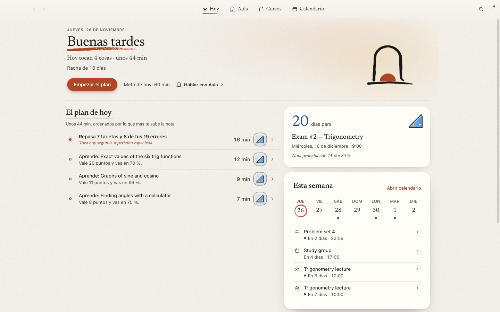

## Cursos

Todo descansa sobre papel cálido con cuatro lugares centrados arriba (**Hoy · Aula · Cursos · Calendario**); si prefieres la barra lateral clásica, puedes desplegarla cuando quieras desde *Más secciones* o con <kbd>⌘</kbd><kbd>⌃</kbd><kbd>S</kbd> / <kbd>Ctrl</kbd><kbd>\</kbd>.

Pulsa <kbd>Ctrl</kbd>/<kbd>⌘</kbd> <kbd>N</kbd> y di qué quieres estudiar. Añade la fecha del examen si la hay, y los
archivos que tengas: PDF, Word, PowerPoint, Excel, EPUB, páginas web, Markdown, archivos de texto o de código, enlaces,
texto pegado, fotos de tus apuntes o de la pizarra (se leen con OCR) y grabaciones de audio o vídeo de una clase. Aula
transcribe una grabación con los subtítulos que la acompañan o con el servicio de transcripción de una clave de API que
hayas añadido, y cada cita la abre en el minuto en que se dijo. Aula también puede traer los materiales de tu
plataforma de estudio.

Después, un pequeño equipo de agentes monta el curso, y puedes verlos trabajar. Unos lectores leen tus materiales. Un
planificador los convierte en un mapa de temas, dando más peso a lo que más pregunta el examen. Los autores escriben las
lecciones, los ejercicios y las tarjetas, y un verificador vuelve a resolver cada ejercicio con respuesta comprobable
sin mirar la solución. Cuando no coinciden, un árbitro decide y corrige la solución. Si tu IA llega a un límite de uso
a mitad, el curso se guarda y pulsas *Reanudar* más tarde.

Puedes seguir cambiando un curso cuando ya está hecho (*añade 10 ejercicios más difíciles de identidades*) y deshacer
un cambio si no te convence.

<table>
  <tr>
    <td width="50%">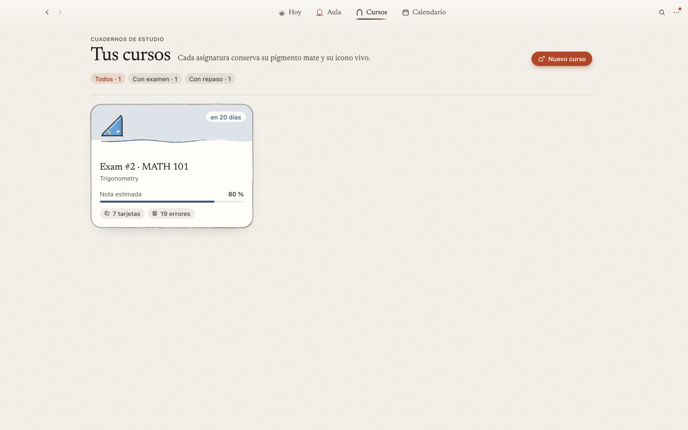</td>
    <td width="50%">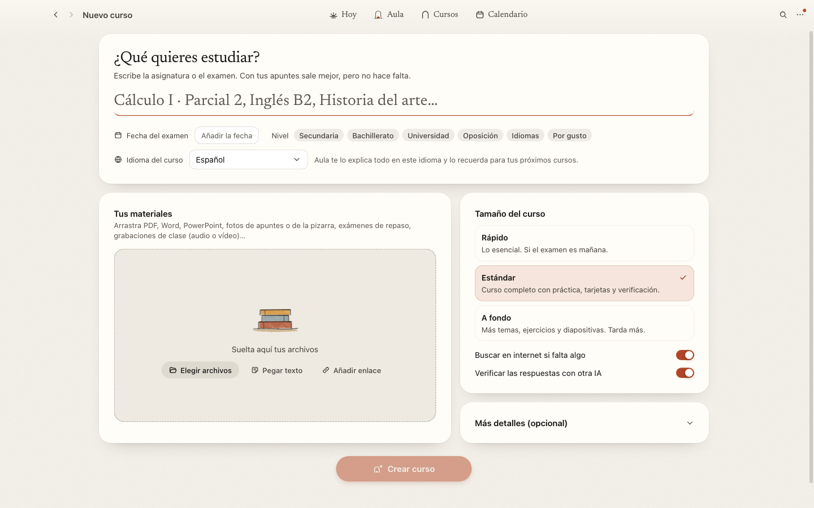</td>
  </tr>
</table>

  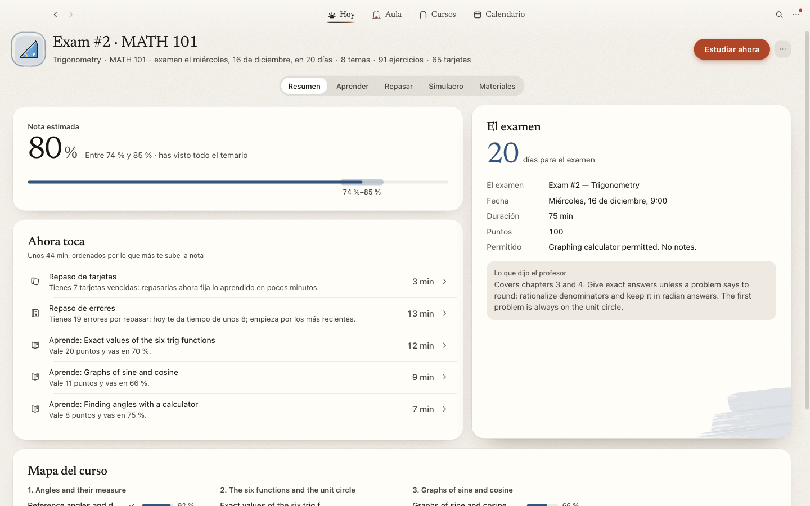

## Lecciones

Puedes hacer una lección paso a paso (Aula explica, enseña un ejemplo y comprueba que lo has entendido antes de
seguir), explorarla a tu aire o solo leerla. Las matemáticas se componen con KaTeX, también la notación química. Las
lecciones pueden llevar gráficas con controles deslizantes, diagramas con etiquetas para practicar, moléculas en 3D
con su geometría real, simulaciones, mapas, diagramas de flujo y diapositivas. Las imágenes vienen de Wikimedia Commons
con su autor y su licencia, y Aula puede leerte cualquier lección en voz alta con las voces de tu sistema.

  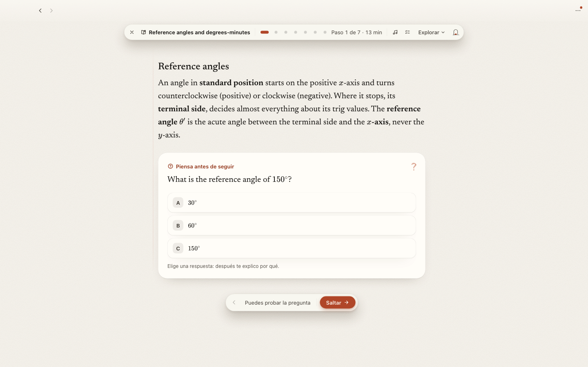

## Práctica

Aula corrige ella misma la mayoría de las respuestas, sin preguntar a la IA. Su motor matemático entiende fracciones,
radicales, π y expresiones equivalentes, y hay 16 tipos de respuesta, desde opción múltiple y ecuaciones hasta
etiquetar una figura o ajustar una reacción. Las respuestas abiertas se corrigen con una rúbrica. Cuando cometes un
error típico, Aula lo reconoce y te explica por qué está mal. En los cursos de idiomas cuentan las tildes, así que
*murio* no es *murió*. Lo que fallas va a un cuaderno de errores y vuelve a los 1, 3, 7, 16 y 35 días.

Las tarjetas usan repaso espaciado con FSRS. Los simulacros copian la estructura de tu examen real (secciones, puntos,
dificultad), van con cronómetro y terminan con un informe por tema y un botón para practicar lo que fallaste. La
pantalla *Hoy* junta todo lo pendiente de tus cursos en un solo plan, empezando por lo que más sube tu nota.

<table>
  <tr>
    <td width="50%">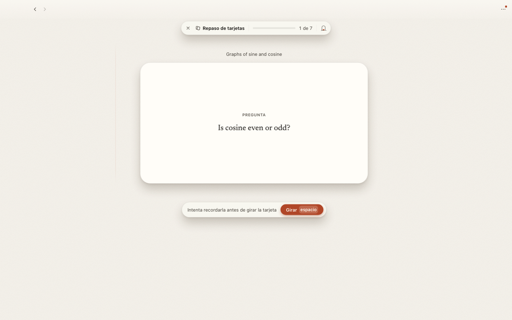</td>
    <td width="50%">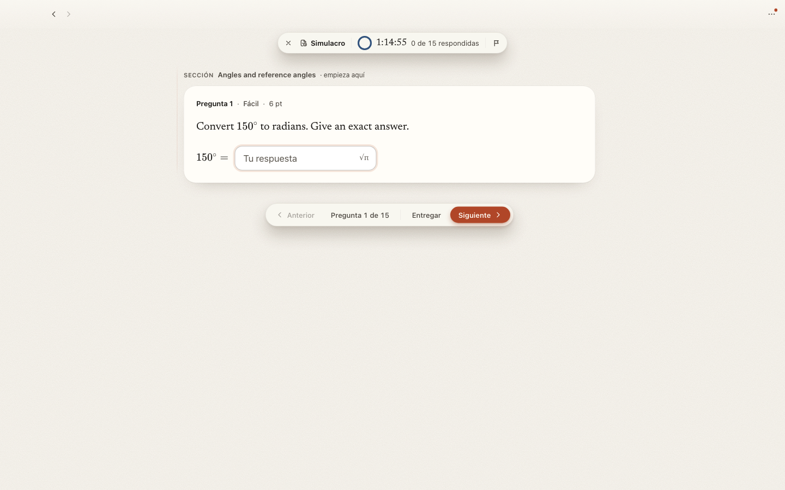</td>
  </tr>
</table>

## Hablar con Aula

<kbd>Ctrl</kbd>/<kbd>⌘</kbd> <kbd>2</kbd> abre un chat que conoce tus cursos, tu calendario y cómo vas. Dile *tengo un
examen de inglés el lunes a las 10* y se ofrece a añadirlo a tu calendario y a montarte un curso. Ves cada paso según
ocurre, y lo que vaya a cambiar algo espera a que lo apruebes. Puede ponerte cuestionarios y tarjetas en el propio chat,
dibujar gráficas y fórmulas y citar tus materiales (pulsas una cita y el documento se abre en esa página).

Cada ejercicio tiene además un tutor al lado. Ve el ejercicio y tu respuesta, y te da pistas sin soltarte la solución.

  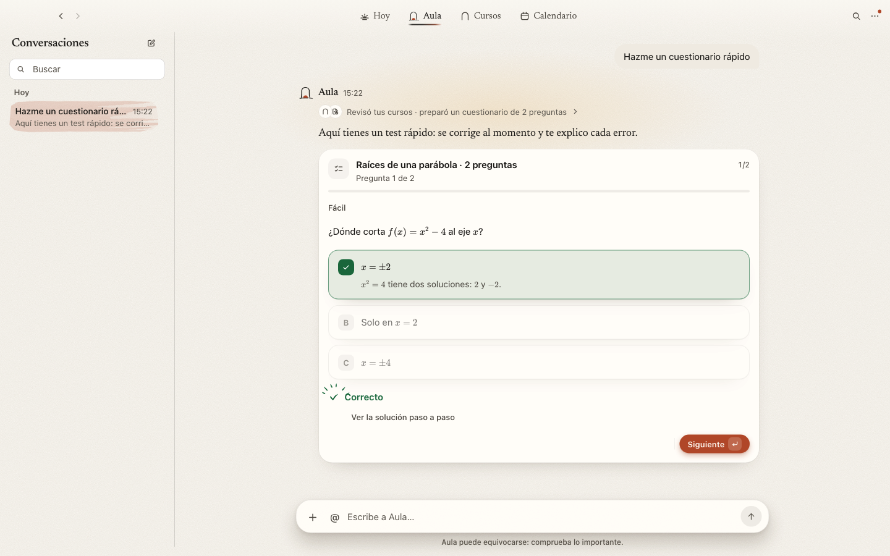

## Todo lo demás

- **Calendario** (<kbd>Ctrl</kbd>/<kbd>⌘</kbd> <kbd>3</kbd>): tus exámenes, las entregas de tu plataforma y tus propios
  eventos en vista de mes, semana o agenda. Escribe los eventos con tus palabras (*laboratorio de física todos los
  martes a las 4 hasta junio*), suscríbete a enlaces de calendario o importa y exporta archivos `.ics`. Cada examen
  tiene un botón *Preparar este examen*.
- **Herramientas** (<kbd>Ctrl</kbd>/<kbd>⌘</kbd> <kbd>5</kbd>): calculadora, graficadora, tabla periódica, ayudas de
  química, moléculas en 3D, conversor de unidades, temporizador Pomodoro, estadística, matrices, geometría,
  simulaciones de física y una lista de fórmulas y constantes.
- **Estadísticas**: tiempo de estudio, aciertos, un mapa de constancia de 12 semanas, dominio por tema, tu nota
  estimada a lo largo del tiempo y dieciséis logros.
- **Documentos**: convierte un curso en una guía de estudio, un resumen, una chuleta, tarjetas para imprimir, un examen
  de práctica o diapositivas, en PDF, Word o Markdown. Los PDF y las fotos se abren en un lector donde puedes resaltar,
  tomar notas y preguntar por una página.
- **Plataformas de estudio**: Canvas, Moodle, Blackboard, Google Classroom, Brightspace, Schoology, Microsoft Teams,
  Sakai, itslearning, Open edX o cualquier web de clase. Inicias sesión una vez en el navegador de Aula y se queda
  abierta. Aula solo lee: bloquea todo lo que entregaría un trabajo, empezaría un cuestionario, publicaría, borraría o
  pagaría, y nunca escribe tu contraseña.
- **Aula siempre activa** (opcional): con la ventana cerrada, Aula puede mandarte un resumen por la mañana, mirar tu
  plataforma, recordarte las entregas y escribir un resumen semanal. Todo llega a *Novedades*, y se para hasta el día
  siguiente cuando gasta su presupuesto diario.
- **Tu iPad y tu iPhone** (opcional, con Aula en un Mac): abre Aula desde tus dispositivos mientras tus cursos, tu IA y
  tus datos se quedan en el Mac. En el iPad, la app entera; en el iPhone, Aula como tu asistente (lo que hizo, lo que
  hay pendiente, el chat y el calendario). Los dispositivos llegan al Mac por tu red privada de Tailscale y se vinculan
  una vez con un código. Desde ahí también puedes abrir el navegador de Aula en vivo: iniciar sesión en tu plataforma
  estando fuera de casa, o hacer tú una tarea y pasársela a Aula para que la revise antes de enviarla. Un dispositivo
  vinculado también abre Ajustes con la parte de uso diario (qué IA usar entre las que están listas en el Mac,
  apariencia, idioma, *Aula siempre activa*, memoria); las claves, las plataformas y tus datos se gestionan en el Mac.
  Más en [docs/DEVICES.md](DEVICES.md). La app de Android funciona igual ([native/android](../native/android/README.md)).
- **Aula como servidor** (opcional): Aula sin ventana en un equipo siempre encendido (un servidor en casa, un NAS, un
  contenedor Linux: `ghcr.io/luumlabs/aula-server`), y la usas solo desde tus dispositivos. El primero que vinculas es
  su propietario y lleva desde ahí la IA, las plataformas y los dispositivos. Más en [docs/SERVER.md](SERVER.md).
- **Memoria**: Aula recuerda lo que le ayuda a enseñarte, por ejemplo cómo prefieres que te expliquen o qué te cuesta.
  Puedes verlo, corregirlo, pausarlo o exportarlo todo en *Ajustes → Lo que Aula recuerda*.
- **Buscar**: <kbd>Ctrl</kbd>/<kbd>⌘</kbd> <kbd>K</kbd> encuentra pantallas, cursos y herramientas, y cualquier cosa
  dentro de tus cursos.

La interfaz está en español e inglés, y los cursos se pueden escribir en 12 idiomas. Tiene modo claro y oscuro, y las
animaciones respetan el ajuste de *reducir movimiento* de tu sistema.

<table>
  <tr>
    <td width="50%">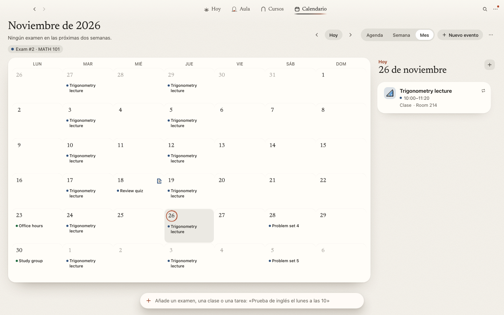</td>
    <td width="50%">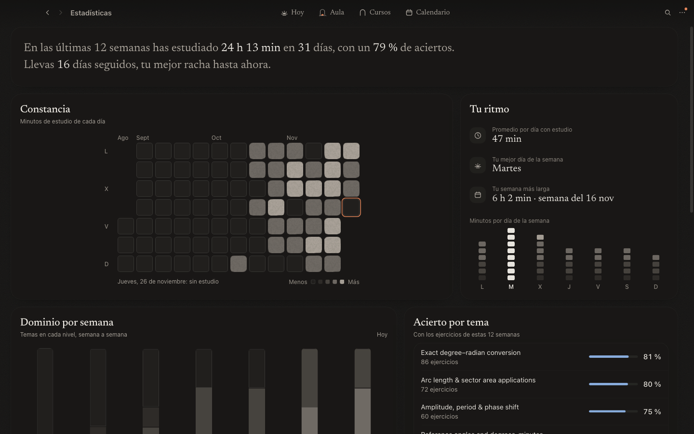</td>
  </tr>
  <tr>
    <td width="50%">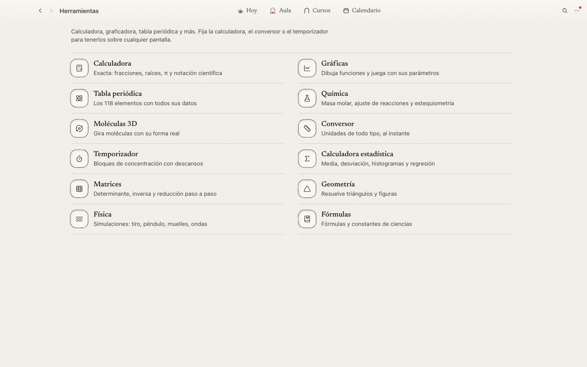</td>
    <td width="50%">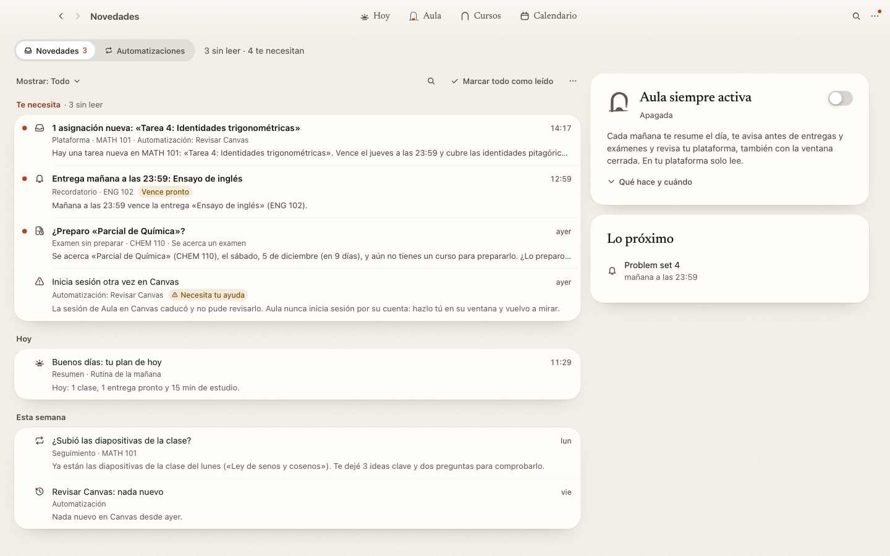</td>
  </tr>
</table>

<b>Atajos de teclado</b>

<kbd>Ctrl</kbd> en Windows y Linux, <kbd>⌘</kbd> en macOS.

| Atajo | Qué hace |
| --- | --- |
| <kbd>⌘</kbd> <kbd>K</kbd> | Buscar |
| <kbd>⌘</kbd> <kbd>N</kbd> · <kbd>⌘</kbd> <kbd>O</kbd> | Curso nuevo · Importar un curso (`.aulapack`) |
| <kbd>⌘</kbd> <kbd>1</kbd> … <kbd>7</kbd> | Hoy · Aula · Calendario · Estadísticas · Herramientas · Documentos · Novedades |
| <kbd>⌘</kbd> <kbd>J</kbd> | Preguntar a Aula |
| <kbd>⌘</kbd> <kbd>,</kbd> | Ajustes |
| <kbd>⌘</kbd> <kbd>[</kbd> / <kbd>]</kbd> (macOS) · <kbd>Alt</kbd> <kbd>←</kbd> / <kbd>→</kbd> (Windows, Linux) | Atrás · Adelante |
| <kbd>⌘</kbd> <kbd>⌃</kbd> <kbd>S</kbd> (macOS) · <kbd>Ctrl</kbd> <kbd>\\</kbd> (Windows, Linux) | Mostrar u ocultar la barra lateral |
| Ejercicios | <kbd>Intro</kbd> comprobar · <kbd>A</kbd>–<kbd>Z</kbd> o <kbd>1</kbd>–<kbd>9</kbd> elegir una opción · <kbd>⇧</kbd> <kbd>Intro</kbd> nueva línea en una respuesta corta · <kbd>⌘</kbd> <kbd>Intro</kbd> entregar una respuesta abierta |
| Tarjetas | <kbd>Espacio</kbd> girar · <kbd>1</kbd>–<kbd>4</kbd> valorar · <kbd>H</kbd> pista · <kbd>⌘</kbd> <kbd>Z</kbd> deshacer |
| Simulacro | <kbd>Alt</kbd> <kbd>←</kbd> / <kbd>→</kbd> anterior / siguiente · <kbd>⌘</kbd> <kbd>⇧</kbd> <kbd>L</kbd> marcar |
| Lector de documentos | <kbd>⌘</kbd> <kbd>F</kbd> buscar · <kbd>⌘</kbd> <kbd>⇧</kbd> <kbd>H</kbd> resaltar la selección · <kbd>⌘</kbd> <kbd>+</kbd> / <kbd>−</kbd> zoom · <kbd>⌘</kbd> <kbd>0</kbd> ajustar al ancho · <kbd>←</kbd> / <kbd>→</kbd> o <kbd>RePág</kbd> / <kbd>AvPág</kbd> cambiar de página · <kbd>Esc</kbd> quitar la selección |
| Chat | <kbd>Intro</kbd> enviar · <kbd>⇧</kbd> <kbd>Intro</kbd> nueva línea |

## Tu IA en detalle

Aula necesita un modelo de IA para escribir tus cursos y para hablar contigo. Elige sola el mejor que encuentra, y
puedes cambiarlo cuando quieras en *Ajustes → Tu IA*. Sin IA puedes seguir estudiando los cursos de ejemplo y los que
ya tengas.

| Opción | Qué necesitas | Notas |
| --- | --- | --- |
| Suscripción a Claude (Pro o Max) | La herramienta oficial `claude`, con la sesión iniciada | Sin clave de API y sin coste extra. |
| Suscripción a ChatGPT (Plus o Pro) | *Conectar con ChatGPT* en Aula | Usa Codex, la herramienta oficial de OpenAI. Aula puede descargarlo por ti y comprueba su SHA-256. |
| Un modelo en tu ordenador | Nada. Aula mira cuánta RAM tiene tu ordenador y te sugiere un modelo que quepa | Un clic descarga el servidor oficial de `llama.cpp` y un modelo verificado (desde 1 GB hasta decenas de GB, según tu ordenador). Después es gratis y funciona sin conexión. También detecta Ollama y LM Studio. |
| Una clave de API | Una clave de Anthropic, OpenAI, Google Gemini, OpenRouter, DeepSeek, Mistral, Groq, xAI, Xiaomi MiMo, OpenCode Zen o cualquier servicio compatible con OpenAI | Pagas directamente al proveedor. Aula te enseña lo que llevas gastado y puede pararse en un límite diario. Las claves se cifran con el llavero del sistema. |

OpenCode también funciona, si está instalado y con la sesión iniciada.

  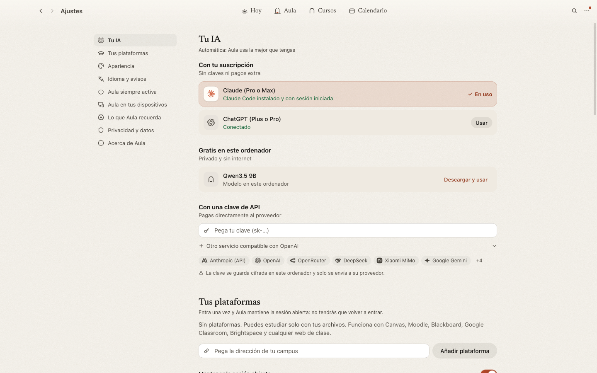

## Un corto sobre Aula

*Nueve días.* Un corto de animación sobre Aula, pintado con código: de noche, un estudiante con bufanda roja camina
entre hojas que vuelan hacia un gran arco encendido. [Míralo](https://github.com/luumlabs/aula/releases/download/v0.1.0/Aula-film-web.mp4)
(1:50, vídeo de 26 MB, rótulos en inglés).

<!-- Para quien mantiene Aula: para un reproductor en la página, suelta aquí un corte del corto de 10 MB como mucho con
     el editor web de GitHub (antes comprueba que el correo de tus commits es la dirección noreply: GitHub → Settings →
     Emails). Deja la URL del adjunto sola en su línea: GitHub la convierte en un reproductor que también funciona para
     quien no ha iniciado sesión. -->
