# What Aula does

<b>English</b> · <a href="FEATURES.es.md">Español</a>

The full tour. For the short version and the download, see the [README](../README.md).

You get short lessons, exercises that are checked as you answer them, flashcards and a mock exam shaped like the real
one. Then Aula helps you work through all of it, a bit each day, until the exam.

It isn't tied to one subject. Calculus, organic chemistry, anatomy, a language, a driving test, a book you want to
understand properly. If you have class materials, Aula uses them, so the course follows your syllabus. If you don't, a
line like *Statistics for psychology, final in May* is enough to get started.

Your courses and progress are stored on your computer. Aula works with the AI you already pay for (a Claude or ChatGPT
subscription, or an API key) or with a free model that runs on your own machine. There's no account and no tracking.

  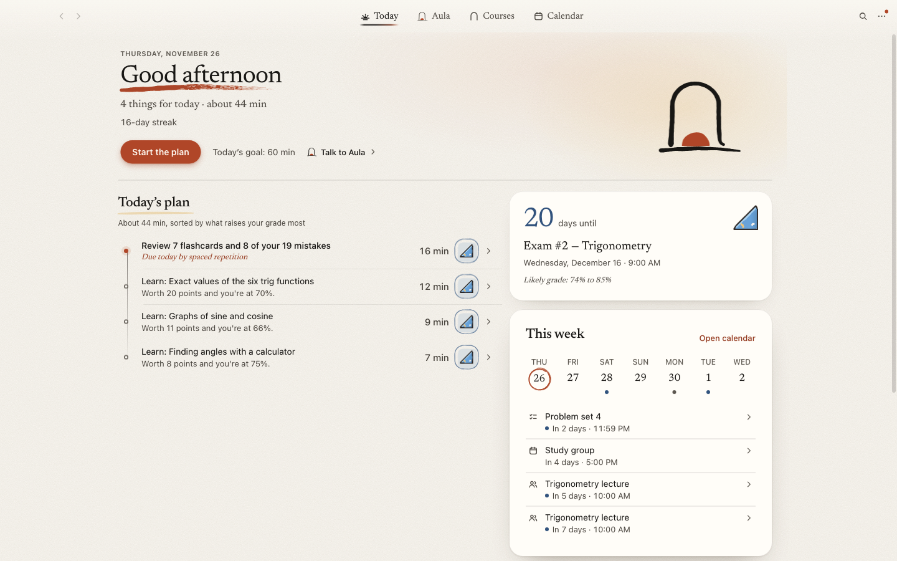

## Courses

Press <kbd>Ctrl</kbd>/<kbd>⌘</kbd> <kbd>N</kbd> and say what you want to study. Add the exam date if there is one, and
any files you have: PDF, Word, PowerPoint, Excel, EPUB, web pages, Markdown, text or code files, links, pasted text, or
photos of your notes or the whiteboard (read with OCR), and audio or video recordings of a class. Aula transcribes a
recording from the subtitles next to the file or with the transcription service of an API key you have added, and a
citation opens it at the minute where it was said. Aula can also pull your materials from your study platform.

A small team of agents then builds the course, and you can watch them work. Readers go through your materials. A
planner turns them into a map of topics, weighted by what the exam asks. Authors write the lessons, exercises and
flashcards, and a verifier solves every exercise that has a checkable answer again, without looking at the answer key.
When the two disagree, a referee decides and fixes the key. If your AI hits a usage limit halfway, the course is saved
and you press *Resume* later.

You can keep changing a course after it's built (*add 10 harder exercises on identities*), and undo a change if you
don't like it.

<table>
  <tr>
    <td width="50%">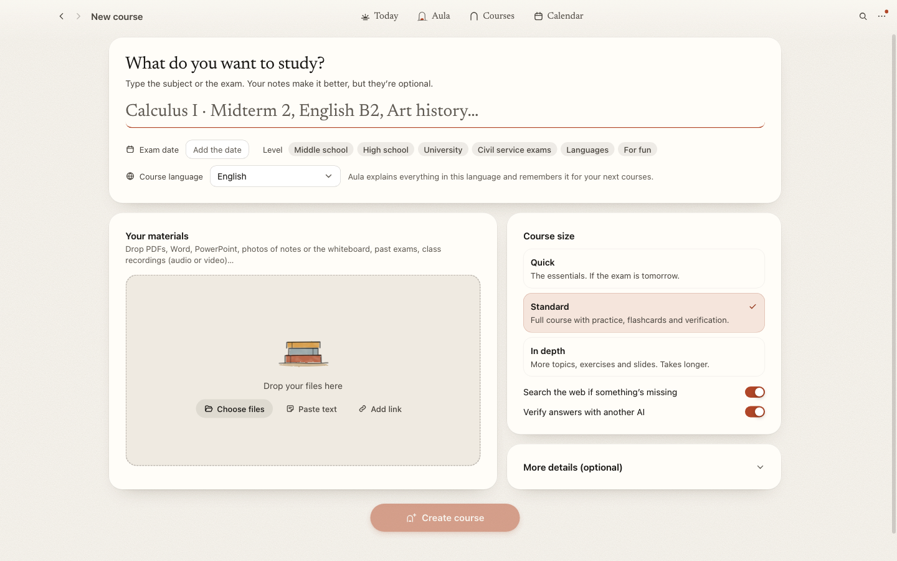</td>
    <td width="50%">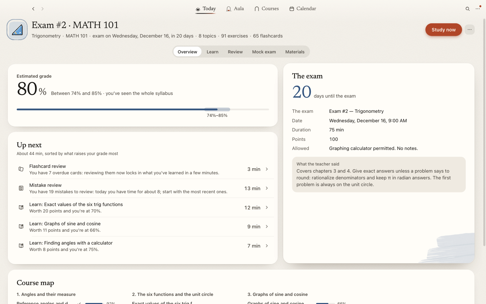</td>
  </tr>
</table>

## Lessons

You can go through a lesson step by step (Aula explains, shows an example and checks you got it before moving on),
explore it freely, or just read it. Math is typeset with KaTeX, chemistry notation included. Lessons can have graphs
with sliders, labeled diagrams you can practice on, 3D molecules with their real geometry, simulations, maps,
flowcharts and slides. Images come from Wikimedia Commons with their author and license, and Aula can read any lesson
aloud with your system's voices.

  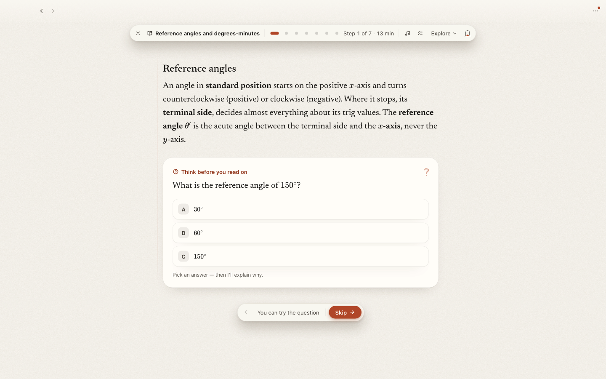

## Practice

Aula grades most answers itself, without asking the AI. Its math engine understands fractions, radicals, π and
equivalent expressions, and there are 16 kinds of answers, from multiple choice and equations to labeling a figure or
balancing a reaction. Open answers are graded against a rubric. When you make a common mistake, Aula recognizes it and
tells you why it's wrong. In language courses accents count, so *murio* is not *murió*. Whatever you miss goes into a
mistakes notebook and comes back after 1, 3, 7, 16 and 35 days.

Flashcards use FSRS spaced repetition. Mock exams copy the structure of your real one (sections, points, difficulty),
run on a timer and end with a report by topic and a button to practice what you missed. The *Today* screen puts
everything that's due across your courses into one plan, starting with what will raise your grade the most.

<table>
  <tr>
    <td width="50%">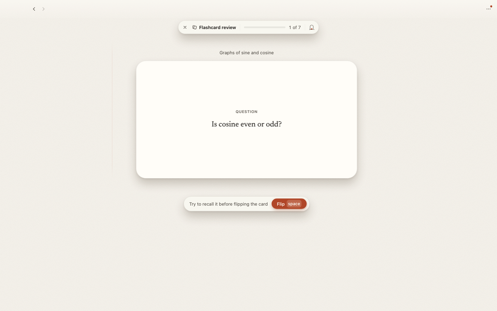</td>
    <td width="50%">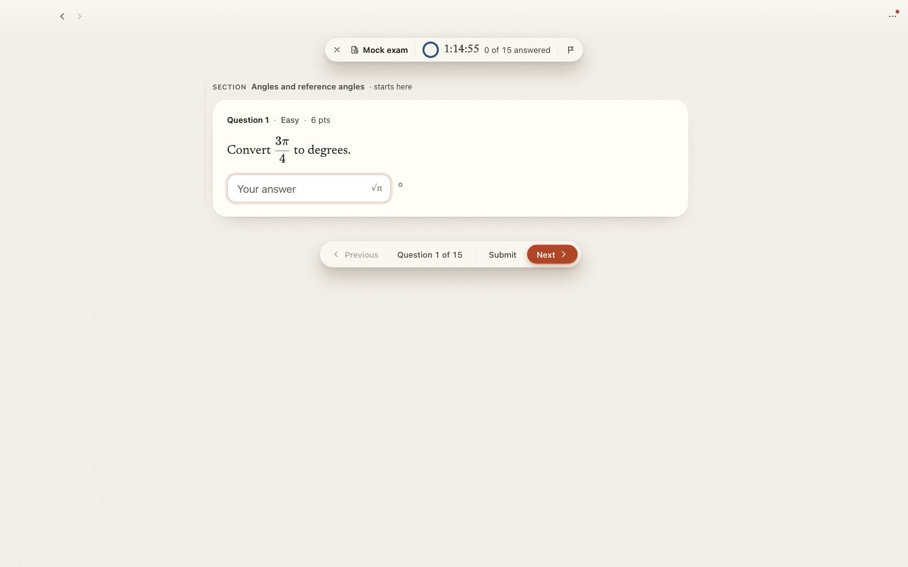</td>
  </tr>
</table>

## Talking to Aula

<kbd>Ctrl</kbd>/<kbd>⌘</kbd> <kbd>2</kbd> opens a chat that knows your courses, your calendar and how you're doing.
Tell it *I have an English test on Monday at 10* and it offers to add the test to your calendar and build a course for
it. You see each step as it happens, and anything that would change something waits for you to approve it. It can put
quizzes and flashcards right in the chat, draw graphs and formulas, and cite your own materials (click a citation and
the document opens on that page).

Every exercise also has a tutor next to it. It sees the exercise and your answer, and gives hints without giving the
answer away.

  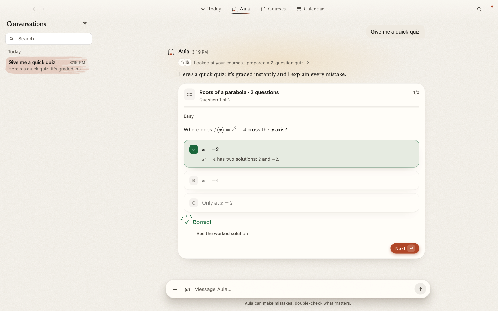

## Everything else

- **Calendar** (<kbd>Ctrl</kbd>/<kbd>⌘</kbd> <kbd>3</kbd>): your exams, platform deadlines and your own events in month,
  week or agenda view. Type events in plain words (*Physics lab every Tuesday at 4pm until June*), subscribe to
  calendar links, or import and export `.ics` files. Every exam has a *Prepare for this exam* button.
- **Tools** (<kbd>Ctrl</kbd>/<kbd>⌘</kbd> <kbd>5</kbd>): a calculator, a grapher, the periodic table, chemistry helpers,
  3D molecules, a unit converter, a Pomodoro timer, statistics, matrices, geometry, physics simulations and a list of
  formulas and constants.
- **Statistics**: study time, accuracy, a 12-week consistency heatmap, mastery by topic, your estimated grade over time
  and sixteen achievements.
- **Documents**: turn a course into a study guide, a summary, a cheat sheet, printable flashcards, a practice exam or
  slides, as PDF, Word or Markdown. PDFs and photos open in a reader where you can highlight, take notes and ask about a
  page.
- **Study platforms**: Canvas, Moodle, Blackboard, Google Classroom, Brightspace, Schoology, Microsoft Teams, Sakai,
  itslearning, Open edX or any class website. You sign in once in Aula's own browser and it stays signed in. Aula only
  reads: it blocks anything that would submit work, start a quiz, post, delete or pay, and it never types your
  password.
- **Aula always on** (optional): with the window closed, Aula can send you a morning summary, check your platform, remind
  you of deadlines and write a weekly summary. It all lands in the Inbox, and it stops for the day when it reaches its
  daily budget.
- **Your iPad and iPhone** (optional, with Aula on a Mac): open Aula from your own devices while your courses, your AI
  and your data stay on the Mac. The iPad gets the whole app; the iPhone, Aula as your assistant (what it did, what is
  pending, the chat and the calendar). Devices reach the Mac over your private Tailscale network and are linked once
  with a code. From there you can also open Aula's browser live: sign in to your platform away from home, or do an
  assignment yourself and hand it to Aula to review before you submit it. A linked device can also open Settings for
  the daily-use part (which AI to use among those ready on the Mac, appearance, language, *Aula always on*, memory);
  keys, platforms and your data are managed on the Mac. See [docs/DEVICES.md](DEVICES.md). The Android app works
  the same way ([native/android](../native/android/README.md)).
- **Aula as a server** (optional): run Aula without a window on a computer that is always on (a home server, a NAS, a
  Linux container: `ghcr.io/luumlabs/aula-server`) and use it only from your devices. The first device you link is its
  owner and manages the AI, platforms and devices from there. See [docs/SERVER.md](SERVER.md).
- **Memory**: Aula remembers what helps it teach you, like how you prefer explanations or what you find hard. You can
  see, edit, pause or export all of it in *Settings → What Aula remembers*.
- **Search**: <kbd>Ctrl</kbd>/<kbd>⌘</kbd> <kbd>K</kbd> finds screens, courses and tools, and anything inside your
  courses.

The interface is in English and Spanish, and courses can be written in 12 languages. There's a light and a dark mode,
and animations follow your system's *reduce motion* setting.

<table>
  <tr>
    <td width="50%">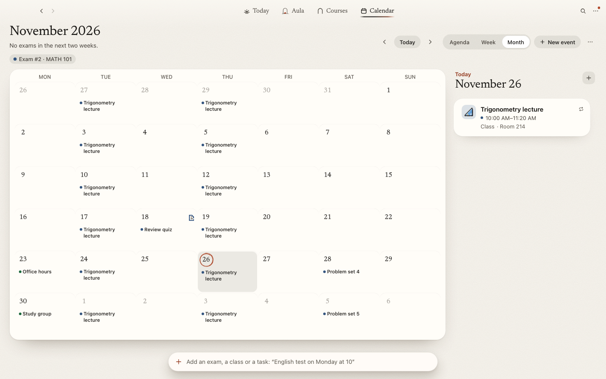</td>
    <td width="50%">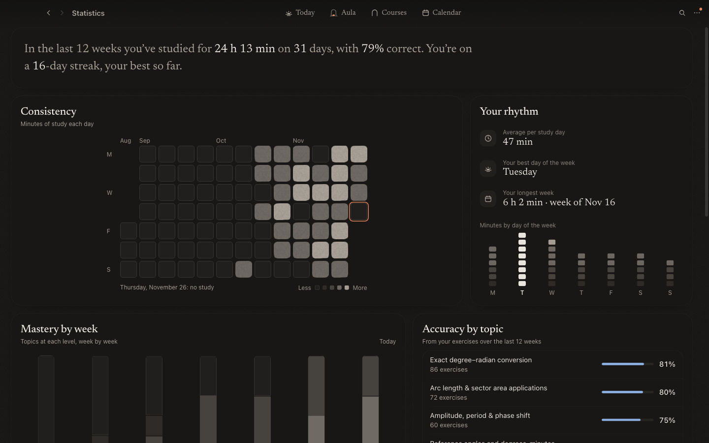</td>
  </tr>
  <tr>
    <td width="50%">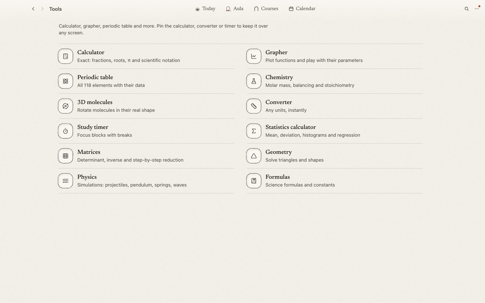</td>
    <td width="50%">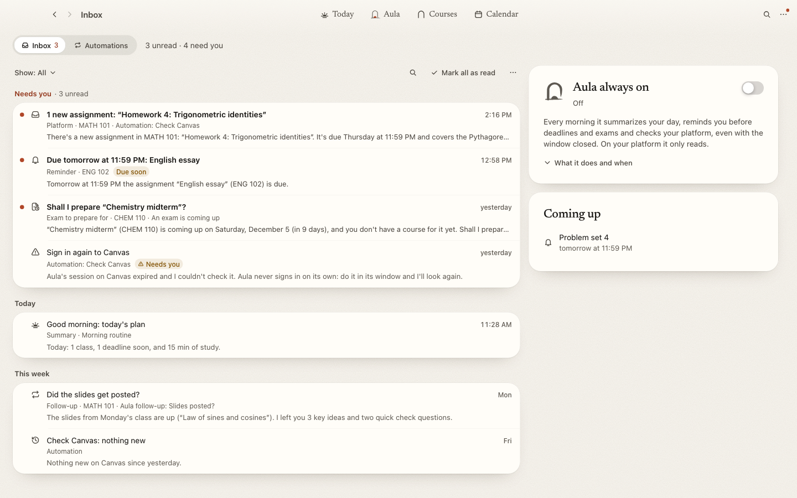</td>
  </tr>
</table>

<b>Keyboard shortcuts</b>

<kbd>Ctrl</kbd> on Windows and Linux, <kbd>⌘</kbd> on macOS.

| Shortcut | What it does |
| --- | --- |
| <kbd>⌘</kbd> <kbd>K</kbd> | Search |
| <kbd>⌘</kbd> <kbd>N</kbd> · <kbd>⌘</kbd> <kbd>O</kbd> | New course · Import a course (`.aulapack`) |
| <kbd>⌘</kbd> <kbd>1</kbd> … <kbd>7</kbd> | Today · Aula · Calendar · Statistics · Tools · Documents · Inbox |
| <kbd>⌘</kbd> <kbd>J</kbd> | Ask Aula |
| <kbd>⌘</kbd> <kbd>,</kbd> | Settings |
| <kbd>⌘</kbd> <kbd>[</kbd> / <kbd>]</kbd> (macOS) · <kbd>Alt</kbd> <kbd>←</kbd> / <kbd>→</kbd> (Windows, Linux) | Back · Forward |
| <kbd>⌘</kbd> <kbd>⌃</kbd> <kbd>S</kbd> (macOS) · <kbd>Ctrl</kbd> <kbd>\\</kbd> (Windows, Linux) | Show or hide the sidebar |
| Exercises | <kbd>Enter</kbd> check · <kbd>A</kbd>–<kbd>Z</kbd> or <kbd>1</kbd>–<kbd>9</kbd> pick an option · <kbd>⇧</kbd> <kbd>Enter</kbd> new line in a short answer · <kbd>⌘</kbd> <kbd>Enter</kbd> submit an open answer |
| Flashcards | <kbd>Space</kbd> flip · <kbd>1</kbd>–<kbd>4</kbd> rate · <kbd>H</kbd> hint · <kbd>⌘</kbd> <kbd>Z</kbd> undo |
| Mock exam | <kbd>Alt</kbd> <kbd>←</kbd> / <kbd>→</kbd> previous / next · <kbd>⌘</kbd> <kbd>⇧</kbd> <kbd>L</kbd> flag |
| Document reader | <kbd>⌘</kbd> <kbd>F</kbd> find · <kbd>⌘</kbd> <kbd>⇧</kbd> <kbd>H</kbd> highlight the selection · <kbd>⌘</kbd> <kbd>+</kbd> / <kbd>−</kbd> zoom · <kbd>⌘</kbd> <kbd>0</kbd> fit to width · <kbd>←</kbd> / <kbd>→</kbd> or <kbd>Page Up</kbd> / <kbd>Page Down</kbd> change page · <kbd>Esc</kbd> clear the selection |
| Chat | <kbd>Enter</kbd> send · <kbd>⇧</kbd> <kbd>Enter</kbd> new line |

## Your AI in detail

Aula needs an AI model to write your courses and to talk to you. It picks the best one it can find on its own, and you
can change it any time in *Settings → Your AI*. Without one you can still study the example courses and any course you
already have.

| Option | What you need | Notes |
| --- | --- | --- |
| Claude subscription (Pro or Max) | The official `claude` CLI, signed in | No API key and no extra cost. |
| ChatGPT subscription (Plus or Pro) | *Connect with ChatGPT* in Aula | Uses the official Codex CLI. Aula can download it for you and checks its SHA-256. |
| A model on your computer | Nothing. Aula checks how much RAM your computer has and suggests a model that fits | One click downloads the official `llama.cpp` server and a verified model (from about 1 GB to tens of GB, depending on your computer). After that it's free and works offline. Ollama and LM Studio are detected too. |
| An API key | A key from Anthropic, OpenAI, Google Gemini, OpenRouter, DeepSeek, Mistral, Groq, xAI, Xiaomi MiMo, OpenCode Zen or any OpenAI-compatible service | You pay the provider directly. Aula shows what you've spent and can stop at a daily limit. Keys are encrypted with your system's keychain. |

OpenCode works too, if it's installed and signed in.

  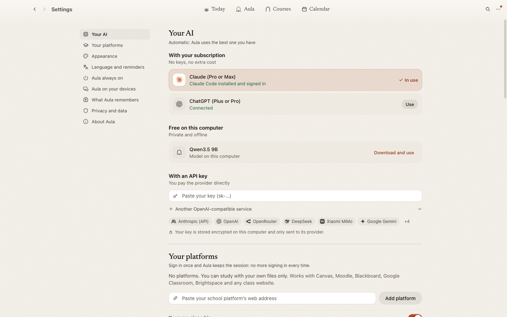

## A short film about Aula

*Nine days.* A short animated film about Aula, painted by code: at night, a student with a red scarf walks through
flying pages towards a great lit arch. [Watch it](https://github.com/luumlabs/aula/releases/download/v0.1.0/Aula-film-web.mp4)
(1:50, 26 MB video).

<!-- Maintainers: for an inline player, drop a ≤10 MB cut of the film here in GitHub's web editor (first check that your
     commit email is the noreply address: GitHub → Settings → Emails). Keep the bare attachment URL on a line of its
     own: GitHub turns it into a player that also plays for visitors who aren't signed in. -->
